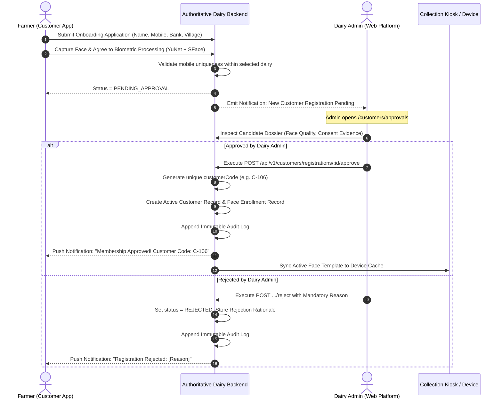

# DFarm Dairy Admin Web — Customer Approval Workflow

## 1. Onboarding Journey & Tenant Selection

When an independent dairy farmer installs the DFarm Customer App and completes their self-registration, they select their registered local dairy cooperative (e.g. `DF-GOKUL-01`).

---

## 2. Mandatory Verification Rules

1. **No Automatic Approval**: Registrations are never activated by background timers or default triggers. The Dairy Admin must explicitly review identity and biometric evidence.
2. **Mobile Uniqueness**: A mobile number can belong to only one active customer within the dairy tenant.
3. **Biometric Quality Threshold**: The system verifies that the OpenCV YuNet landmarks and SFace INT8 template extraction achieved acceptable confidence (> 85%).
4. **Mandatory Rejection Rationale**: Rejections require an explicit, meaningful reason (minimum 5 characters).
5. **Audited Assignment**: Customer code generation (`C-XXX`) is sequential, atomic, and logged in audit history.
