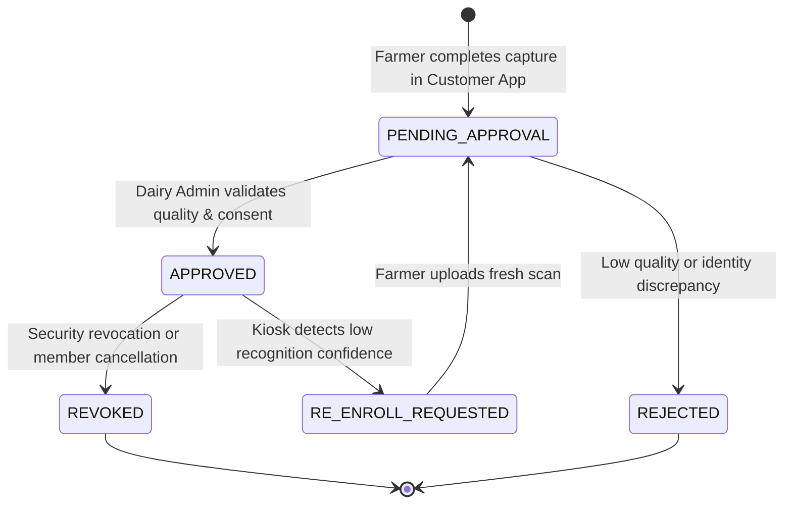

# DFarm Dairy Admin Web — Face Enrollment Administration

## 1. Computer Vision Biometric Pipeline

The DFarm platform relies on a standardized, high-performance edge facial recognition pipeline across all touchpoints:

- **Face Detection & Landmarks:** `OpenCV YuNet ONNX` (Ultra-lightweight 5-point facial landmark detector).
- **Feature Extraction & Embedding:** `OpenCV SFace INT8 ONNX` (Quantized 128-dimensional hyperspherical vector representation).

The Dairy Admin Web platform is responsible for the **administrative governance and lifecycle management** of these biometric templates.

---

## 2. Administrative Lifecycle State Machine

---

## 3. Privacy & Governance Safeguards

1. **Zero-Knowledge UI**:
   - The Dairy Admin Web application **never downloads or displays raw face images or raw embedding vectors**.
   - The UI displays cryptographic proof: template version (`v1.2`), model pipeline (`YuNet-v1.0 + SFace-INT8-v1.0`), quality score (`96.4%`), consent timestamp, and hardware capture device.
2. **Template Versioning**:
   - Updates to a farmer's face template do not overwrite previous historical versions. A new template version number is issued, preserving the audit trail.
3. **Kiosk Cache Synchronization**:
   - When a template is revoked or re-enrollment is requested, an invalidation signal is broadcast to all collection kiosks (`DF-KIOSK-001`, `DF-KIOSK-002`) to immediately purge the offline cache.
