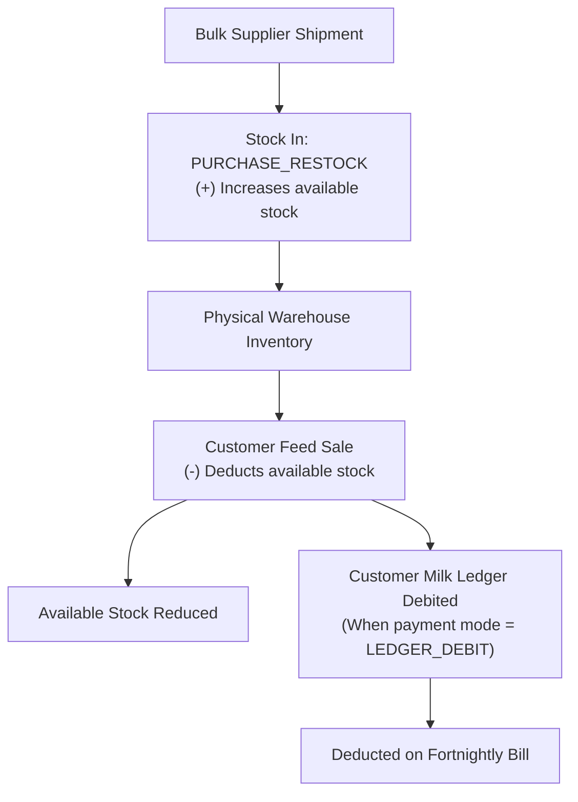

# DFarm Dairy Admin Web — Feed Inventory & Sales Documentation

## 1. Product Catalog & Categories

The feed management module tracks cattle feed, nutritional supplements, and fodder products distributed to dairy farmers:

1. **Cattle Feed Concentrates:** High-yield pellet bags (50kg, 25kg).
2. **Mineral Mixtures:** Chelated micro-mineral packets (1kg) to boost butterfat and animal health.
3. **Calcium Tonics:** Liquid calcium supplements (5L cans) to maintain peak lactation yield.
4. **Silage & Fodder Seeds:** Bulk seasonal fodder packs.

---

## 2. Inventory Movements & Ledger Synchronization

Every stock transaction generates an auditable `FeedStockMovement` record:

### Low Stock Alerts
Each product has a configurable `minStockAlertLevel`. When stock drops below the threshold (e.g. Mineral Mixture < 20 packets), an alert is raised on the operational dashboard and notification drawer.
