# DFarm Dairy Admin Web — Screen & Navigation Map

## Navigation Hierarchy

```mermaid
flowchart TD
    Login["/login (Mobile OTP Authentication)"] --> AuthCheck{"Authenticated & Tenant Scoped?"}
    AuthCheck -- No --> Login
    AuthCheck -- Yes --> Dashboard["/dashboard (Dairy Dashboard)"]

    subgraph "Farmers & Biometrics"
        Approvals["/customers/approvals (Pending Registrations)"]
        Directory["/customers/directory (Customer Directory)"]
        Detail["/customers/detail/:id (10-Section Customer Dossier)"]
        FaceBiometrics["/biometrics/face-enrollment (YuNet/SFace Administration)"]
        Rfid["/rfid/cards (RFID Card Registry)"]
    end

    subgraph "Collection & Quality"
        Sessions["/collection/sessions (Shift Sessions Reconciliation)"]
        Register["/collection/register (Milk Collection Register & Adjustments)"]
        Quality["/quality/analytics (Fat/SNF Lactometer Telemetry)"]
        RateCharts["/rate-charts (Milk Rate Chart Versioning)"]
    end

    subgraph "Accounts & Financials"
        Ledger["/ledger (Server-Authoritative Customer Ledgers)"]
        Billing["/billing (Fortnightly Billing & Settlements)"]
        Payments["/payments (Disbursement Payments & Bank Receipts)"]
    end

    subgraph "Inventory & Hardware"
        Feed["/feed/inventory (Cattle Feed & Customer Sales)"]
        Devices["/devices (Collection Kiosks & Offline Sync Queue)"]
    end

    subgraph "Governance & Analytics"
        Reports["/reports (17 Business Reports Hub)"]
        Staff["/staff (Operator Permissions & Least Privilege)"]
        Audit["/audit (Immutable Audit Log Trail)"]
        Profile["/profile (Dairy Business Profile & Shift Schedule)"]
    end

    Dashboard --> Approvals
    Dashboard --> Directory
    Directory --> Detail
    Dashboard --> FaceBiometrics
    Dashboard --> Rfid
    Dashboard --> Sessions
    Dashboard --> Register
    Dashboard --> Quality
    Dashboard --> RateCharts
    Dashboard --> Ledger
    Dashboard --> Billing
    Dashboard --> Payments
    Dashboard --> Feed
    Dashboard --> Devices
    Dashboard --> Reports
    Dashboard --> Staff
    Dashboard --> Audit
    Dashboard --> Profile
```

## Route Index Table

| Route Path | Screen Title | Permissions Required | Description |
|---|---|---|---|
| `/login` | Mobile OTP Authentication | Public | Enforces genuine 6-digit OTP verification and dairy tenant binding. |
| `/dashboard` | Dairy Dashboard | `VIEW_DASHBOARD` | Real-time intake metrics, volume charts, pending approvals counter, and operational shortcuts. |
| `/customers/approvals` | Pending Registrations | `APPROVE_REGISTRATIONS` | Review applicant identity, YuNet facial biometric consent/quality, and execute approve/reject actions. |
| `/customers/directory` | Customer Directory | `MANAGE_CUSTOMERS` | Complete patron directory with live search, milk preference filters, soft-delete, and restore. |
| `/customers/detail/:id` | Customer Dossier | `MANAGE_CUSTOMERS` | Deep 10-tab dossier: profile, bank details, face status, RFID, collections, ledger, bills, and feed purchases. |
| `/biometrics/face-enrollment` | Face Biometrics Lifecycle | `MANAGE_FACE_ENROLLMENT` | Administrative review of YuNet/SFace ONNX templates, re-enrollment requests, and security revocations. |
| `/rfid/cards` | RFID Card Registry | `MANAGE_RFID` | Tag assignment, duplication prevention, and marking misplaced tags as LOST. |
| `/collection/sessions` | Collection Sessions | `MANAGE_COLLECTIONS` | Monitor active shift sessions, reconcile opening/closing operators, and track offline sync state. |
| `/collection/register` | Milk Collection Register | `MANAGE_COLLECTIONS` | Comprehensive milk intake transactions with audited non-destructive weight/rate adjustment mechanism. |
| `/quality/analytics` | Milk Quality Analytics | `VIEW_REPORTS` | Lactometer and ultrasonic analyzer telemetry for continuous Fat, SNF, and density tracking. |
| `/rate-charts` | Rate Chart Versioning | `MANAGE_RATE_CHARTS` | Two-axis Cow/Buffalo rate chart versioning, step increment matrix, and historical version preservation. |
| `/ledger` | Customer Ledger | `VIEW_LEDGER` | Server-authoritative double-entry ledger with milk credits, feed debits, and authorized manual adjustments. |
| `/billing` | Billing & Settlement | `GENERATE_BILLS` | Fortnightly settlement cycle management, non-duplicate generation enforcement, and printed statements. |
| `/payments` | Payments & Receipts | `RECONCILE_PAYMENTS` | Official disbursement records, bank UTR tracking, and payment voucher generation. |
| `/feed/inventory` | Feed Inventory & Sales | `MANAGE_FEED_INVENTORY` | Product stock levels, restock purchase logs, and customer feed sales with automatic ledger debit. |
| `/devices` | Hardware & Sync Telemetry | `MANAGE_DEVICES` | Smart analyzer kiosks, firmware versions, biometric template cache distribution, and offline queues. |
| `/reports` | Reports Hub | `VIEW_REPORTS` | Dedicated analytics hub for all 17 specified business reports with CSV and print export. |
| `/staff` | Staff & Operator Access | `MANAGE_STAFF` | Configurable permission matrix adhering to the principle of least privilege. |
| `/audit` | Audit Trail | `VIEW_AUDIT_LOGS` | Immutable governance log recording operator actions, target entities, timestamps, and authorized reasons. |
| `/profile` | Dairy Profile | `VIEW_DASHBOARD` | Official registration credentials, operating morning/evening shift windows, and contact points. |
