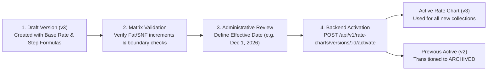

# DFarm Dairy Admin Web — Milk Rate Chart Versioning Documentation

## 1. Rate Matrix Structure

Milk procurement pricing in DFarm is determined by an authoritative two-axis matrix calculated on Fat percentage and SNF (Solids-Not-Fat) percentage:

$$\text{Applied Rate per Liter} = \text{Base Rate} + \Delta\text{Fat} \times \text{Step}_{\text{fat}} + \Delta\text{SNF} \times \text{Step}_{\text{snf}}$$

Separate charts are maintained for:
1. **Cow Milk:** Typically ranges Fat 3.0% – 5.0% and SNF 8.0% – 9.2%. Base rate benchmark: ~₹38.50/L.
2. **Buffalo Milk:** Typically ranges Fat 6.0% – 10.0% and SNF 8.5% – 9.5%. Base rate benchmark: ~₹58.00/L.

---

## 2. Versioning & Activation Workflow

---

## 3. Financial Invariance Rule

- **Historical Rate Protection:** Existing milk collection records always retain the exact `rateChartVersion` and `appliedRatePerLiter` that were active at the instant the milk was received.
- Activating a new rate chart **never retroactively changes the financial total of past collection transactions**.
- Any future price adjustment must occur via the authorized non-destructive adjustment mechanism.
