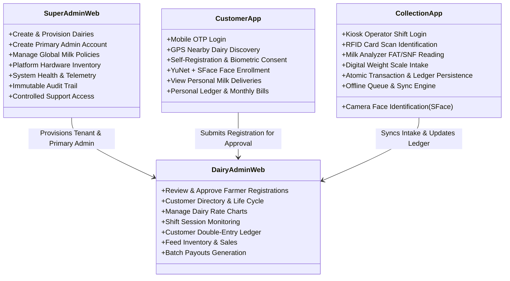

# APPLICATION RESPONSIBILITY MATRIX

**Audit Document Reference:** `DFARM-ARCH-002`  
**Version:** `1.0.0-PROMPT0-AUDIT`  
**Status:** `READ-ONLY TECHNICAL BASELINE`  
**Classification:** `Application Boundary & Functional Ownership Matrix`  

---

## 1. Core Architectural Separation of Concerns

The DFarm ecosystem strictly segregates administrative governance from cooperative tenant operations. No application may cross its assigned operational boundary.

---

## 2. Exhaustive Responsibility & Boundary Matrix

| Functional Capability | Super Admin Web | Dairy Admin Web | Customer Mobile App | Collection Kiosk App | Backend Service / Database Ownership |
| :--- | :---: | :---: | :---: | :---: | :--- |
| **Tenant Business Creation** | **AUTHORITATIVE** | FORBIDDEN | FORBIDDEN | FORBIDDEN | Control-plane DB: `organizations`, `dairy_centers` |
| **Physical Database Provisioning** | **AUTHORITATIVE** | FORBIDDEN | FORBIDDEN | FORBIDDEN | Control-plane DB: `dairy_database_mappings` |
| **Primary Admin Account Creation** | **AUTHORITATIVE** | FORBIDDEN | FORBIDDEN | FORBIDDEN | Control-plane DB: `users`, `dairy_admin_invitations` |
| **Primary Admin Activation** | INVITATION SENDER | **ACTIVATES** | FORBIDDEN | FORBIDDEN | Activation endpoint: `/api/v1/dairies/invitations/*` |
| **Dairy Profile Management** | SUSPEND / ACTIVATE | **OPERATIONAL** | READ-ONLY | READ-ONLY | Tenant DB: `organizations`, `dairy_centers` |
| **Farmer Registration Initiation** | FORBIDDEN | FORBIDDEN | **AUTHORITATIVE** | READ-ONLY | Tenant DB: `customers` (status: `PENDING_APPROVAL`) |
| **Farmer Approval / Rejection** | FORBIDDEN | **AUTHORITATIVE** | RECEIVES NOTIFICATION | FORBIDDEN | Tenant DB: `customers`, `customer_status_history` |
| **Biometric Face Capture** | FORBIDDEN | REVIEW QUALITY | **ENROLLS** | IDENTIFIES | YuNet + SFace runtime; Tenant DB: `face_enrollments` |
| **RFID Card Assignment** | FORBIDDEN | **AUTHORITATIVE** | FORBIDDEN | READS UID | Tenant DB: `rfid_cards`, `rfid_card_assignments` |
| **Milk Rate Chart Formulation** | GLOBAL GUIDELINES | **AUTHORITATIVE** | READ-ONLY | CONSUMES | Tenant DB: `rate_charts`, `rate_chart_grids` |
| **FAT / SNF Commercial Policy** | **GLOBAL DEDUCTION** | LOCAL ADJUSTMENT | FORBIDDEN | ENFORCES AT INTAKE | Evaluated during collection transaction calculation |
| **Hardware Master Inventory** | **AUTHORITATIVE** | RECEIVES ASSIGNMENT | FORBIDDEN | CONSUMES TELEMETRY | Control-plane DB: `hardware_master_inventory` |
| **Hardware Device Configuration** | FORBIDDEN | **AUTHORITATIVE** | FORBIDDEN | READS LOCAL ADAPTER | Tenant DB: `collection_devices` |
| **Shift Session Management** | FORBIDDEN | SUPERVISES | FORBIDDEN | **AUTHORITATIVE** | Tenant DB: `shift_sessions` |
| **Milk Intake & Analyzer Reading**| FORBIDDEN | FORBIDDEN | FORBIDDEN | **AUTHORITATIVE** | Tenant DB: `milk_collection_transactions` |
| **Customer Ledger Accounting** | FORBIDDEN | **AUDITS & SETTLES**| READ-ONLY | ATOMIC ACCRUAL | Tenant DB: `customer_ledger_accounts`, `ledger_entries` |
| **Monthly Billing & Settlement** | FORBIDDEN | **AUTHORITATIVE** | READ-ONLY | FORBIDDEN | Tenant DB: `monthly_billing_cycles`, `customer_bills` |
| **Bulk Farmer Payout Generation**| FORBIDDEN | **AUTHORITATIVE** | READS STATUS | FORBIDDEN | Tenant DB: `payment_batches`, `customer_payouts` |
| **Feed Inventory Management** | FORBIDDEN | **AUTHORITATIVE** | PURCHASES / ORDERS | FORBIDDEN | Tenant DB: `feed_products`, `feed_inventory_movements` |
| **System Health & Anomaly AI** | **PLATFORM-WIDE** | TENANT HEALTH | FORBIDDEN | DEVICE HEALTH | Control-plane DB: `platform_telemetry_events` |
| **Operational Alerts Lifecycle** | **PLATFORM-WIDE** | TENANT ALERTS | FORBIDDEN | OFFLINE ALERTS | Control-plane DB: `platform_alerts` |
| **Immutable Audit Trail** | **SYSTEM-WIDE** | TENANT AUDIT | FORBIDDEN | LOCAL LOGS | Append-only: `system_audit_logs`, `audit_logs` |
| **Controlled Diagnostic Support**| **AUTHORITATIVE** | CONSENTS (FUTURE) | FORBIDDEN | FORBIDDEN | Control-plane DB: `controlled_support_sessions` |
| **AMC Subscription & Renewal** | **AUTHORITATIVE** | PAYMENT MAKER | FORBIDDEN | FORBIDDEN | Central Razorpay billing: `dairy_amc_subscriptions` |

---

## 3. Violations & Leakages Detected During Audit

1. **Super Admin Module Boundary Breach:**  
   Super Admin web client currently bundles local business logic for mock dairy tenants (`apps/dfarm-super-admin/src/services/mockBackend.ts`) rather than issuing authenticated REST calls to the backend control plane.
2. **Dairy Admin Tenant Identity Locking:**  
   Dairy Admin web code assumes static identity (`apps/dfarm-dairy-admin/src/api/mock-server.ts`), failing to honor dynamic tenant database scoping when multiple dairies are created.
3. **Collection App Self-Contained Mocking:**  
   Collection App contains `apps/dfarm-collection-app/src/api/mock-backend.ts`, which pre-populates sample farmers and collection records, risking accidental divergence from live tenant database records.
4. **Customer App Cross-Tenant Ambiguity:**  
   Customer App allows selecting a Dairy from geolocation coordinates, but if the target Dairy database has not been initialized on the backend, the customer is saved to default memory storage without persisting to an isolated tenant database.
