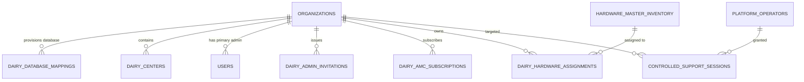

# CENTRAL CONTROL PLANE DESIGN AUDIT

**Audit Document Reference:** `DFARM-ARCH-003`  
**Version:** `1.0.0-PROMPT0-AUDIT`  
**Status:** `READ-ONLY TECHNICAL BASELINE`  
**Classification:** `Central Control-Plane Architecture & Database Audit`  

---

## 1. Architectural Scope & Purpose

The **Central Control-Plane Database** (`dfarm_central`) represents the root administrative core of the DFarm platform. It maintains system-wide invariants, multi-tenant database routing, platform operator credentials, hardware registries, global policy masters, platform telemetry, and immutable audit logs.

It **must never** store operational dairy records (e.g. daily milk intake sessions, individual farmer FAT/SNF readings, or double-entry customer subledgers).

---

## 2. Central Control-Plane Entity Catalog & Schema Audit

### 2.1 Dairy Registry & Location Coordinates
- **Table:** `organizations`
- **Migration:** `supabase/migrations/002_organizations_and_centers.sql`, `028_dairy_location_coordinates_and_address.sql`
- **Fields:**
  - `id` (UUID, Primary Key)
  - `name` (VARCHAR, Business Name)
  - `code` (VARCHAR, Unique Format `DF-[DISTRICT]-[SUFFIX]`)
  - `status` (`ACTIVE`, `SUSPENDED`, `INACTIVE`)
  - `latitude`, `longitude` (DECIMAL, Geographic coordinates for GPS discovery)
  - `formatted_address`, `place_id`, `address_line1`, `village_locality`, `city`, `district`, `state`, `postal_code`, `country`
  - `business_phone`, `business_email`
  - `created_at`, `updated_at`, `location_updated_at`
- **Audit Findings:** Schema is well-structured and supports spatial coordinates. However, migration 028 includes CHECK constraints that fail in `pg-mem`, leading to custom regex striping in `PostgresPool.ts` (lines 184-186).

### 2.2 Tenant Database Directory
- **Table:** `dairy_database_mappings`
- **Migration:** `supabase/migrations/031_dairy_database_mappings.sql`
- **Fields:**
  - `id` (UUID, PK)
  - `dairy_id` (UUID, Unique FK to `organizations.id`)
  - `dairy_code` (VARCHAR(30))
  - `database_name` (VARCHAR(100), e.g. `dfarm_tenant_gokul_0118`)
  - `resource_type` (`PHYSICAL_DATABASE`, `DEDICATED_SCHEMA`, `ISOLATED_INSTANCE`)
  - `connection_uri_encrypted` (TEXT, Encrypted connection URI)
  - `schema_version` (VARCHAR(50), e.g. `v1.0.0`)
  - `provisioning_status` (`PENDING`, `PROVISIONING`, `MIGRATED`, `ACTIVE`, `FAILED`)
  - `provisioning_error` (TEXT)
  - `provisioned_at`, `last_verified_at` (TIMESTAMPTZ)
- **Audit Findings:** Table DDL is complete and verified. However, in `TenantDatabaseManager.ts` (lines 196-203), when retrieving an existing mapping, the code invokes `createIsolatedMemoryDatabase()` instead of resolving the physical connection URI, causing operational data loss upon server restart.

### 2.3 Primary Dairy Admin Identity & Invitations
- **Tables:** `users`, `dairy_admin_invitations`
- **Migrations:** `003_user_identity_foundation.sql`, `029_dairy_admin_activation_tokens.sql`, `030_super_admin_pankaj_popat_yewale.sql`
- **Fields (`dairy_admin_invitations`):**
  - `id` (UUID, PK)
  - `dairy_id` (UUID, FK to `organizations`)
  - `admin_id` (UUID, FK to `users`)
  - `email` (VARCHAR(150), Normalized Email)
  - `token_hash` (VARCHAR(64), SHA-256 hash of activation token)
  - `status` (`PENDING`, `CONSUMED`, `EXPIRED`, `REVOKED`)
  - `delivery_status` (`ACCEPTED`, `DELIVERED`, `FAILED`, `PENDING`)
  - `delivery_provider` (VARCHAR(50), e.g. `SMTP (smtp.gmail.com)` or `STANDBY_LOCAL_PREVIEW`)
  - `delivery_message_id` (VARCHAR(200))
  - `created_at`, `expires_at`, `consumed_at`, `revoked_at`
- **Audit Findings:** Token lifecycle is cryptographically sound (SHA-256 hashed at rest, single-use, 48-hour expiration). Email delivery gracefully falls back to `STANDBY_LOCAL_PREVIEW` when SMTP credentials are absent.

### 2.4 Platform Operators & Access Control
- **Table:** `platform_operators` (Missing from PostgreSQL DDL)
- **Current State:** Super Admin UI displays permission chips:
  - `dairies:read`, `dairies:create`, `dairies:manage`, `dairies:suspend`, `dairies:reactivate`
  - `admins:read`, `admins:manage`, `admins:transfer`
  - `audit:read`, `system:monitor`, `alerts:manage`, `reports:read`, `support:access`, `platform:admin`
- **Audit Findings:** **Critical Defect.** These capabilities are defined as hardcoded frontend strings in `apps/dfarm-super-admin/src/api/client.ts` (lines 78-82) and `seedData.ts` (lines 16-31). There is **no database table** `platform_operators` or `operator_permissions` in the backend migrations, and **no backend middleware** validating these granular scopes on incoming requests.

### 2.5 Controlled Support Access Portal
- **Table:** `controlled_support_sessions` (Missing from PostgreSQL DDL)
- **Intended Specification:**
  - Target Dairy ID
  - Support Ticket Reference
  - Diagnostic Scope (`READ_ONLY`, `TELEMETRY_LOGS`, `CONFIG_AUDIT`)
  - Authorization Duration (e.g. 1 hour, 4 hours)
  - Mandatory Justification Reason
  - Session Start, Expiry, Automatic Revocation, and Audit History
- **Audit Findings:** In `apps/dfarm-super-admin/src/api/client.ts` (lines 421-439), calls to `requestSupportSession()` and `revokeSupportSession()` delegate exclusively to `mockBackend.ts`. The backend has zero database tables or API routes for support sessions. This module is non-functional in production.

### 2.6 Platform Alerts & System Health Telemetry
- **Tables:** `platform_alerts`, `platform_health_metrics` (Missing from PostgreSQL DDL)
- **Current State:**
  - In `apps/dfarm-super-admin/src/features/monitoring/SystemHealthPage.tsx` and `PlatformAlertsPage.tsx`, metrics (Postgres latency, API throughput, queue depth, error rates) are loaded via `mockBackend.getPlatformHealth()` and `mockBackend.getAlerts()`.
- **Audit Findings:** The backend offers a basic `/health/live` check in `health.routes.ts`, but has no table or service collecting historical node heartbeats, connection pool telemetry, or AI anomaly detection.

### 2.7 Hardware Master Inventory
- **Table:** `hardware_master_inventory` (Partially referenced in migration 010, missing master sales/warranty tracking)
- **Intended Specification:** Device Type, Brand, Model, Serial Number, Purchase/Sale Status, Sold/Assigned Dairy, Installation Date, Warranty Expiry, AMC Expiry, Calibration Due Date.
- **Audit Findings:** Migration `010_devices_sync_and_audit.sql` creates a tenant-scoped table `devices` (`id`, `device_serial_number`, `device_type`, `is_active`). However, the **platform-level Hardware Master Inventory** managed by Super Admin across all dairies does not exist in any database migration.

### 2.8 AMC Subscriptions & Razorpay Payment
- **Table:** `dairy_amc_subscriptions` (Missing from PostgreSQL DDL)
- **Intended Specification:** Dairy ID, Plan Tier, Billing Frequency, Start Date, Expiry Date, Razorpay Order ID, Razorpay Payment ID, Razorpay Signature, Verification Status, Auto-Deactivation Rule.
- **Audit Findings:** Unimplemented. No Razorpay SDK, webhook receiver, or AMC tables exist in `services/backend`.

---

## 3. Control-Plane vs Tenant Database Separation Protocol

To prevent cross-tenant data leakage and preserve platform stability:
1. **Control-Plane Exclusivity:** The central database must be inaccessible to Dairy Admin, Collection App, and Customer App clients. Only Super Admin authenticated identities and the internal backend tenant resolver may access `dfarm_central`.
2. **Credential Secrecy:** Connection strings to dedicated dairy operational databases must remain encrypted in `dairy_database_mappings.connection_uri_encrypted` using server-side AES-256-GCM.
3. **Automated Migration Engine:** When Super Admin provisions a dairy, the central backend must execute DDL migrations (002 through 028) against the newly provisioned tenant database before marking its status as `ACTIVE`.
