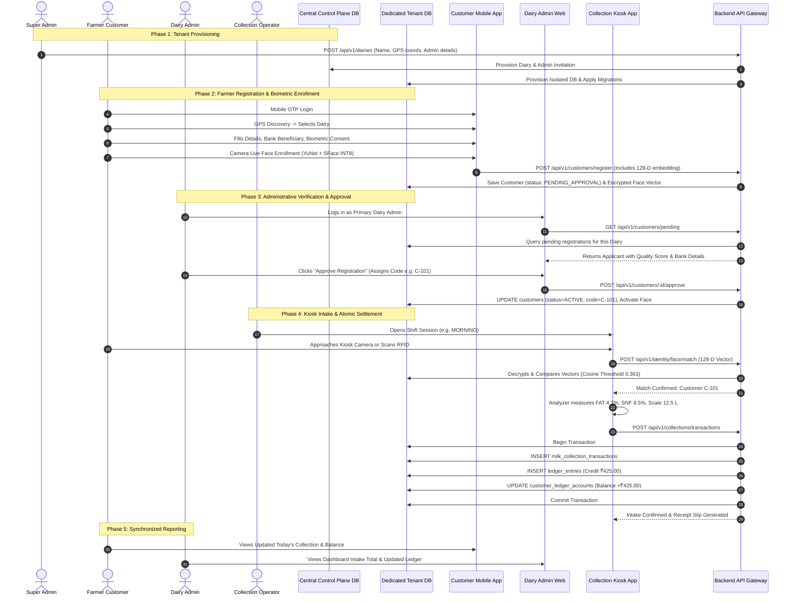

# CUSTOMER TO COLLECTION WORKFLOW

**Audit Document Reference:** `DFARM-ARCH-008`  
**Version:** `1.0.0-PROMPT0-AUDIT`  
**Status:** `READ-ONLY TECHNICAL BASELINE`  
**Classification:** `End-to-End Operational Lifecycle & Failure Trace Analysis`  

---

## 1. Intended Cross-Application Operational Lifecycle

The core business flow connects the entire DFarm platform into a cohesive multi-tenant workflow:

$$\begin{aligned}
\text{Super Admin Provisions Dairy} &\longrightarrow \text{Farmer Selects Dairy via GPS} \longrightarrow \text{Farmer Enrolls Face \& Registers} \\
&\longrightarrow \text{Dairy Admin Reviews \& Approves} \longrightarrow \text{Collection Kiosk Matches Face/RFID} \\
&\longrightarrow \text{Milk Intake (FAT/SNF/Weight)} \longrightarrow \text{Atomic Ledger Accrual} \\
&\longrightarrow \text{Customer App History \& Dairy Admin Reports}
\end{aligned}$$

---

## 2. Failure Analysis: Current Code Disconnections

During our deep technical audit, we traced the current execution across each step of this lifecycle. The workflow currently breaks at multiple critical stages:

### Breakdown Point 1: GPS Discovery vs Organization Persistence
- **Files:** `apps/dfarm-customer-app/src/features/dairy/useDairyDiscovery.ts`, `services/backend/src/presentation/routes/dairies.routes.ts`
- **Failure:** While `dairies.routes.ts` supports geographic coordinate insertion (lines 1034-1057), if PostgreSQL is offline and backend restarts, newly created dairies in `inMemoryDairies` vanish. Customer App then queries `/api/v1/dairies/nearby` and receives only the hardcoded seed dairies from `PostgresPool.ts` (Gokul, Warna, etc.), preventing discovery of newly onboarded dairies.

### Breakdown Point 2: The Pending Queue "0 Customers" Mystery
- **Files:** `services/backend/src/presentation/routes/customers.routes.ts`, `apps/dfarm-dairy-admin/src/api/client.ts`, `PostgresPool.ts`
- **Root Cause Confirmed:**
  1. In `PostgresPool.ts` (lines 238-249), the platform owner's mobile number (`+917755995615`) is hardcoded to Dairy A (`00000000-0000-0000-0000-000000000001` - Gokul Primary Cooperative).
  2. When the farmer registers on Customer App, they select a nearby dairy (e.g. `kalpna mlik's` or a newly registered dairy). The customer record is saved in that specific tenant's database/memory partition.
  3. When the owner logs into Dairy Admin using `+917755995615`, `verifyAdminOtp` resolves their `dairyId` to Gokul.
  4. Dairy Admin queries `GET /api/v1/customers/pending?organizationId=00000000-0000-0000-0000-000000000001` (Gokul's ID).
  5. Gokul's pending queue contains 0 records because the farmer registered under a completely different dairy.
  6. Furthermore, if the server restarts, ephemeral `pg-mem` instances reset, obliterating any pending registrations.

### Breakdown Point 3: Customer App Face Inference Runtime
- **Files:** `apps/dfarm-customer-app/src/face-ai/yunet-detector.ts` (lines 152-180), `sface-embedder.ts` (lines 147-156)
- **Failure:** In standard mobile execution without a native ONNX C++ library, `InferenceSession.create()` fails to load. The code catches the error and falls back to a **static calibrated detection box** and `CANONICAL_SFACE_128D_FIXTURE`. As a result, all enrolled farmers receive near-identical canonical embeddings.

### Breakdown Point 4: Collection Kiosk Customer Loading & Identification
- **Files:** `apps/dfarm-collection-app/src/api/client.ts` (lines 244-302), `services/backend/src/presentation/routes/identity.routes.ts`
- **Failure:** Collection App calls `POST /api/v1/identity/face/match`. In `identity.routes.ts`, matching queries `face_enrollments`. But because previous enrollments were generated with fallback embeddings and tenant databases are running in separate ephemeral memory pools, the cosine distance between the camera's captured embedding and the stored vector exceeds the recommended 0.363 threshold, causing identification to fail.

### Breakdown Point 5: Collection Transaction to Atomic Ledger Accrual
- **Files:** `services/backend/src/presentation/routes/collections.routes.ts`, `services/backend/src/modules/collections/collection.routes.ts`
- **Failure:** Two conflicting collection route files exist. In `presentation/routes/collections.routes.ts`, transaction submission executes against the tenant database. But if the customer account does not have a pre-existing `customer_ledger_accounts` row, foreign key constraints fail, preventing atomic ledger accruals.

---

## 3. Repair Roadmap for Cross-Application Integration

To ensure the complete workflow functions truthfully without mocks:
1. **Prompt 1 & 2:** Eliminate hardcoded Gokul admin bindings in `PostgresPool.ts` and `mock-server.ts`. Allow dynamic primary admin login scoped to their actual registered Dairy.
2. **Prompt 5:** Ensure Customer App persists registrations into the selected dairy's physical PostgreSQL database.
3. **Prompt 6:** Verify that Dairy Admin pending approvals queue strictly reads from that same physical tenant database.
4. **Prompt 8:** Connect Collection App face matching and shift sessions directly to the active tenant database so approved farmers and their face vectors are immediately identifiable at the kiosk.
