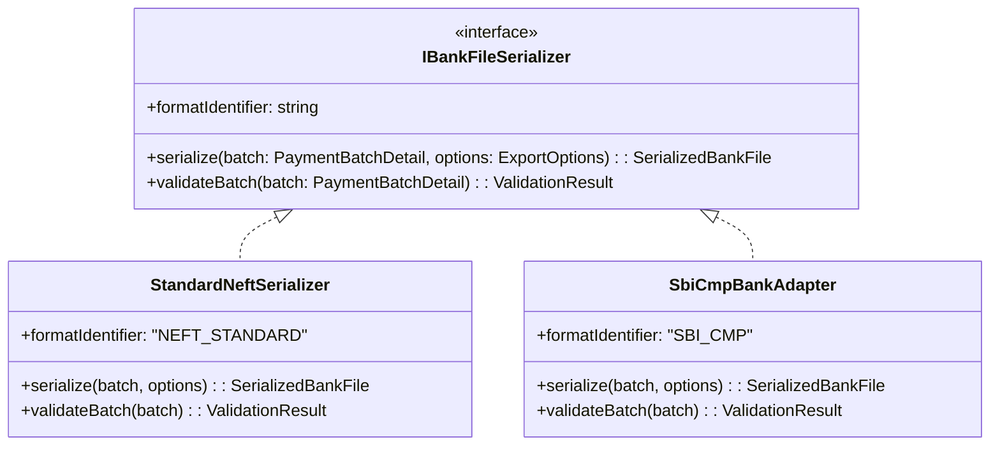

# DFARM ARCHITECTURE: BANK FILE SERIALIZERS & SECURE EXPORT ADAPTERS

**Document ID:** `DFARM-ARCH-BFSA-001`  
**Roadmap Phase:** Roadmap Phase 09 — Financial Calculation, Farmer Settlement, Bulk Bank Payout & Reconciliation  
**Target:** `services/backend/src/modules/payments/serializers/`  
**Standard:** RBI Clearing House Standard, AES-256-GCM Decryption, Cryptographic Checksum  

---

## 1. Adapter Architecture & Bank Format Classification

DFarm implements a pluggable bank serializer architecture for bulk electronic payment generation:

### Official Integration Classification Tier:
| Bank Format Profile | Adapter Implementation | Classification Status | Operational Capability |
| :--- | :--- | :--- | :--- |
| **Standard NEFT Batch (RBI Clearing House)** | `StandardNeftSerializer.ts` | **FILE SERIALIZER IMPLEMENTED AND TESTED** | Supported. Generates validated CSV files accepted by nationalized & district central cooperative banks (DCCBs). |
| **SBI Corporate Multi-Payment (CMP)** | `SbiCmpBankAdapter.ts` | **BLOCKED — OFFICIAL BANK SPECIFICATION REQUIRED** | Blocked. Requires official SBI CMP corporate client code, public encryption key, and product mandate from the dairy. |

---

## 2. Standard NEFT CSV Specification

The `NEFT_STANDARD` serializer exports bulk files compliant with Indian clearing standards:

### 2.1 File Format & Encoding:
- **Encoding:** ASCII / UTF-8 without BOM.
- **Delimiter:** Comma (`,`), with quotes around text fields containing commas.
- **Line Ending:** Standard CRLF (`\r\n`).

### 2.2 Column Schema:
| Column # | Field Name | Data Type | Example | Validation Rules |
| :--- | :--- | :--- | :--- | :--- |
| 1 | `Transaction Type` | String | `NEFT` | Constant: `NEFT` (or `RTGS` for amounts $\ge ₹ 2,00,000$) |
| 2 | `Beneficiary Name` | String | `RAMESH PATEL` | Max 50 chars, alphabetic and spaces only |
| 3 | `Beneficiary Account Number` | String | `123456789012` | 9 to 18 digits, decrypted server-side |
| 4 | `Beneficiary IFSC` | String | `SBIN0001234` | Exactly 11 alphanumeric characters (`/^[A-Z]{4}0[A-Z0-9]{6}$/`) |
| 5 | `Amount` | Numeric | `1048.50` | Strictly positive, formatted to 2 decimal places |
| 6 | `Customer Reference` | String | `REF-BATCH-0042-PAT01` | Unique tracking reference per farmer |
| 7 | `Debit Account Number` | String | `987654321000` | Dairy's registered corporate current account |
| 8 | `Narration` | String | `Milk Settlement Oct 2026` | Max 30 chars descriptive note |

---

## 3. Security, Decryption & Download Protocols

1. **Restricted Server-Side Decryption:**
   Beneficiary account numbers stored as AES-256-GCM ciphertexts in `customers.bank_account_number` are decrypted **only** in ephemeral memory during the file compilation step. Plaintext account numbers are never persisted to disk or included in standard API JSON payloads.
2. **SHA-256 Checksumming:**
   Every generated file is hashed using SHA-256. The hash is recorded in `payment_batches.export_checksum` and written to the audit log (`PAYMENT_BATCH_EXPORTED`).
3. **Short-Lived Ephemeral Download Tokens:**
   Files are not accessed via static URLs. The API returns a cryptographically signed HMAC token valid for **15 minutes**. Downloading requires:
   `GET /api/v1/payments/batches/:batchId/download?token=<token>`
   Responses enforce:
   `Cache-Control: no-store, no-cache, must-revalidate, proxy-revalidate`
4. **Core Invariant: Export $\neq$ Settlement:**
   Generating or downloading a bank payment file transitions batch status to `EXPORTED`, but **never debits the farmer's ledger**. Financial liabilities remain open until bank settlement confirmation is reconciled.
