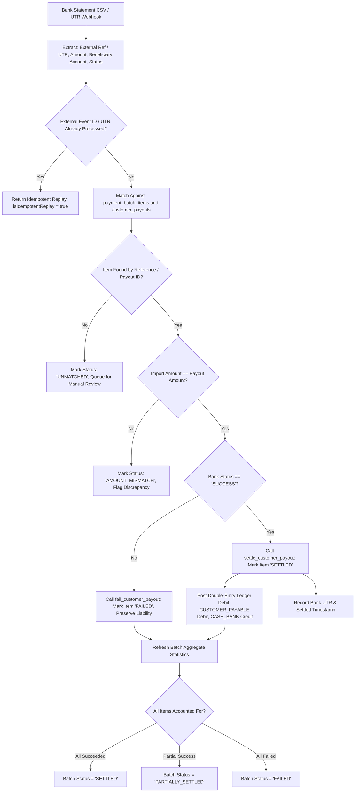

# DFARM ARCHITECTURE: BANK RESPONSE RECONCILIATION & SETTLEMENT ENGINE

**Document ID:** `DFARM-ARCH-BRSE-001`  
**Roadmap Phase:** Roadmap Phase 09 — Financial Calculation, Farmer Settlement, Bulk Bank Payout & Reconciliation  
**Target:** `services/backend/src/modules/payments/`  
**Standard:** Item-Level Reconciliation, UTR Verification, Atomic Ledger Settlement  

---

## 1. Lifecycle States & Status Distinctions

A fundamental failure mode in agricultural banking systems is prematurely marking transactions as "PAID" when a payment file is merely compiled or uploaded. DFarm strictly distinguishes five operational states:

```
[DRAFT]
   | (Maker creates batch)
   v
[PENDING_APPROVAL]
   | (Checker independently approves)
   v
[APPROVED]
   | (Checker exports bank file)
   v
[EXPORTED] ----------------------------+ (Files downloaded; zero ledger impact)
   | (Bank portal upload initiated)     |
   v                                   |
[SUBMITTED]                             |
   | (Bank processes clearing)          |
   v                                   |
[RECONCILING] <------------------------+
   | (Bank Response / UTR Report Imported)
   +-----------------------+-----------------------+
   |                       |                       |
   v                       v                       v
[SETTLED]        [PARTIALLY_SETTLED]            [FAILED]
(All items confirm      (Some items succeed,      (All items rejected
 UTR & amount)           some fail)                or returned)
   |                       |                       |
   v                       v                       v
Ledger Debits Posted   Ledger Debits Posted    Zero Ledger Debits;
for All Farmers        ONLY for Successful     Liability Remains
                       Farmers                 with Farmer
```

---

## 2. Bank Response Import & Matching Algorithm

The `ReconciliationService` and `BatchService.reconcileBatch` match external bank statement rows using high-confidence multi-field tuple verification:



---

## 3. Double-Entry Posting Invariant on Settlement

When a farmer's transfer is confirmed via UTR:
```sql
-- Executed inside an atomic PostgreSQL transaction (settle_customer_payout)
UPDATE customer_ledger_accounts
SET current_balance = current_balance - $amount,
    last_transaction_at = $settled_at,
    updated_at = NOW()
WHERE customer_id = $customer_id;

INSERT INTO ledger_transactions (
    id, organization_id, center_id, customer_id, transaction_type,
    direction, amount, balance_after, reference_entity, reference_id,
    description, idempotency_key, created_by, created_at
) VALUES (
    $txn_id, $org_id, $center_id, $customer_id, 'PAYMENT_PAYOUT_DEBIT',
    'DEBIT', $amount, $new_balance, 'CUSTOMER_PAYMENT', $payout_id,
    'Settled NEFT Payout Ref: ' || $utr, $idempotency_key, $settled_by, $settled_at
);

INSERT INTO ledger_entries (transaction_id, account_id, account_type, entry_type, amount)
VALUES 
    ($txn_id, $ledger_account_id, 'CUSTOMER_PAYABLE', 'DEBIT', $amount),
    ($txn_id, $center_id, 'CASH_BANK', 'CREDIT', $amount);
```

### Invariants:
1. **Zero Double-Debit:** Re-submitting the same bank statement CSV or webhook triggers the unique index constraint on `external_event_id` or checks `payout.status === 'SETTLED'`, returning `isIdempotentReplay: true` without altering ledger balances.
2. **Failed Payments Preserve Liability:** If a transfer is rejected due to an invalid IFSC or frozen account, the customer's ledger balance is **not** debited. The amount remains payable to the farmer and can be included in subsequent settlement batches.
