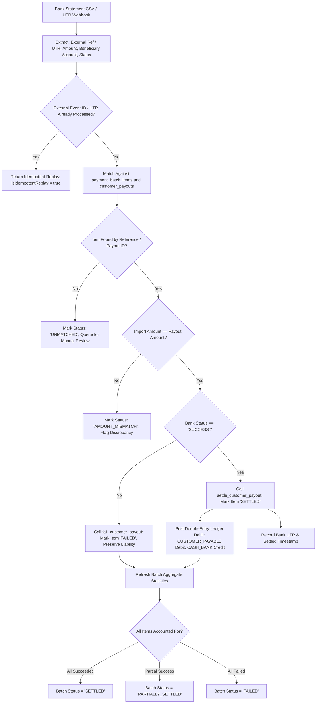

# DFARM ARCHITECTURE: BANK RESPONSE RECONCILIATION & SETTLEMENT ENGINE

**Document ID:** `DFARM-ARCH-BRSE-001`  
**Roadmap Phase:** Roadmap Phase 09 — Financial Calculation, Farmer Settlement, Bulk Bank Payout & Reconciliation  
**Target:** `services/backend/src/modules/payments/`  
**Standard:** Item-Level Reconciliation, UTR Verification, Atomic Ledger Settlement  

---

## 1. Lifecycle States & Status Distinctions

A fundamental failure mode in agricultural banking systems is prematurely marking transactions as "PAID" when a payment file is merely compiled or uploaded. DFarm strictly distinguishes five operational states:

```
[DRAFT]
   | (Maker creates batch)
   v
[PENDING_APPROVAL]
   | (Checker independently approves)
   v
[APPROVED]
   | (Checker exports bank file)
   v
[EXPORTED] ----------------------------+ (Files downloaded; zero ledger impact)
   | (Bank portal upload initiated)     |
   v                                   |
[SUBMITTED]                             |
   | (Bank processes clearing)          |
   v                                   |
[RECONCILING] <------------------------+
   | (Bank Response / UTR Report Imported)
   +-----------------------+-----------------------+
   |                       |                       |
   v                       v                       v
[SETTLED]        [PARTIALLY_SETTLED]            [FAILED]
(All items confirm      (Some items succeed,      (All items rejected
 UTR & amount)           some fail)                or returned)
   |                       |                       |
   v                       v                       v
Ledger Debits Posted   Ledger Debits Posted    Zero Ledger Debits;
for All Farmers        ONLY for Successful     Liability Remains
                       Farmers                 with Farmer
```

---

## 2. Bank Response Import & Matching Algorithm

The `ReconciliationService` and `BatchService.reconcileBatch` match external bank statement rows using high-confidence multi-field tuple verification:



---

## 3. Double-Entry Posting Invariant on Settlement

When a farmer's transfer is confirmed via UTR:
```sql
-- Executed inside one shared tenant transaction via tenantDbManager.getStrictTenantDb(organizationId, { bypassCache: true, strictOperational: true })
-- calling public.settle_customer_payout / public.fail_customer_payout / public.reverse_customer_payout
UPDATE customer_ledger_accounts
SET current_balance = current_balance - $amount,
    last_transaction_at = $settled_at,
    updated_at = NOW()
WHERE customer_id = $customer_id;

INSERT INTO ledger_transactions (
    id, organization_id, center_id, customer_id, transaction_type,
    direction, amount, balance_after, reference_entity, reference_id,
    description, idempotency_key, created_by, created_at
) VALUES (
    $txn_id, $org_id, $center_id, $customer_id, 'PAYMENT_PAYOUT_DEBIT',
    'DEBIT', $amount, $new_balance, 'CUSTOMER_PAYMENT', $payout_id,
    'Settled NEFT Payout Ref: ' || $utr, $idempotency_key, $settled_by, $settled_at
);

INSERT INTO ledger_entries (transaction_id, account_id, account_type, entry_type, amount)
VALUES 
    ($txn_id, $ledger_account_id, 'CUSTOMER_PAYABLE', 'DEBIT', $amount),
    ($txn_id, $center_id, 'CASH_BANK', 'CREDIT', $amount);
```

### Invariants:
1. **Zero Double-Debit:** Re-submitting the same bank statement or Reverse MIS payload enforces UTR/reversal idempotency and conflict protection (`CONFLICTING_UTR_REFERENCE`, `CONFLICTING_REVERSAL_REFERENCE`, `uq_recon_org_payout_action_ref_matched`, `uq_payment_adjustments_org_idempotency`) without altering ledger balances.
2. **Failed Payments Preserve Liability:** If a transfer is rejected due to an invalid IFSC or frozen account, the customer's ledger balance is **not** debited. The amount remains payable to the farmer and can be included in subsequent settlement batches.
3. **Compensating Reversals Only on Settled Payouts:** Returned transfers (`REVERSED`) restore the farmer payable liability via `public.reverse_customer_payout` only when the payout is genuinely `SETTLED`, and never credit `FAILED` or `UNKNOWN` payouts.

## 4. Strict Tenant Database Isolation & Atomic Transaction Boundary (DF-022 / DF-024)

1. **Authoritative Tenant Routing:** [`tenant-payment-context.ts`](file:///c:/Users/panka/.gemini/antigravity/worktrees/DFarm/dfarm_customer_app_init/services/backend/src/modules/payments/tenant-payment-context.ts), [`UnionBankReconciliationService`](file:///c:/Users/panka/.gemini/antigravity/worktrees/DFarm/dfarm_customer_app_init/services/backend/src/integrations/banking/union-bank/UnionBankReconciliationService.ts), [`UnionBankSubmissionService`](file:///c:/Users/panka/.gemini/antigravity/worktrees/DFarm/dfarm_customer_app_init/services/backend/src/integrations/banking/union-bank/UnionBankSubmissionService.ts), [`UnionBankStatusInquiryService`](file:///c:/Users/panka/.gemini/antigravity/worktrees/DFarm/dfarm_customer_app_init/services/backend/src/integrations/banking/union-bank/UnionBankStatusInquiryService.ts), [`ReconciliationService`](file:///c:/Users/panka/.gemini/antigravity/worktrees/DFarm/dfarm_customer_app_init/services/backend/src/modules/payments/reconciliation.service.ts), [`BatchService`](file:///c:/Users/panka/.gemini/antigravity/worktrees/DFarm/dfarm_customer_app_init/services/backend/src/modules/payments/batch.service.ts), [`PayoutService`](file:///c:/Users/panka/.gemini/antigravity/worktrees/DFarm/dfarm_customer_app_init/services/backend/src/modules/payments/payout.service.ts), [`ReceiptService`](file:///c:/Users/panka/.gemini/antigravity/worktrees/DFarm/dfarm_customer_app_init/services/backend/src/modules/payments/receipt.service.ts), [`SettlementCalculationService`](file:///c:/Users/panka/.gemini/antigravity/worktrees/DFarm/dfarm_customer_app_init/services/backend/src/modules/payments/settlement-calculation.service.ts), [`BankFileService`](file:///c:/Users/panka/.gemini/antigravity/worktrees/DFarm/dfarm_customer_app_init/services/backend/src/modules/payments/serializers/BankFileService.ts), and [`PaymentController.getFarmerPaymentOverview`](file:///c:/Users/panka/.gemini/antigravity/worktrees/DFarm/dfarm_customer_app_init/services/backend/src/modules/payments/payment.controller.ts) resolve exactly one operational tenant PostgreSQL database via `tenantDbManager.getStrictTenantDb(organizationId, { bypassCache: true, strictOperational: true })`. Zero payment/banking code imports `config/db.js`, calls `pool.connect()`, uses `getAllTenantDbs()`, or falls back to `resolveDefaultOrgId()`.
2. **External Bank HTTP Boundary (Submission & Status Inquiry):** [`UnionBankSubmissionService`](file:///c:/Users/panka/.gemini/antigravity/worktrees/DFarm/dfarm_customer_app_init/services/backend/src/integrations/banking/union-bank/UnionBankSubmissionService.ts) commits the `GENERATED` submission intent inside Tenant TX1 before calling `UnionBankApiClient.submitBatch()` outside any open DB transaction, then opens Tenant TX2 to record acknowledgement (`PROCESSING`), pre-flight rejection (`FAILED`), or recoverable `TIMEOUT_UNKNOWN` / `UNKNOWN`. Similarly, [`UnionBankStatusInquiryService`](file:///c:/Users/panka/.gemini/antigravity/worktrees/DFarm/dfarm_customer_app_init/services/backend/src/integrations/banking/union-bank/UnionBankStatusInquiryService.ts) reads item context in TX1, runs `queryPaymentStatus()` outside DB locks, and applies transitions in TX2 (`UNKNOWN` is never converted to `FAILED`).
3. **Single Batch-Level Transaction & Savepoints:** All Reverse MIS and batch reconciliation mutations share one tenant transaction client inside `tenantDb.withTransaction(...)`. Per-item domain rejections roll back to PostgreSQL `SAVEPOINT`s (with `MANUAL_REVIEW_REQUIRED` / `CONFLICT_REQUIRES_MANUAL_REVIEW` audit persistence on conflicting UTR or reversal keys) without aborting valid siblings, whereas unexpected database/infrastructure failures roll back the entire batch atomically.
4. **Fail-Closed Dairy Debit Account & Credential Hygiene (DF-024):** Zero-account (`'00000000000000'`) and global `UNION_BANK_DEBIT_ACCOUNT` fallbacks are eliminated across Union Bank and NEFT serializers, validators, submission/API clients, and UI payloads. Missing or all-zero debit accounts fail closed before generating files or calling gateway APIs, logs/errors carry only masked account digits (`XXXX-XXXX-<last4>`), and production API dispatch remains gated on real bank credentials and `502 UNION_BANK_GATEWAY_CERTIFICATION_REQUIRED`.
5. **Post-Commit Notifications & Single Authoritative Ledger:** Split-brain dual-write tenant synchronization in [`payout.service.ts`](file:///c:/Users/panka/.gemini/antigravity/worktrees/DFarm/dfarm_customer_app_init/services/backend/src/modules/payments/payout.service.ts) has been eliminated, and notifications are deferred in memory and flushed via `Promise.allSettled` strictly after outer PostgreSQL `COMMIT`.
