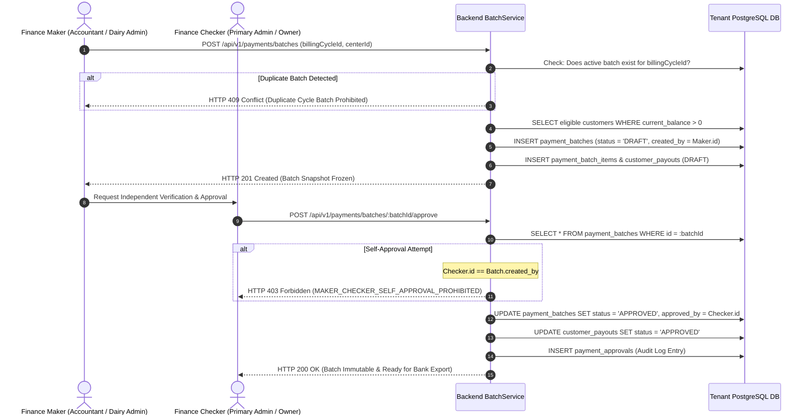

# DFARM ARCHITECTURE: BULK PAYOUT BATCH & MAKER–CHECKER GOVERNANCE

**Document ID:** `DFARM-ARCH-BPMC-001`  
**Roadmap Phase:** Roadmap Phase 09 — Financial Calculation, Farmer Settlement, Bulk Bank Payout & Reconciliation  
**Target:** `services/backend`, `apps/dfarm-dairy-admin`  
**Standard:** Strict Segregation of Duties (SoD), Dual Authorization, Zero Self-Approval  

---

## 1. Principles of Financial Segregation of Duties

To safeguard farmer funds against unauthorized disbursement, collusion, and clerical errors, DFarm enforces mandatory dual-control (**Maker–Checker**) authorization on all bulk payout operations:

1. **Maker (Preparation):** An authorized finance staff member (`ACCOUNTANT`, `DAIRY_ADMIN`, or `CENTER_MANAGER`) prepares the settlement batch from a finalized billing cycle, reviews beneficiary eligibility, and submits the batch for review.
2. **Checker (Approval):** An independent authorized officer (`PRIMARY_DAIRY_ADMIN` or `DAIRY_OWNER`) reviews batch totals, exception records, and beneficiary details.
3. **Absolute Prohibition of Self-Approval:**
   Under **no circumstances** may the identity who created or modified the batch approve it:
   $$\text{approver\_id} \neq \text{created\_by}$$
   Violations result in an immediate HTTP 403 Forbidden with error code `MAKER_CHECKER_SELF_APPROVAL_PROHIBITED`.

---

## 2. Payout Batch State Machine & Workflow

---

## 3. Duplicate Payout Prevention & Obligation Reservation

1. **Billing Cycle Uniqueness Constraint:**
   A billing cycle cannot be associated with more than one active payout batch in states `DRAFT`, `PENDING_APPROVAL`, `APPROVED`, `SUBMITTED`, or `SETTLED`.
2. **Payout Item Uniqueness:**
   A unique constraint `uq_batch_payout UNIQUE (batch_id, payout_id)` guarantees no double-listing of payouts.
3. **Obligation Reservation:**
   When a payout item is created in `DRAFT` or `APPROVED` status, the pending amount is reserved against the customer's ledger balance:
   $$\text{Eligible Balance} = \text{Current Ledger Balance} - \sum \text{Pending Reserved Payouts}$$
   This prevents race conditions where an individual manual payout and a bulk batch attempt to disburse the same ledger balance concurrently.
