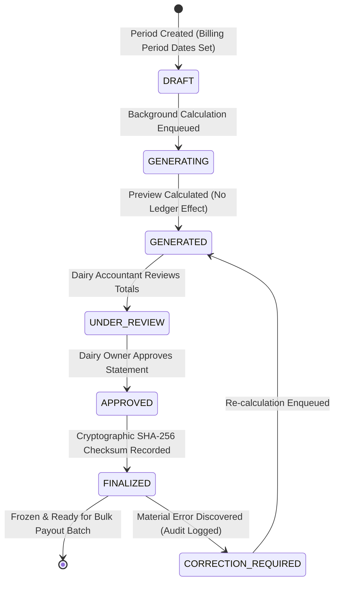

# DFARM ARCHITECTURE: FARMER SETTLEMENT & BILLING CYCLE SPECIFICATION
## PERIODIC BILLING SCHEDULES, DEDUCTION RECONCILIATION & STATEMENT FINALIZATION

**Document ID:** `DFARM-ARCH-FSBA-001`  
**Roadmap Phase:** Roadmap Phase 09 — Financial Calculation, Farmer Settlement, Bulk Bank Payout & Reconciliation  
**Target:** `services/backend`, `apps/dfarm-dairy-admin`, `apps/dfarm-customer-app`  
**Standard:** Double-Entry Reconciliation, Cryptographic Statement Finalization  

---

## 1. Billing Schedules & Supported Intervals

Dairy cooperatives operate on periodic billing cycles to disburse earnings to farmers:
- **`CALENDAR_MONTH`:** Standard monthly cycle (1st of month to last calendar day).
- **`TEN_DAY`:** Trimonthly cycle (1st–10th, 11th–20th, 21st–end of month).
- **`FIFTEEN_DAY`:** Bi-monthly cycle (1st–15th, 16th–end of month).
- **`CUSTOM_PERIOD`:** Approved seasonal or cooperative-specific interval.

All interval boundaries are evaluated using the dairy's configured timezone (`Asia/Kolkata` / IST), eliminating client device timezone drift.

---

## 2. Authoritative Settlement Formula

$$\text{Total Credits} = \text{Gross Milk Earnings} + \text{Quality Bonuses} + \text{Incentive Credits}$$

$$\text{Total Debits} = \text{Feed Purchases} + \text{Emergency Advances Recovered} + \text{Authorized Deductions}$$

$$\text{Closing Balance} = \text{Opening Balance} + \text{Total Credits} - \text{Total Debits} - \text{Previously Settled Payouts}$$

$$\text{Net Payable Amount} = \max(0.00, \text{Closing Balance})$$

### Invariant: Double-Counting Prevention
- If feed purchases were posted as journal debits in `ledger_transactions` upon store dispatch, they must **not** be deducted a second time from net payable if calculating from the ledger's running balance.
- The settlement engine reconciles transactions directly against journal references, ensuring each transaction ID contributes to exactly one financial cycle.

---

## 3. Preview vs. Finalized Statement Lifecycle

1. **Preview (`GENERATED`):** Provides read-only visibility into calculated milk credits, feed deductions, and net payables. No ledger debits or bank batches are triggered.
2. **Finalized (`FINALIZED`):** The statement becomes frozen and immutable. An SHA-256 checksum over all line items is recorded in `bill_finalization_records`. Payout batches can only be constructed from `FINALIZED` billing periods.
3. **Cross-App Parity:** The farmer's mobile passbook (`apps/dfarm-customer-app`) and Dairy Admin statement view (`apps/dfarm-dairy-admin`) render the exact same finalized figures.
