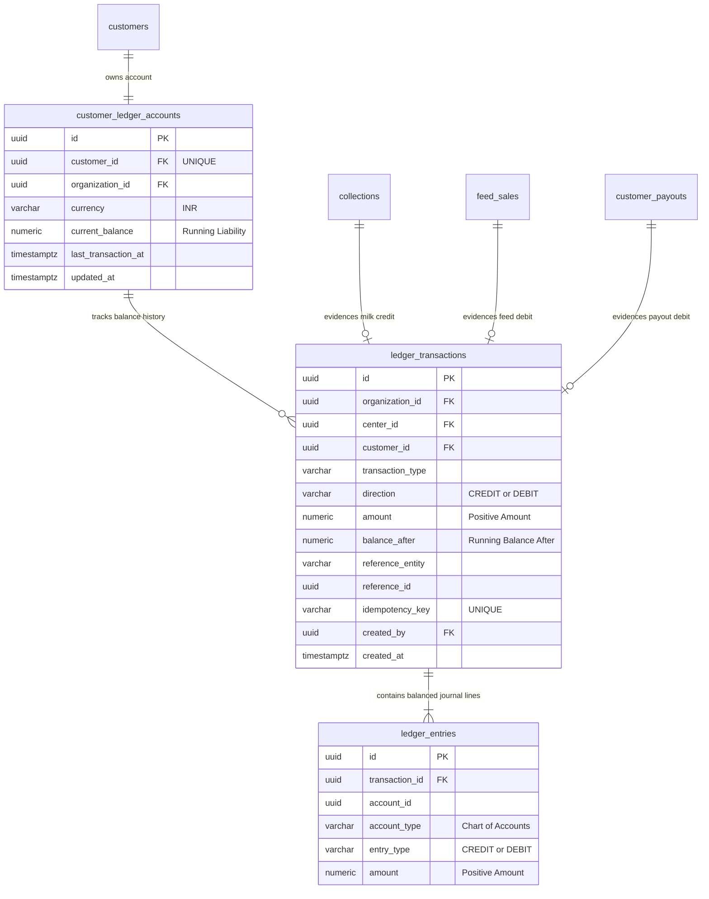

# DFARM ARCHITECTURE: FINANCIAL SOURCE OF TRUTH & ACCOUNTING CANON
## DEFINITIVE RECONCILIATION OF LEDGER SCHEMA, JOURNAL TRANSACTIONS, CHART OF ACCOUNTS & DOUBLE-ENTRY INVARIANTS

**Document ID:** `DFARM-ARCH-FSOT-001`  
**Roadmap Phase:** Roadmap Phase 09 — Financial Calculation, Farmer Settlement, Bulk Bank Payout & Reconciliation  
**Target:** `services/backend`, `packages/database`, PostgreSQL Tenant Databases (`dfarm_tenant_<code_hash>`)  
**Status:** AUTHORITATIVE ARCHITECTURAL STANDARD  

---

## 1. Executive Summary & Problem Statement

Prior implementation reports and legacy architectural notes contained multiple overlapping names for financial ledger tables:
- `customer_ledger_entries`
- `customer_ledger_accounts`
- `ledger_accounts`
- `ledger_entries`
- `ledger_transactions`

To eliminate all ambiguity, protect against dual-ledger drift, and guarantee audit compliance, this document formally certifies the **single authoritative financial data model** for the DFarm platform.

There is **only one** financial accounting engine in DFarm. It is implemented across three relational tables inside each physically isolated tenant PostgreSQL database (`dfarm_tenant_<code_hash>`).

---

## 2. Authoritative Database Schema Specification

### 2.1 Table 1: Account Header (`customer_ledger_accounts`)
- **Purpose:** Represents the continuous financial account for a registered patron.
- **Key Invariant:** Exactly one ledger account per customer (`customer_id UNIQUE`).
- **Primary Field:** `current_balance NUMERIC(12,2)`. Represents the dairy's current outstanding net liability to the farmer.
  - Positive balance ($\ge 0$): Dairy owes money to the farmer (Credit balance).
  - Negative balance ($< 0$): Farmer owes money to the dairy (Debt from feed purchases or advances).

### 2.2 Table 2: Event Journal Header (`ledger_transactions`)
- **Purpose:** Append-only transaction journal capturing every discrete economic event.
- **Immutability:** Triggers prohibit any `UPDATE` or `DELETE` statements on this table.
- **Audit Columns:**
  - `transaction_type`: e.g., `MILK_COLLECTION_CREDIT`, `FEED_PURCHASE_DEBIT`, `PAYMENT_PAYOUT_DEBIT`, `APPROVED_ADJUSTMENT_CREDIT`.
  - `direction`: Strict `CREDIT` (increases liability to farmer) or `DEBIT` (decreases liability).
  - `amount`: Always strictly positive ($> 0.00$).
  - `balance_after`: Exact calculated running balance following transaction commitment.
  - `idempotency_key`: Cryptographic or structured uniqueness token (`UNIQUE`) preventing replay attacks or duplicate network submissions.

### 2.3 Table 3: Double-Entry Balancing Lines (`ledger_entries`)
- **Purpose:** Contains the paired debit and credit accounting lines representing double-entry balance.
- **Invariant:** For every `transaction_id`, the sum of lines where `entry_type = 'DEBIT'` must exactly equal the sum of lines where `entry_type = 'CREDIT'`:
  $$\sum \text{Debits} = \sum \text{Credits}$$

---

## 3. Approved Chart of Accounts

| Account Code | Account Classification | Normal Balance | Business Purpose |
| :--- | :--- | :--- | :--- |
| `CUSTOMER_PAYABLE` | Liability | Credit | Represents aggregate funds owed by the dairy cooperative to farmers. |
| `MILK_PURCHASE_EXPENSE` | Expense | Debit | Cost of raw milk procured at kiosk collection counters. |
| `FEED_INVENTORY` | Asset | Debit | Value of cattle feed stock held in center inventory. |
| `CASH_BANK` | Asset | Debit | Physical cash in vault or funds in cooperative bank current accounts. |
| `ADVANCE_RECEIVABLE` | Asset | Debit | Outstanding short-term loans/advances disbursed to farmers. |
| `DEDUCTION_INCOME` | Income | Credit | Administrative, veterinary, or membership fees retained by cooperative. |
| `INCENTIVE_EXPENSE` | Expense | Debit | Seasonal or quality bonus subsidies paid to farmers. |
| `RECONCILIATION_SUSPENSE` | Suspense / Clearing | Zero | Temporary holding account for unmatched bank statement credits/debits. |

---

## 4. Canonical Journal Entries for Business Workflows

### 4.1 Workflow 1: Milk Collection Intake
When raw milk is accepted at the kiosk counter and calculated at ₹ 1,000.00:
1. `ledger_transactions`:
   - `transaction_type`: `MILK_COLLECTION_CREDIT`
   - `direction`: `CREDIT`
   - `amount`: `1000.00`
   - `reference_entity`: `MILK_COLLECTION`
   - `reference_id`: `<collection_uuid>`
2. `ledger_entries`:
   - Line 1: `account_type = 'MILK_PURCHASE_EXPENSE'`, `entry_type = 'DEBIT'`, `amount = 1000.00`
   - Line 2: `account_type = 'CUSTOMER_PAYABLE'`, `entry_type = 'CREDIT'`, `amount = 1000.00`
3. `customer_ledger_accounts`:
   - `current_balance = current_balance + 1000.00`

### 4.2 Workflow 2: Store Credit Cattle Feed Purchase
When a farmer purchases cattle feed worth ₹ 400.00 against their milk earnings:
1. `ledger_transactions`:
   - `transaction_type`: `FEED_PURCHASE_DEBIT`
   - `direction`: `DEBIT`
   - `amount`: `400.00`
   - `reference_entity`: `FEED_SALE`
   - `reference_id`: `<feed_sale_uuid>`
2. `ledger_entries`:
   - Line 1: `account_type = 'CUSTOMER_PAYABLE'`, `entry_type = 'DEBIT'`, `amount = 400.00`
   - Line 2: `account_type = 'FEED_INVENTORY'`, `entry_type = 'CREDIT'`, `amount = 400.00`
3. `customer_ledger_accounts`:
   - `current_balance = current_balance - 400.00`

### 4.3 Workflow 3: Confirmed Bank Settlement Payout
When a bank NEFT transfer of ₹ 600.00 is settled and verified with bank UTR:
1. `ledger_transactions`:
   - `transaction_type`: `PAYMENT_PAYOUT_DEBIT`
   - `direction`: `DEBIT`
   - `amount`: `600.00`
   - `reference_entity`: `CUSTOMER_PAYMENT`
   - `reference_id`: `<payout_uuid>`
2. `ledger_entries`:
   - Line 1: `account_type = 'CUSTOMER_PAYABLE'`, `entry_type = 'DEBIT'`, `amount = 600.00`
   - Line 2: `account_type = 'CASH_BANK'`, `entry_type = 'CREDIT'`, `amount = 600.00`
3. `customer_ledger_accounts`:
   - `current_balance = current_balance - 600.00`

---

## 5. Non-Negotiable Invariants

1. **No Direct Balance Mutation:**
   Application code must **never** execute `UPDATE customer_ledger_accounts SET current_balance = $1` without simultaneously appending the corresponding `ledger_transactions` and `ledger_entries` records in the same atomic database transaction.
2. **Reversals Must Be Compensating Entries:**
   If a milk collection is revoked or a payout fails, existing rows are **never** modified or deleted. An explicit compensating journal entry is inserted (e.g., `COLLECTION_REVERSAL_DEBIT` or `PAYOUT_REVERSAL_CREDIT`).
3. **No Unconfirmed Payout Debits:**
   Drafting, approving, or exporting a bulk payout file does **NOT** touch the general ledger. A debit to `CUSTOMER_PAYABLE` is permitted **only after genuine bank settlement is confirmed**.
