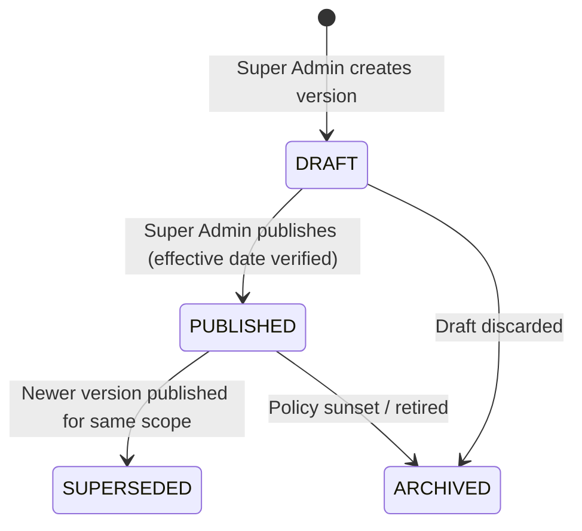

# DFARM ARCHITECTURE: CENTRAL GLOBAL RATE POLICY MANAGEMENT
**Document ID:** `DFARM-ARCH-GRP-001`  
**Roadmap Scope:** Roadmap Phase 04 — Super Admin Platform Services  
**Author:** DFarm Principal Solution Architect & Database Engineering Team  
**Status:** APPROVED & IMPLEMENTED  

---

## 1. Executive Summary & Purpose

The **Central Global Rate Policy Management Engine** provides state-level and cooperative-federation-level pricing governance, statutory minimum support price (MSP) baselines, and quality premium benchmarks across all dairy cooperatives managed on the DFarm platform.

Under DFarm's multi-tenant architecture, individual dairy cooperatives maintain operational autonomy with physical database isolation (`dfarm_tenant_<code_hash>`). However, central regulatory compliance, government procurement floor prices, and state federation directives require central definition, versioning, and policy publication at the platform level (`dfarm_central`).

---

## 2. Fundamental Architectural Principles

1. **Central Definition vs. Local Adoption (Non-Destructive Governance):**
   Global rate policies are defined and stored in the central control plane database (`dfarm_central`). Publishing a global rate policy version **never** automatically overwrites a dairy cooperative's active local rate charts or retroactively modifies historical milk intake records.
2. **Draft Version Quarantine:**
   New policies and policy revisions begin strictly in `DRAFT` status. A draft policy version cannot be selected, applied, or referenced in operational intake transactions.
3. **Cryptographic Integrity & Checksums:**
   Every policy version computes an immutable SHA-256 checksum based on the serialized parameter set, version number, and `effective_from` timestamp. This prevents undetected tampering or parameter mutation post-publication.
4. **Temporal Versioning & Effective Dating:**
   Policies feature monotonic version increments (`version_number`), strict `effective_from` timestamps, and optional `effective_to` sunset dates.
5. **Role-Based Governance (Least Privilege):**
   Only platform users holding the `SUPER_ADMIN` role can author, draft, or publish global rate policies. `PLATFORM_OPERATOR` accounts are restricted to read-only visibility (`system:monitor`, `policies:read`).

---

## 3. Database Schema Specification (`dfarm_central`)

The global rate policy architecture is backed by two authoritative relational tables defined in migration `033_central_platform_policies_and_support.sql`:

```sql
-- Global Rate Policy Definitions
CREATE TABLE IF NOT EXISTS global_rate_policies (
    id UUID PRIMARY KEY DEFAULT gen_random_uuid(),
    policy_code VARCHAR(50) NOT NULL UNIQUE,
    name VARCHAR(150) NOT NULL,
    description TEXT,
    policy_type VARCHAR(50) NOT NULL DEFAULT 'STANDARD_BASE',
    is_active BOOLEAN NOT NULL DEFAULT TRUE,
    created_by UUID,
    created_at TIMESTAMPTZ NOT NULL DEFAULT NOW(),
    updated_at TIMESTAMPTZ NOT NULL DEFAULT NOW(),
    CONSTRAINT chk_global_rate_policy_type CHECK (
        policy_type IN ('STANDARD_BASE', 'SEASONAL_INCENTIVE', 'QUALITY_PREMIUM', 'INTER_DAIRY_BENCHMARK', 'STATUTORY_MINIMUM')
    )
);

-- Versioned Policy Parameters
CREATE TABLE IF NOT EXISTS global_rate_policy_versions (
    id UUID PRIMARY KEY DEFAULT gen_random_uuid(),
    policy_id UUID NOT NULL REFERENCES global_rate_policies(id) ON DELETE CASCADE,
    version_number INTEGER NOT NULL,
    status VARCHAR(50) NOT NULL DEFAULT 'DRAFT',
    effective_from TIMESTAMPTZ NOT NULL,
    effective_to TIMESTAMPTZ,
    parameters JSONB NOT NULL,
    checksum VARCHAR(64) NOT NULL,
    change_summary TEXT,
    created_by UUID,
    created_by_name VARCHAR(150),
    published_by UUID,
    published_by_name VARCHAR(150),
    published_at TIMESTAMPTZ,
    created_at TIMESTAMPTZ NOT NULL DEFAULT NOW(),
    CONSTRAINT uidx_rate_policy_version UNIQUE (policy_id, version_number),
    CONSTRAINT chk_rate_policy_status CHECK (status IN ('DRAFT', 'PUBLISHED', 'SUPERSEDED', 'ARCHIVED'))
);
```

---

## 4. Policy Lifecycle State Machine



1. **DRAFT:** Parameters, milk categories (Cow, Buffalo), base fat/SNF expectations, and price grids can be updated. Checksum is recalculated upon each mutation.
2. **PUBLISHED:** Version parameters become frozen and immutable. Dairies can benchmark or opt-in to adopt this policy baseline.
3. **SUPERSEDED:** Automatically transitioned when a newer version becomes effective.

---

## 5. API Endpoints

| Method | Endpoint | Authorized Roles | Description |
|---|---|---|---|
| `GET` | `/api/v1/super-admin/policies/rate` | `SUPER_ADMIN`, `PLATFORM_OPERATOR` | List all global rate policies with active versions |
| `POST` | `/api/v1/super-admin/policies/rate` | `SUPER_ADMIN` strictly | Create new global rate policy definition |
| `POST` | `/api/v1/super-admin/policies/rate/:id/versions` | `SUPER_ADMIN` strictly | Draft a new version with pricing parameters |
| `POST` | `/api/v1/super-admin/policies/rate/:id/versions/:vId/publish` | `SUPER_ADMIN` strictly | Freeze and publish version |

---

## 6. Audit Trail & Verification

All policy actions emit permanent records into `admin_audit_logs`:
- `GLOBAL_RATE_POLICY_CREATED`
- `GLOBAL_RATE_POLICY_VERSION_DRAFTED`
- `GLOBAL_RATE_POLICY_VERSION_PUBLISHED`

Verified by test suite `services/backend/tests/roadmap-phase-04-platform-services.test.js` (Group 3).
