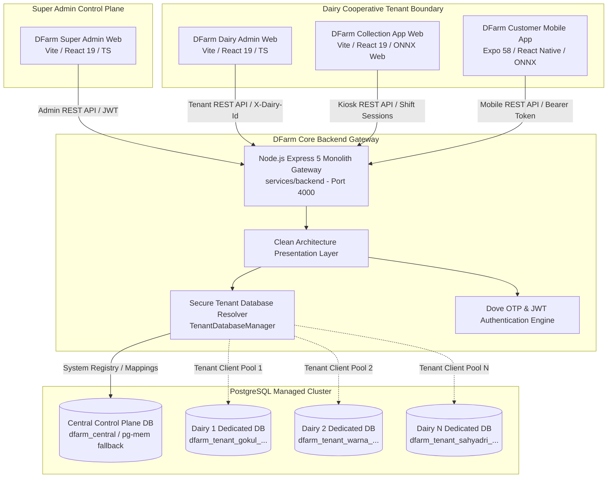

# DFARM PLATFORM MASTER ARCHITECTURE

**Audit Document Reference:** `DFARM-ARCH-001`  
**Version:** `1.0.0-PROMPT0-AUDIT`  
**Status:** `READ-ONLY TECHNICAL BASELINE`  
**Classification:** `Master Architectural Specification`  
**Evaluator:** DFarm Principal Solution Architect & Technical Audit Team  

---

## 1. Executive Summary & Architectural Invariant

The DFarm platform is a multi-tier, multi-tenant enterprise system designed for cooperative milk collection, real-time quality testing, biometric identity verification, double-entry financial accounting, and centralized operational administration.

The platform architecture strictly separates platform administration from tenant operations:
1. **Platform Hierarchy:** `SUPER ADMIN` governs the platform, provisions new Dairy tenants, and creates the root `PRIMARY DAIRY ADMIN`.
2. **Operational Node:** Every Dairy functions as a self-contained cooperative operational tenant.
3. **Target Data Architecture:** One central PostgreSQL control-plane database (`dfarm_central`) and **one separate, physically isolated PostgreSQL operational database per Dairy** (`dfarm_tenant_<code_hash>`).
4. **Client Interfaces:** Four distinct applications connect to the ecosystem:
   - **DFarm Super Admin Web** (Central Control Plane)
   - **DFarm Dairy Admin Web** (Single-Tenant Operational Governance)
   - **DFarm Customer Mobile App** (Farmer Self-Service & Onboarding)
   - **DFarm Collection App** (High-Throughput Offline-First Milk Intake Kiosk)

---

## 2. High-Level System Architecture Diagram

---

## 3. Technology Stack & Package Inventory

| Component | Source Path | Target Technology | Evaluated Version | Current Execution Reality |
| :--- | :--- | :--- | :--- | :--- |
| **Monorepo Harness** | `/` | npm workspaces | npm 10+, Node 22+ | Monorepo configuration valid across 8 workspaces. |
| **Super Admin Web** | `apps/dfarm-super-admin` | Vite + React 19 SPA | React 19.3.1, Vite 8.3.6, TS 7.0.2 | Operational UI, but 90% of business modules call client-side `mockBackend.ts`. |
| **Dairy Admin Web** | `apps/dfarm-dairy-admin` | Vite + React 19 SPA | React 19.3.1, Vite 8.3.6, TS 7.0.2 | Operational UI, client contains 2,683-line `mock-server.ts`. Backend calls hardcoded to Gokul. |
| **Customer App** | `apps/dfarm-customer-app` | Expo / React Native | Expo 58.0.0, RN 0.88.1, React 19.3.0 | Modern Greenfield app; biometric inference runs with test fallbacks; connects to backend. |
| **Collection App** | `apps/dfarm-collection-app` | Vite + React 19 SPA | React 19.3.1, Vite 8.3.6, TS 7.0.2 | Kiosk web interface with ONNX Web runtime; virtual drivers simulate analyzer/scales. |
| **Backend Service** | `services/backend` | Express 5 Monolith | Express 5.3.0, pg 8.23.1, Zod 3.24.1 | Clean Architecture routes mounted alongside legacy routes; falls back to in-memory `pg-mem`. |
| **Database DDL** | `packages/database` & `supabase` | PostgreSQL 16+ DDL | 32 migration files (001-031) | DDL scripts exist, but PostgreSQL cluster is offline; runs in ephemeral `pg-mem`. |
| **Shared Types** | `packages/shared-types` | TypeScript Types | TypeScript 5.7.2 | Domain types exported; duplicated in apps. |
| **Shared Validation** | `packages/shared-validation` | Zod Validation | Zod 3.24.1 | Common validation schemas; partially imported. |

---

## 4. Architectural Findings & Integrity Analysis

### Finding DF-ARCH-001: Absence of Physical PostgreSQL Connectivity
- **Severity:** `P0 - Critical`
- **Location:** `services/backend/src/infrastructure/database/PostgresPool.ts` (Lines 17-27, 347-365)
- **Observed Behavior:** Connection to `127.0.0.1:54322` consistently fails with `ECONNREFUSED`. The backend intercepts connection failure and initializes a virtual `pg-mem` database instance.
- **Architectural Impact:** All platform entities, dairy organizations, customers, collection transactions, and audit records reside in transient process heap memory. Any restart of the Node.js process destroys all data.

### Finding DF-ARCH-002: Dual Routing Conflict in Express Gateway
- **Severity:** `P0 - Critical`
- **Location:** `services/backend/src/app.ts` (Lines 75, 80-106)
- **Observed Behavior:** `cleanApiRouter` is mounted at `/api/v1` at Line 75. Subsequently, modular route files (`modules/customers/customer.routes.js`, `modules/collections/collection.routes.js`, etc.) are mounted directly at `/api/v1/*` at Lines 81-105.
- **Architectural Impact:** Incoming HTTP calls encounter overlapping route patterns. Request matching depends on registration order, causing subtle endpoint hijacking, inconsistent middleware execution, and silent route masking.

### Finding DF-ARCH-003: Client-Side Simulation Bypassing Backend in Super Admin
- **Severity:** `P0 - Critical`
- **Location:** `apps/dfarm-super-admin/src/api/client.ts` (Lines 1-467), `apps/dfarm-super-admin/src/services/mockBackend.ts` (Lines 1-1928)
- **Observed Behavior:** The Super Admin API client imports `mockBackend` and delegates `getDashboardMetrics()`, `getGlobalAnalytics()`, `getPlatformHealth()`, `getAlerts()`, `getAuditLogs()`, `requestSupportSession()`, and `generateReport()` directly to client-side localStorage/mock storage.
- **Architectural Impact:** The Super Admin web portal operates in a disconnected simulation sandbox for monitoring, analytics, alerts, and audit features, rather than serving as the central control plane.

### Finding DF-ARCH-004: Hardcoded Primary Dairy Admin Identity
- **Severity:** `P1 - High`
- **Location:** `services/backend/src/infrastructure/database/PostgresPool.ts` (Lines 238-249), `apps/dfarm-dairy-admin/src/api/mock-server.ts` (Lines 30-36)
- **Observed Behavior:** The primary administrator mobile `+917755995615` is statically seeded to `00000000-0000-0000-0000-000000000001` (Gokul Primary Cooperative). The Dairy Admin web client seeds `CURRENT_DAIRY_ID = 'dairy-ten-9801'` (Gokul Cooperative).
- **Architectural Impact:** Any login by the platform owner unconditionally associates the session with Gokul. When a customer registers with any other Dairy (e.g. Kalpna, Warna, Sahyadri), the owner logging into Dairy Admin is locked into Gokul, causing the pending registrations queue to appear empty.

---

## 5. Architectural Corrective Directives for Subsequent Prompts

1. **Prompt 1 Mandate:** Provision and connect a real PostgreSQL cluster. Implement central control-plane routing table `dairy_database_mappings` and replace `pg-mem` fallbacks with real PostgreSQL database connections.
2. **Prompt 2 Mandate:** Unify Express routing by dismantling conflicting duplicate route definitions. Enforce strict JWT-based tenant context resolution.
3. **Prompt 3 Mandate:** Deprecate `mockBackend.ts` in Super Admin. Wire all Super Admin dashboard, tenant, health, and audit views to genuine control-plane database endpoints.
4. **Prompt 5 & 6 Mandate:** Align Customer App registration target with Dairy Admin authentication context so that farmer applications write to and read from the exact tenant database.
