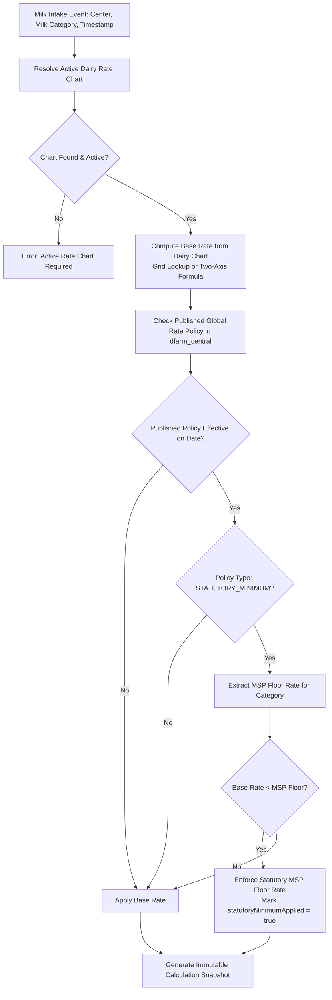

# DFARM ARCHITECTURE: CENTRAL RATE POLICY & DAIRY RATE CHART INTEGRATION

**Document ID:** `DFARM-ARCH-RPFI-001`  
**Roadmap Phase:** Roadmap Phase 09 — Financial Calculation, Farmer Settlement, Bulk Bank Payout & Reconciliation  
**Target:** Central Control Plane (`dfarm_central`) & Tenant Databases (`dfarm_tenant_<code_hash>`)  
**Status:** APPROVED ARCHITECTURAL SPECIFICATION  

---

## 1. Overview & Policy Topology

Under DFarm's federated multi-tenant architecture, pricing governance operates across two distinct relational layers:
1. **Central Control Plane (`dfarm_central`):**
   - Holds platform-wide regulatory policies: `global_rate_policies` and `global_rate_policy_versions`.
   - Defines statutory minimum support price (MSP) floor benchmarks, inter-dairy guidelines, and seasonal government subsidies.
2. **Tenant Cooperative Database (`dfarm_tenant_<code_hash>`):**
   - Holds dairy-specific commercial charts: `rate_charts`, `rate_chart_versions`, and `rate_matrix_cells`.
   - Defines daily pricing matrices (FAT $\times$ SNF grid) and two-axis formula parameters for Cow and Buffalo milk.

---

## 2. Policy Resolution & Precedence Engine

The `FinancialPolicyResolutionService` evaluates transactions using strict deterministic precedence rules:



### Precedence Rules:
1. **Quarantine of Draft & Expired Versions:**
   Only global policy versions and local rate chart versions in `PUBLISHED` / `ACTIVE` status whose `effective_from <= transaction_date` and (`effective_to IS NULL OR effective_to >= transaction_date`) are evaluated.
2. **Statutory Floor Enforcement:**
   When a central `STATUTORY_MINIMUM` policy is active, local dairy pricing cannot pay a farmer less than the published statutory floor rate. If the dairy rate chart calculates ₹ 30.00/L but statutory MSP is ₹ 32.00/L, the applied rate is clamped to ₹ 32.00/L, protecting rural producers.
3. **Immutability of Historical Transactions:**
   Publishing a new policy version today **never** triggers retroactive recalculation of historical collection transactions. Every transaction permanently preserves the foreign references and parameter checksums of the versions active at the time of milk intake.

---

## 3. Snapshot Data Contract

For every evaluated transaction, an immutable snapshot is preserved:

```typescript
export interface PricingCalculationSnapshot {
  rateChartId: string;
  rateChartVersion: number;
  globalRatePolicyId?: string;
  globalRatePolicyVersionId?: string;
  policyType?: string;
  rawRatePerLiter: number;
  statutoryMinimumApplied: boolean;
  statutoryFloorRate?: number;
  finalRatePerLiter: number;
  totalAmount: number;
  resolvedAt: string;
}
```
