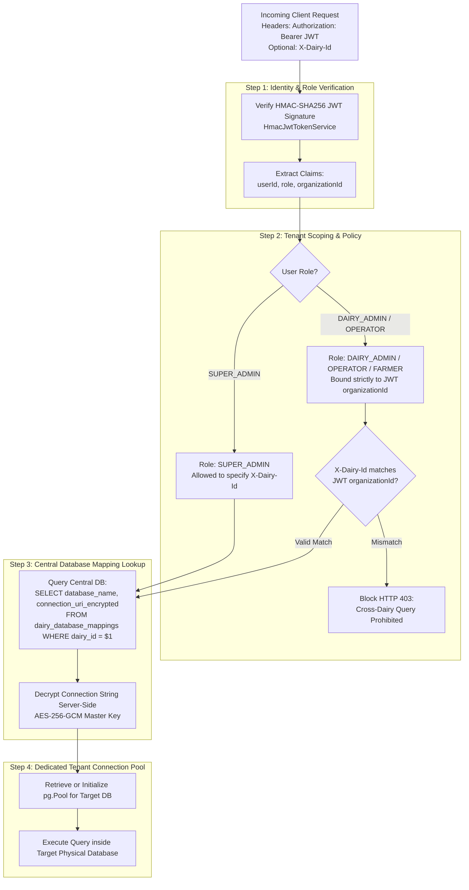

# SECURE TENANT RESOLVER AUDIT

**Audit Document Reference:** `DFARM-ARCH-006`  
**Version:** `1.0.0-PROMPT0-AUDIT`  
**Status:** `READ-ONLY TECHNICAL BASELINE`  
**Classification:** `Runtime Tenant Context & Database Connection Routing Audit`  

---

## 1. Architectural Mandate: Trusted Server-Side Resolution

A tenant database resolver must never trust client-supplied database credentials, database names, or connection strings. All connection routing must occur exclusively on the server, anchored by a cryptographically verified JWT session or central registry mapping.



---

## 2. Deep Technical Audit of Existing Tenant Resolver

### 2.1 Implementation Location
- **Primary Class:** `TenantDatabaseManager`
- **File:** `services/backend/src/infrastructure/database/TenantDatabaseManager.ts`
- **Resolution Method:** `getTenantDb(dairyId?: string): Promise<IDatabaseClient>`

### 2.2 Detailed Execution Trace

```typescript
// TenantDatabaseManager.ts - lines 185-226
public async getTenantDb(dairyId?: string): Promise<IDatabaseClient> {
  if (!dairyId) {
    // Default to control plane DB
    return this.getControlPlaneDb();
  }

  // 1. Check in-memory connection pool cache
  if (this.tenantClients.has(dairyId)) {
    return this.tenantClients.get(dairyId)!;
  }

  // 2. Check in-memory mapping cache
  const mapping = this.tenantMappings.get(dairyId);
  if (mapping) {
    // Re-provision client: CRITICAL DEFECT
    const client = this.createIsolatedMemoryDatabase(dairyId);
    await this.applyTenantMigrations(client, dairyId);
    this.tenantClients.set(dairyId, client);
    return client;
  }

  // 3. Fallback: Query control-plane DB for organization record
  const controlDb = this.getControlPlaneDb();
  if (controlDb) {
    try {
      const orgRes = await controlDb.query(
        `SELECT id, code, name FROM organizations WHERE id = $1 LIMIT 1;`,
        [dairyId]
      );
      if (orgRes.rows.length > 0) {
        const row = orgRes.rows[0];
        await this.provisionTenantDatabase(row.id, row.code || 'DAIRY', row.name || 'Dairy');
        return this.tenantClients.get(dairyId)!;
      }
    } catch {
      // Fallback
    }
  }

  // 4. Fallback: Auto-provision a dynamic in-memory tenant
  await this.provisionTenantDatabase(dairyId, `DAIRY-${dairyId.slice(0, 4).toUpperCase()}`, 'Dynamic Tenant');
  return this.tenantClients.get(dairyId)!;
}
```

---

## 3. Vulnerabilities & Architectural Deficiencies

### Vulnerability 1: Implicit In-Memory Database Creation upon Cache Miss
- **Location:** `TenantDatabaseManager.ts` (lines 196-203, 224-226)
- **Mechanism:** If `getTenantDb()` is called for any UUID:
  1. If mapped, it creates a brand new `pg-mem` database instance on every process reboot.
  2. If unmapped and not in `organizations`, it automatically auto-provisions a virtual tenant database on the fly (`Dynamic Tenant`).
- **Impact:** An attacker or misconfigured client passing random UUIDs in headers triggers silent instantiation of in-memory database heaps, leading to uncontrolled memory consumption (OOM vulnerability).

### Vulnerability 2: Header-Based Overrides Bypassing Authorization
- **Location:** `services/backend/src/presentation/routes/customers.routes.ts` (lines 36-39, 180)
- **Code:**
  ```typescript
  let organizationId = req.user?.organizationId;
  if (!organizationId) {
    organizationId = (req.query['organizationId'] as string) || 
                     (req.headers['x-dairy-id'] as string) || 
                     (req.headers['x-dairy-tenant-id'] as string);
  }
  ```
- **Mechanism:** In routes using `optionalAuthenticate` (such as `GET /api/v1/customers/pending`), if a client provides no Bearer token, the route extracts the tenant context directly from `x-dairy-id` or query parameters without verifying caller permissions.
- **Impact:** Any unauthenticated caller can query any Dairy's pending registrations by guessing or discovering its UUID (`IDOR` vulnerability).

### Vulnerability 3: Multi-Database Scatter-Gather Lookup in Repositories
- **Location:** `services/backend/src/infrastructure/repositories/PostgresCustomerRepository.ts` (lines 135-144, 191-197, 233-239)
- **Mechanism:** When `findById(id)` is called without an explicit `organizationId`, the repository executes a scatter-gather loop across **all tenant databases registered on the system**:
  ```typescript
  for (const m of tenantDbManager.getAllMappings()) {
    targetClients.push(await tenantDbManager.getTenantDb(m.dairyId));
  }
  ```
- **Impact:** This violates physical tenant isolation. A customer ID from Dairy A can be returned to a caller who has no authorized relationship with Dairy A.

---

## 4. Hardened Target Specification for Prompt 1

1. **Mandatory Authenticated Context:** Tenant resolution must only occur for verified identities where `req.user.organizationId` is authenticated.
2. **Strict Super Admin Authorization:** Only users with `req.user.role === 'SUPER_ADMIN'` may supply an override `X-Dairy-Id` header to inspect another tenant.
3. **Encrypted Connection String Storage:** `dairy_database_mappings` must store `connection_uri_encrypted` (AES-256-GCM). Upon resolution, the URI is decrypted server-side and mapped to a persistent `pg.Pool` cache: `Map<string, pg.Pool>`.
4. **Pool Resource Limits:** Tenant connection pools must be constrained (e.g. `max: 5` connections per tenant, `idleTimeoutMillis: 30000`) with eviction policies to prevent connection exhaustion on the PostgreSQL cluster.
5. **Elimination of Fallback In-Memory Spawning:** If a requested Dairy ID is not mapped or fails connection, the resolver must throw a `TenantDatabaseNotFoundError` resulting in HTTP 404 / 503, never silently spawning virtual mock databases.
