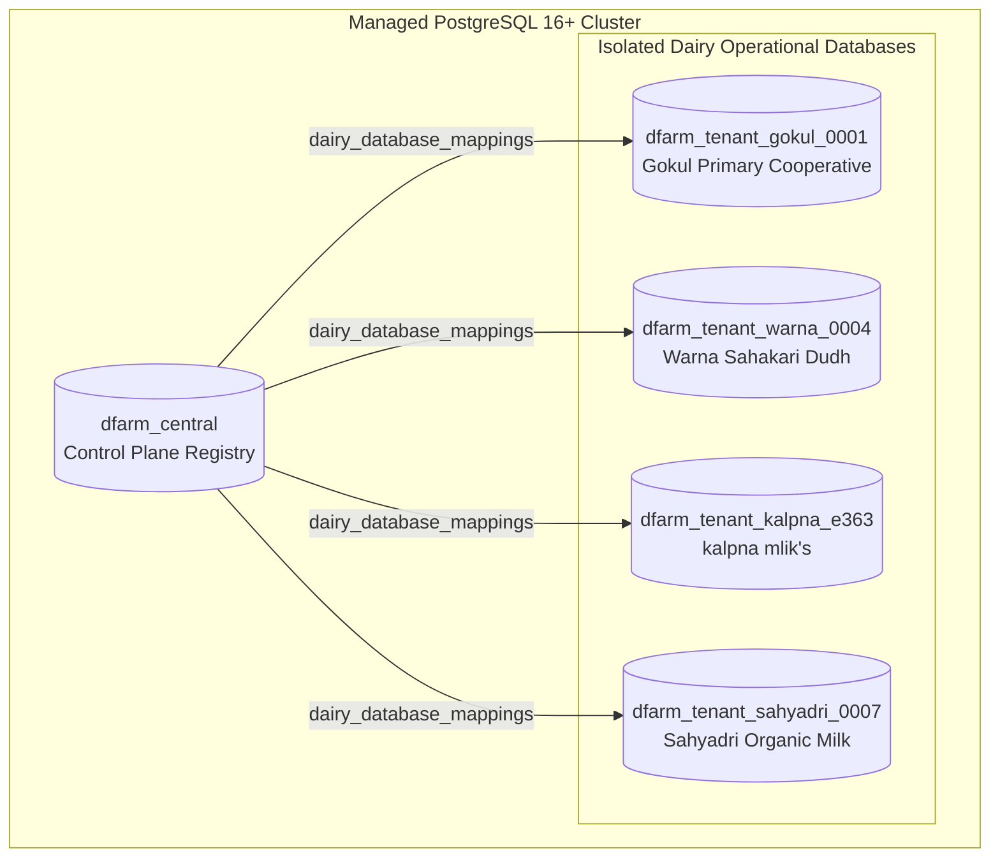
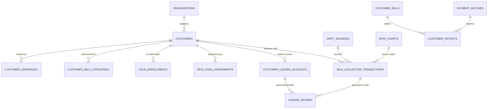

# TENANT DATABASE ARCHITECTURE AUDIT

**Audit Document Reference:** `DFARM-ARCH-004`  
**Version:** `1.0.0-PROMPT0-AUDIT`  
**Status:** `READ-ONLY TECHNICAL BASELINE`  
**Classification:** `Dedicated Operational Database Architecture Audit`  

---

## 1. Architectural Mandate: Physical Multi-Database Isolation

The owner-confirmed target architecture for DFarm is **One Managed PostgreSQL Cluster with One Separate Physical PostgreSQL Database per Dairy Tenant**.

It is **not** a shared-table-per-dairy model (`WHERE dairy_id = ...`).  
It is **not** a single database partitioned solely by PostgreSQL schemas.  
Every operational Dairy must receive its own distinct physical PostgreSQL database.



---

## 2. Dedicated Tenant Operational Database Schema

Each tenant database hosts the operational business tables required for that Dairy's daily transactions:



### Table Inventory in Every Tenant Database

| Table Name | Origin Migration | Purpose & Invariant |
| :--- | :--- | :--- |
| `organizations` | `002_organizations_and_centers.sql` | Tenant organization profile (single row representing this dairy). |
| `dairy_centers` | `002_organizations_and_centers.sql` | Operational collection centers and BMCs under this dairy. |
| `users` | `003_user_identity_foundation.sql` | Center managers, collection operators, and accountants for this dairy. |
| `user_center_assignments` | `003_user_identity_foundation.sql` | Operators assigned to specific collection centers. |
| `customers` | `004_customer_identity.sql` | Registered farmers under this dairy. Contains bank details & approval status. |
| `customer_addresses` | `004_customer_identity.sql` | Farmer residential locality, taluka, and village. |
| `customer_milk_categories`| `004_customer_identity.sql` | Permissions for COW, BUFFALO, or BOTH milk supply. |
| `customer_consent_records` | `004_customer_identity.sql` | Explicit biometric consent audit trail. |
| `face_model_versions` | `005_face_and_rfid.sql`, `013` | YuNet & SFace INT8 128-D model version descriptors and thresholds. |
| `face_enrollments` | `005_face_and_rfid.sql` | Encrypted 128-D face embeddings (AES-256-GCM), IV, auth tag, quality score. |
| `rfid_cards` | `005_face_and_rfid.sql` | Physical Mifare/NFC RFID cards registered to this dairy. |
| `rfid_card_assignments` | `005_face_and_rfid.sql` | Active/historical mapping of RFID cards to farmers. |
| `rate_charts` | `007_rate_management.sql`, `018` | Dairy-specific milk rate charts with effective date ranges. |
| `rate_chart_grids` | `007_rate_management.sql`, `018` | FAT/SNF pricing matrices (e.g. FAT 3.0-10.0, SNF 7.0-10.5). |
| `shift_sessions` | `008_collection_sessions.sql`, `027` | Morning/Evening collection sessions tied to specific kiosks. |
| `milk_collection_transactions`| `008`, `017` | Immutable collection intake records (FAT, SNF, CLR, Weight, Total Amount). |
| `customer_ledger_accounts`| `009_customer_ledger.sql`, `019` | Double-entry balance accumulator for each customer. |
| `ledger_entries` | `009_customer_ledger.sql`, `019` | Append-only financial debit/credit journal entries. |
| `monthly_billing_cycles` | `020_automated_monthly_billing.sql`| Closed billing cycle records. |
| `customer_bills` | `020_automated_monthly_billing.sql`| Frozen itemized milk bills for a billing period. |
| `payment_batches` | `021_customer_payouts_batches.sql` | Grouped NEFT / Bank payout batches. |
| `customer_payouts` | `021_customer_payouts_batches.sql` | Individual payout line items with UTR reconciliation. |
| `feed_products` | `014_feed_inventory.sql` | Cattle feed catalog and pricing. |
| `feed_inventory_movements`| `014_feed_inventory.sql` | Stock procurement, returns, and inventory counts. |
| `customer_feed_sales` | `014_feed_inventory.sql` | Feed sales debited directly to farmer ledger accounts. |
| `devices` | `010_devices_sync_and_audit.sql` | Hardware devices (analyzers, scales, RFID readers) paired with this dairy. |
| `sync_events` | `010_devices_sync_and_audit.sql` | Idempotent sync queue for offline collection events. |
| `audit_logs` | `010_devices_sync_and_audit.sql` | Tenant operational audit history. |

---

## 3. Current Implementation Deficiencies & Failure Modes

### Defect 1: Ephemeral In-Memory Database Fallback
- **Location:** `services/backend/src/infrastructure/database/TenantDatabaseManager.ts` (lines 137-142, 196-203, 339-399)
- **Current Behavior:** Because the PostgreSQL server is not connected, `TenantDatabaseManager` instantiates an isolated `pg-mem` virtual database for each dairy on demand.
- **Root Cause:** In `getTenantDb(dairyId)`:
  ```typescript
  const mapping = this.tenantMappings.get(dairyId);
  if (mapping) {
    const client = this.createIsolatedMemoryDatabase(dairyId);
    await this.applyTenantMigrations(client, dairyId);
    this.tenantClients.set(dairyId, client);
    return client;
  }
  ```
  Every time a connection is fetched for an existing mapping after a service restart, **a completely blank in-memory database is created**, executing DDL from scratch and wiping all customer registrations, collections, and ledger records.

### Defect 2: Schema Isolation vs Physical Database Creation Fallback
- **Location:** `TenantDatabaseManager.ts` (lines 272-337)
- **Current Behavior:** When Postgres is available, `createPostgresTenantResource` executes `CREATE DATABASE "${dbName}"`. If the database user lacks `CREATEDB` permissions (standard on managed cloud services like Supabase, AWS RDS, or DigitalOcean), the `catch` block falls back to `CREATE SCHEMA IF NOT EXISTS "${schemaName}"`.
- **Architectural Deviation:** Creating schemas within a single database (`tenant_00000000_...`) violates the strict requirement for separate PostgreSQL databases. Furthermore, search path isolation (`SET search_path TO ...`) in connection pools is notorious for connection contamination if clients are released back to the pool without resetting the search path.

### Defect 3: Cross-Tenant Customer Repository Search Leakage
- **Location:** `services/backend/src/infrastructure/repositories/PostgresCustomerRepository.ts` (lines 136-143, 192-196, 234-238)
- **Current Behavior:** When `findById()`, `findByRfid()`, or `findByPhone()` is invoked without an explicit `organizationId`:
  ```typescript
  const mappings = tenantDbManager.getAllMappings();
  for (const m of mappings) {
    const cl = await tenantDbManager.getTenantDb(m.dairyId);
    targetClients.push({ client: cl, orgId: m.dairyId });
  }
  targetClients.push({ client: db, orgId: '' });
  ```
- **Security Breach:** The repository iterates through **every single tenant database on the platform**, querying each one sequentially until a match is found. This breaks tenant isolation and creates a serious cross-dairy data lookup vulnerability (Finding `DF-SEC-001`).
