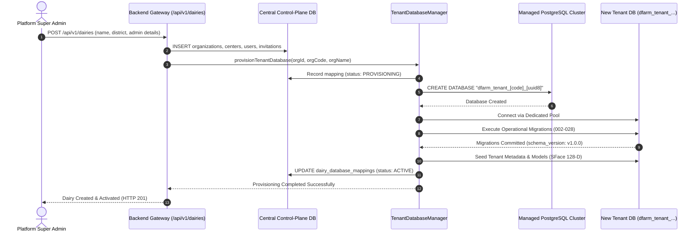

# TENANT DATABASE PROVISIONING AUDIT

**Audit Document Reference:** `DFARM-ARCH-005`  
**Version:** `1.0.0-PROMPT0-AUDIT`  
**Status:** `READ-ONLY TECHNICAL BASELINE`  
**Classification:** `Automated Database Lifecycle & Provisioning Engine Audit`  

---

## 1. Intended Automated Provisioning Flow

When a Super Admin registers a new Dairy on the platform, the platform must provision a new, isolated PostgreSQL database without requiring manual DBA intervention.



---

## 2. Deep Technical Audit of Existing Provisioning Implementation

### 2.1 Trigger Point in Backend API
- **Location:** `services/backend/src/presentation/routes/dairies.routes.ts` (lines 1128-1135)
- **Code:**
  ```typescript
  let tenantDbMapping = null;
  try {
    tenantDbMapping = await tenantDbManager.provisionTenantDatabase(orgId, orgCode, name.trim());
  } catch (err: any) {
    logger.error({ error: err.message, orgId, orgCode }, 'Tenant database provisioning encountered an issue');
  }
  ```
- **Audit Findings:** The route attempts provisioning asynchronously after inserting the organization record. However, if provisioning fails or throws an exception, the HTTP response **still returns HTTP 201 Created** (`responseData`), leaving the dairy in an un-provisioned or half-provisioned zombie state.

### 2.2 Database Creation Execution
- **Location:** `services/backend/src/infrastructure/database/TenantDatabaseManager.ts` (lines 113-183, 268-337)
- **Database Naming Convention:**
  ```typescript
  const cleanCode = dairyCode.toLowerCase().replace(/[^a-z0-9]/g, '_');
  const dbName = `dfarm_tenant_${cleanCode}_${dairyId.slice(0, 8)}`;
  ```
  Example generated name: `dfarm_tenant_df_kop_1234_e363070f`.
- **Audit Findings:**
  1. **Privilege Limitation:** `rootPool.query('CREATE DATABASE "${dbName}";')` requires the connecting user to hold the `CREATEDB` attribute in PostgreSQL. On typical managed cloud databases (such as Supabase, AWS Aurora/RDS default master, or Heroku), `CREATE DATABASE` cannot be executed from standard pooled client connections.
  2. **Silently Downgrading Catch Block:** When `CREATE DATABASE` fails, `createPostgresTenantResource` silently falls back to creating a schema:
     ```typescript
     const schemaName = `tenant_${dairyId.replace(/[^a-zA-Z0-9]/g, '_')}`;
     await rootPool.query(`CREATE SCHEMA IF NOT EXISTS "${schemaName}";`);
     ```
     This fallback silently breaks the architecture requirement (separate physical databases) without alerting the administrator or recording a warning in the database mapping record.

### 2.3 Migration Execution & Verification
- **Location:** `TenantDatabaseManager.ts` (lines 401-461)
- **Applied Migrations List:**
  ```typescript
  const operationalMigrationFiles = [
    '002_organizations_and_centers.sql',
    '003_user_identity_foundation.sql',
    '004_customer_identity.sql',
    '005_face_and_rfid.sql',
    '006_customer_identification_audit.sql',
    '007_rate_management.sql',
    '008_collection_sessions_and_transactions.sql',
    '009_customer_ledger.sql',
    '010_devices_sync_and_audit.sql',
    '027_kiosk_shift_sessions_and_sface128_seed.sql',
    '028_dairy_location_coordinates_and_address.sql',
  ];
  ```
- **Audit Findings:**
  1. **Truncated Migration Sequence:** Only 11 of the 32 migration files in `supabase/migrations/` are applied to newly provisioned tenant databases. Critical accounting, double-entry ledger, feed procurement, monthly billing, and batch payouts migrations are **completely omitted**:
     - `014_feed_inventory_procurement_and_sales.sql` (Omitted)
     - `017_milk_collection_workflow_and_atomic_ledger.sql` (Omitted)
     - `018_milk_rate_management_system.sql` (Omitted)
     - `019_customer_accounting_and_double_entry_ledger.sql` (Omitted)
     - `020_automated_monthly_billing_and_settlements.sql` (Omitted)
     - `021_customer_payouts_batches_and_reconciliation.sql` (Omitted)
  2. **Regex DDL Stripping:** The file parser strips PostgreSQL triggers, policies, and functions with:
     ```typescript
     if (/^CREATE\s+TRIGGER/i.test(stmt) || /^CREATE\s+POLICY/i.test(stmt) || ...) continue;
     ```
     While this avoids `pg-mem` parsing errors in virtual mode, running this against real PostgreSQL leaves the tenant database without essential data integrity triggers (such as `trigger_set_updated_at` and double-entry balance check constraints).

### 2.4 Provisioning Status Persistence
- **Table:** `dairy_database_mappings`
- **Location:** `TenantDatabaseManager.ts` (lines 164-178)
- **Persistence Query:**
  ```sql
  INSERT INTO dairy_database_mappings (
    id, dairy_id, dairy_code, database_name, resource_type,
    schema_version, provisioning_status, provisioned_at, last_verified_at
  ) VALUES ($1, $2, $3, $4, $5, $6, $7, NOW(), NOW())
  ON CONFLICT (dairy_id) DO UPDATE SET ...
  ```
- **Audit Findings:** If the central control-plane database is unavailable or running in offline mode, the catch block logs a warning and stores the mapping **only in an in-memory Map** (`this.tenantMappings`). Consequently, any node restart permanently forgets the tenant mapping.

---

## 3. Provisioning Failure Matrix & Recovery Requirements

| Failure Scenario | Current Behavior | Required Prompt 1 Behavior |
| :--- | :--- | :--- |
| **PostgreSQL Cluster Unreachable** | Creates in-memory `pg-mem` database; returns HTTP 201 Created. | Abort onboarding with HTTP 503; record `FAILED` status in central mapping; do not issue admin activation link. |
| **`CREATEDB` Permission Denied** | Silently falls back to schema isolation `tenant_[id]`. | Dedicated PostgreSQL master connection with verified administrative privileges; reject schema fallback if physical DB requested. |
| **Migration SQL Syntax Failure** | Swallows errors in empty `catch {}` block; continues loop. | Halt transaction; roll back database creation; record exact SQL error in `provisioning_error`. |
| **Process Crash During Migration**| Orphaned empty database left; central mapping missing or wrong. | Transactional state machine (`PENDING` -> `PROVISIONING` -> `ACTIVE` / `FAILED`) with automated cleanup worker. |
