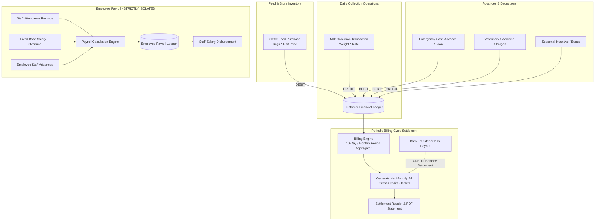

# DFarm: Financial & Dairy Accounting Architecture

This document specifies the financial principles, rate matrix structures, immutable double-entry ledger mechanisms, periodic billing workflows, and the strict structural isolation between dairy customer accounting and employee payroll.

---

## 1. Financial Ledger Architecture & Transaction Flow

The DFarm financial engine operates as an append-only double-entry ledger. Direct balance overwrites are strictly prohibited. The current balance for any farmer is calculated as the sum of all immutable credit and debit entries.

---

## 2. The 14 Independent Financial Modules

### 2.1 Cow Milk Rate Management
Maintains independent rate grids and formulas specifically tailored to cow milk density, fat yield, and state dairy cooperative norms. Supports both grid matrices (fat $\times$ SNF) and TS (Total Solids) formula pricing.

### 2.2 Buffalo Milk Rate Management
Maintains higher-fat pricing structures (typically 5.0% to 12.0% Fat, 8.2% to 11.5% SNF) reflecting the higher commercial market value of buffalo milk solids. Operates completely independently of cow rate structures.

### 2.3 Fat/SNF Pricing Rules
Defines base standards (e.g., Cow base: 3.5% Fat, 8.5% SNF; Buffalo base: 6.0% Fat, 9.0% SNF) and increment/decrement step values per 0.1% deviation.

### 2.4 Historical Rate Versions & Snapshot Immutability
Rate charts possess strict `effective_from` and `effective_to` timestamps. When an organization updates rate charts, the collection records store a foreign key to the exact `rate_chart_id` active at collection time. Retroactive rate changes **never mutate historical collection records or ledger entries**.

### 2.5 Customer Ledger
Append-only table tracking every financial transaction linked to a farmer's canonical `customer_uuid`. Every entry records:
- `transaction_type`: `MILK_CREDIT`, `FEED_DEBIT`, `ADVANCE_DEBIT`, `DEDUCTION_DEBIT`, `PAYMENT_CREDIT`.
- `amount`: Fixed-point numeric value with two decimal places (`NUMERIC(10,2)`).
- `reference_type` & `reference_id`: Foreign key traceability to the source collection slip, feed sale invoice, or payment voucher.

### 2.6 Milk Collection Credits
Automated credit posted synchronously with milk collection intake:
$$\text{Credit} = \text{Weight (kg)} \times \text{Applied Rate (₹/kg)}$$

### 2.7 Feed Purchase Debits
Automated debit posted when a farmer purchases cattle feed or mineral supplements on credit from the dairy store.

### 2.8 Advance and Loan Debits
Tracks emergency cash advances disbursed to farmers, with configurable installment deduction schedules applied during billing cycles.

### 2.9 Authorized Deductions
Configurable periodic deductions, including artificial insemination (AI) charges, veterinary doctor visit fees, cattle insurance premiums, and cooperative membership dues.

### 2.10 Customer Payments
Records settlements paid out to the farmer (via direct bank transfer, UPI, or cash) against approved billing statements.

### 2.11 Monthly / 10-Day Billing Engine
Aggregates ledger transactions across a configurable billing cycle (e.g., 1st to 10th, 11th to 20th, 21st to end-of-month, or full calendar month):
$$\text{Net Payable} = \sum \text{Milk Credits} - \left( \sum \text{Feed Debits} + \sum \text{Advance Deductions} + \sum \text{Other Deductions} \right)$$

### 2.12 Payment Reconciliation
Reconciles disbursed payment batches with bank account statements or cash register balances, flagging uncashed cheques or failed NEFT/IMPS transfers.

### 2.13 Feed Inventory and Sales
Warehouse inventory tracking stock receipts from feed suppliers, unit purchase costs, minimum threshold alerts, and retail sales price lists.

### 2.14 Independent Employee Payroll
A completely isolated accounting domain tracking dairy staff, supervisors, and milk collectors. Staff salaries, shift overtime, and personal advances are processed within `payroll_runs` and **never touch the customer ledger**.

---

## 3. Financial Calculation Standards

### 3.1 Strict Decimal Arithmetic
To prevent floating-point rounding errors (e.g., `0.1 + 0.2 = 0.30000000000000004`), all financial values in application code must be handled using arbitrary-precision decimal libraries (`decimal.js` in TypeScript / Node.js, `BigDecimal` in Java/Android) and stored as `NUMERIC(10,2)` in PostgreSQL and SQLite.

### 3.2 Rounding Rules
All monetary calculations enforce standard commercial half-up rounding:
$$\text{Amount} = \text{round}(\text{Weight} \times \text{Rate}, 2, \text{ROUND\_HALF\_UP})$$

### 3.3 Abstract Payment Provider Integration Boundary
The financial architecture defines abstract payment contracts (`PaymentProviderInterface`). Specific third-party payout gateways (e.g., RazorpayX, Cashfree Payouts, Direct Bank NEFT Excel Export) are treated as pluggable future adaptors and are not hardcoded into core ledger transactions.

