# DFarm Admin Web Dashboard — Architecture Specification

## 1. Executive Summary
The DFarm Admin Web Dashboard is designed as an enterprise Single Page Application (SPA) serving high-volume rural and semi-urban dairy cooperative networks. It operates as the centralized nerve center, consolidating real-time field hardware telemetry, double-entry financial ledgers, cattle feed inventory POS, human capital payroll, and regulatory reporting.

---

## 2. Operational KPIs & Data Sourcing Architecture

| KPI Name | Source Backend Table / Engine | Calculation Mechanism |
|---|---|---|
| **Today's Cow Milk Quantity** | `milk_collections` | `SUM(net_weight) WHERE selected_milk_category = 'COW' AND business_date = :date` |
| **Today's Buffalo Milk Quantity** | `milk_collections` | `SUM(net_weight) WHERE selected_milk_category = 'BUFFALO' AND business_date = :date` |
| **Total Milk Collections** | `milk_collections` | `COUNT(*) WHERE session_state = 'COMPLETED' AND business_date = :date` |
| **Morning Shift Summary** | `milk_collections` | Aggregated quantity, amount, average FAT and SNF for `shift_type = 'MORNING'` |
| **Evening Shift Summary** | `milk_collections` | Aggregated quantity, amount, average FAT and SNF for `shift_type = 'EVENING'` |
| **Total Milk Value** | `milk_collections` | `SUM(total_amount)` authoritative pricing from active rate matrix |
| **Active Customers** | `customers` | `COUNT(*) WHERE status = 'ACTIVE' AND is_deleted = FALSE` |
| **Pending KYC Registrations** | `customers` | `COUNT(*) WHERE status = 'PENDING_VERIFICATION' AND is_deleted = FALSE` |
| **Active Employees** | `employees` | `COUNT(*) WHERE status = 'ACTIVE'` |
| **Feed Stock Alerts** | `feed_inventory` | Count of SKUs with `current_stock <= reorder_level` |
| **Pending Bills** | `farmer_monthly_bills` | Count of bills with `status IN ('DRAFT', 'SUBMITTED')` |
| **Customer Payables** | `customer_ledger_accounts` | `SUM(current_balance) WHERE current_balance > 0` (Account 2100) |
| **Outstanding Advances** | `customer_advances` | `SUM(balance_amount) WHERE status IN ('APPROVED', 'DISBURSED', 'RECOVERING')` |
| **Pending Payouts** | `customer_payouts` | `SUM(amount) WHERE status IN ('DRAFT', 'SUBMITTED', 'APPROVED')` |
| **Failed Sync Events** | `sync_conflict_logs` | Count of unresolved sync conflicts |
| **Device Fleet Status** | `registered_devices` | Count of active terminals and offline policy authorizations |

---

## 3. High-Level Architecture Diagram

```mermaid
flowchart TD
    subgraph UI_Layer["Admin Web Dashboard (React + TypeScript)"]
        Nav["Sidebar & Role Navigation"]
        Dash["Operational Dashboard (15 KPIs)"]
        Cust["Customer Management & Biometrics Shield"]
        Coll["Milk Collections & Thermal Slips"]
        Rate["Rate Matrix & Pricing Simulator"]
        Acct["Accounting, Billing & PDF Statements"]
        Feed["Feed Store & POS (P14)"]
        Emp["Staff & Payroll (P16)"]
        Dev["Terminals & Sync Gateway"]
        Rep["Authoritative Reports & CSV Export"]
    end

    subgraph API_Layer["API Client & Middleware (Axios / Fetch)"]
        AuthM["JWT Session & Center Context"]
        SecM["Biometric Vector Stripper"]
        AuditM["Correlation ID (X-Request-Id)"]
    end

    subgraph Backend_Services["Express.js Microservices Layer"]
        DashSvc["Dashboard Service"]
        CustSvc["Customer Service"]
        CollSvc["Collection Engine"]
        RateSvc["Pricing & Rate Engine (P11)"]
        BillSvc["Monthly Billing Engine (P13)"]
        PaySvc["Payments & Batch Engine (P15)"]
        SyncSvc["Sync & Device Gateway (P08)"]
        FeedSvc["Feed POS Service (P14)"]
        EmpSvc["Employee & Payroll Service (P16)"]
    end

    subgraph Data_Layer["PostgreSQL 16 Relational Engine"]
        DB[(71 Public Tables & Double-Entry Ledger)]
    end

    UI_Layer --> API_Layer
    API_Layer --> Backend_Services
    Backend_Services --> Data_Layer
```

---

## 4. Key Subsystem Integrations

### 4.1 Milk Collections & Thermal Slips
- Collects milk weight, Fat %, SNF %, and calculated unit price.
- Sources label: `MANUAL_OVERRIDE`, `AUTO_SCALE_BRIDGE`, or `MILK_ANALYZER`.
- Offers 40-column monospace thermal receipt preview (`window.print()`).
- Supervisor adjustments create compensating double-entry adjusting journals without erasing original records.

### 4.2 Rate Matrix Management
- Multi-dimensional matrix grid of Fat (rows) $\times$ SNF (columns).
- Version lifecycle: `DRAFT` $\rightarrow$ `SUBMITTED` $\rightarrow$ `APPROVED` $\rightarrow$ `PUBLISHED`.
- Published historical versions are immutable; creating a new version branches from effective dates.

### 4.3 Billing & Settlement Subledger
- Automatically deducts cattle feed store sales and advance loan installments from gross milk revenue.
- Generates tamper-proof SHA-256 statements.
- Direct PDF downloads through authenticated binary streams (`/api/v1/billing/:id/pdf`).

### 4.4 Hardware Terminals & Offline Policy
- Enforces cryptographic offline policies (up to 72 hours).
- Provides audit trails for sync conflicts and idempotency deduplication.
- Protects terminal private keys and avoids transmitting raw biometric templates.
