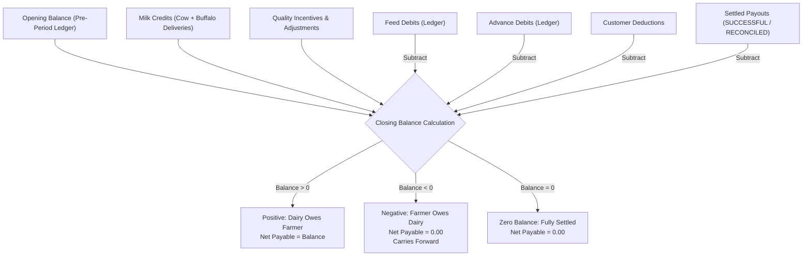
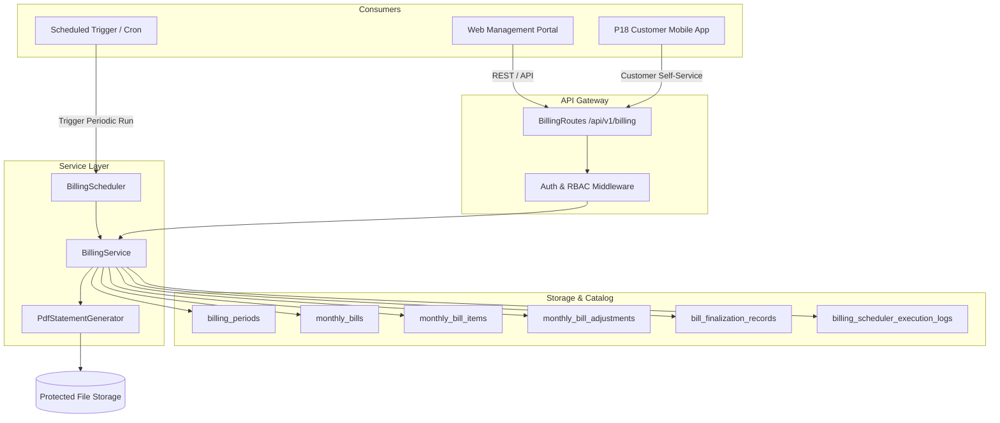
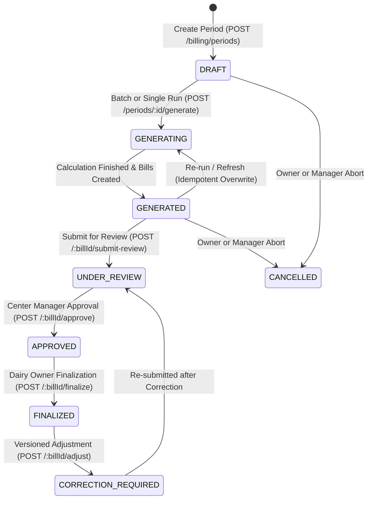

# DFarm Billing & Customer Settlement Architecture

## 1. Executive Summary & Purpose

Phase 13 of DFarm introduces the **Automatic Monthly Billing, Customer Settlement & Statement Generation Engine**. The purpose of this engine is to automatically, idempotently, and deterministically compute periodic settlement balances for dairy farmers (producers), generate itemized collection breakdown statements, calculate net debits and credits, enforce financial immutability, and generate tamper-evident PDF settlement statements.

The design adheres to the core DFarm accounting tenets:
- **Canonical Customer Reference**: Every customer bill is pinned to the customer's canonical UUID.
- **Exact PostgreSQL NUMERIC Precision**: Absolute avoidance of floating-point inaccuracies (`NUMERIC(14,2)` for currency and `NUMERIC(10,2)` for milk weights).
- **Physical Milk Measurement Purity**: Total segregation between Cow and Buffalo deliveries. Strict preservation of canonical P10 units (`KG` default) without silent conversions.
- **Strict Cash vs. Accrual Settlement Boundaries**: Only payouts that have reached `SUCCESSFUL` or `RECONCILED` status reduce the dairy's payable liability; pending or submitted payouts are strictly excluded.
- **Immutability of Finalized Bills**: Direct SQL mutations on `FINALIZED` bills and periods are blocked at the database kernel level via PostgreSQL triggers. Corrections require versioned adjustments (`monthly_bill_adjustments`) and audited status transitions.
- **Self-Service Customer Privacy (P18 Mobile Ready)**: Customers can view and download only their own statements and PDFs; cross-customer access is prevented via role-based access control and RLS.

---

## 2. Core Financial Model

### 2.1 The Settlement Formula

For any billing period $[T_{start}, T_{end}]$, the settlement equation is defined as:

$$\text{Closing Balance} = \text{Opening Balance} + \text{Total Period Credits} - \text{Total Period Debits} - \text{Settled Payouts}$$

Where:
- **Opening Balance**: The customer's subledger balance immediately prior to $T_{start}$ ($< T_{start}$). If no transactions occurred prior to $T_{start}$, Opening Balance = `0.00`.
- **Total Period Credits**:
  - Gross Milk Value delivered during $[T_{start}, T_{end}]$ with status `COMPLETED`.
  - Authorized incentive adjustments or quality bonuses applied during the period.
- **Total Period Debits**:
  - Feed store purchases recorded in the ledger (`FEED_PURCHASE_DEBIT`) during $[T_{start}, T_{end}]$.
  - Cash/bank advance disbursements recorded in the ledger (`ADVANCE_DEBIT`) during $[T_{start}, T_{end}]$.
  - Authorized customer deductions (`customer_deductions`) applicable to the billing period.
  - Other penalty or equipment recovery debits.
- **Settled Payouts**:
  - Payments made by the dairy to the customer (`customer_payments` or ledger `PAYMENT_PAYOUT_DEBIT`) that are in `SUCCESSFUL` or `RECONCILED` status.
  - **CRITICAL**: Payouts in `PENDING`, `SUBMITTED`, or `FAILED` status **MUST NEVER** reduce the closing balance.

### 2.2 Balance Polarity & Net Payable Rules

The financial sign convention is uniform across all DFarm subledgers:
- **Positive Balance ($\text{Closing Balance} > 0.00$)**: The dairy owes money to the customer.
  - $\text{Net Payable Amount} = \text{Closing Balance}$.
  - $\text{is\_negative\_balance} = \text{FALSE}$.
- **Negative Balance ($\text{Closing Balance} < 0.00$)**: The customer owes money to the dairy (e.g. advance exceeded milk delivery value).
  - $\text{Net Payable Amount} = 0.00$ (The dairy does NOT execute a payout to the farmer).
  - $\text{is\_negative\_balance} = \text{TRUE}$.
  - The negative balance carries forward as the opening balance for the subsequent period.
- **Zero Balance ($\text{Closing Balance} = 0.00$)**: Accounts are fully settled.
  - $\text{Net Payable Amount} = 0.00$.

---

## 3. High-Level Architecture Components

The billing system is composed of five distinct decoupled subsystems:

### 3.1 Subsystem Responsibilities

1. **BillingService (`services/backend/src/modules/billing/billing.service.ts`)**:
   - Manages billing period lifecycle (`DRAFT` $\to$ `GENERATING` $\to$ `GENERATED` $\to$ `UNDER_REVIEW` $\to$ `APPROVED` $\to$ `FINALIZED`).
   - Executes batch and single-customer statement calculations.
   - Preserves audit trails, creates versioned adjustments, and seals final bills.
   - Streams PDF statements with cryptographically verified checksums.

2. **PdfStatementGenerator (`services/backend/src/modules/billing/pdf-statement.generator.ts`)**:
   - Generates deterministic, vector-grade A4 statements using `pdfkit`.
   - Embeds bilingual headers (English / Marathi terminology), masked customer mobile numbers, detailed collection breakdown, financial balance boxes, and validation checksums.
   - Computes SHA-256 hashes of generated artifacts for non-repudiation.

3. **BillingScheduler (`services/backend/src/modules/billing/billing.scheduler.ts`)**:
   - Executes periodic billing checks against center configurations.
   - Default frequency: `CALENDAR_MONTH` (e.g. 1st of every month for the preceding calendar month).
   - Generates drafts and marks periods `GENERATED` without auto-finalizing, maintaining mandatory human review by Center Managers and Dairy Owners.
   - Logs execution outcomes in `billing_scheduler_execution_logs`.

4. **REST API Controllers (`services/backend/src/modules/billing/billing.routes.ts`)**:
   - Exposes authenticated endpoints under `/api/v1/billing/*`.
   - Enforces center scoping for staff and customer profile isolation for farmers.

5. **Database Immutability Triggers (`supabase/migrations/014_...sql`)**:
   - `enforce_finalized_period_immutability()` prevents silent alterations on finalized bills.
   - Partial unique indexes prevent overlapping billing periods for the same center.

---

## 4. Lifecycle & State Machine

### State Definitions:
- **DRAFT**: Period boundaries are defined, but statements have not yet been generated.
- **GENERATING**: Calculations are in progress across milk deliveries and ledger transactions.
- **GENERATED**: Bills and itemized lines have been synthesized; visible to accountants for preview.
- **UNDER_REVIEW**: Submitted by the billing operator for managerial verification.
- **APPROVED**: Signed off by the Center Manager as accurate against intake and store registers.
- **FINALIZED**: Sealed by Dairy Owner or Super Admin. PDF statement checksum stored in `bill_finalization_records`. Immutability trigger active.
- **CORRECTION_REQUIRED**: A versioned credit/debit adjustment was applied to a finalized or approved bill; bill version increments and requires re-approval.
- **CANCELLED**: Period discarded before finalization.

---

## 5. Security & Isolation Architecture

1. **Center Scoping for Staff**:
   - `CENTER_MANAGER` and `ACCOUNTANT` users can only generate, list, preview, approve, or adjust bills belonging to centers assigned in `user_center_assignments`. Cross-center actions return `403 FORBIDDEN (CENTER_ACCESS_DENIED)`.
   - `DAIRY_OWNER` and `SUPER_ADMIN` possess organization-wide authority.

2. **Customer Self-Service Isolation (P18 Mobile Readiness)**:
   - When authenticated with `FARMER_CUSTOMER` role, the API rejects any query where `:customerId` does not strictly match `token.customerProfile.customerId`.
   - Cross-customer access attempts return `403 FORBIDDEN (CUSTOMER_ISOLATION_VIOLATION)`.
   - Farmer statements mask sensitive details (e.g. mobile displayed as `+91 98*****4210`).

3. **Storage Security**:
   - Statement PDFs are stored in private local directories (`storage/statements/{periodId}/...`) or secure S3/GCS buckets with pre-signed URL access. Public directory listing is strictly disabled.
   - Every finalized bill stores its SHA-256 integrity hash, allowing verification of authentic statement copies against tampering.
