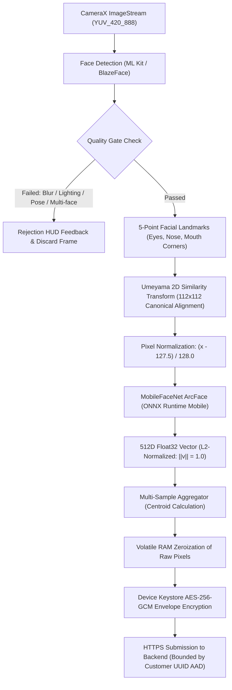

# DFarm Biometric Architecture: Face Recognition & Processing Pipeline

## 1. Executive Summary & Architectural Scope

Phase 07 introduces a consent-based biometric face enrollment and local recognition engine tailored for rural dairy collection centers operating under variable lighting, network intermittency, and low-cost Android hardware.

The biometric subsystem is anchored to the canonical customer identity (`customers.id` UUIDv4) established in Phase 04 and registered via the Android Registration App in Phase 06. Biometric features exist strictly as an authentication modality linked to this persistent identity—no isolated or detached customer records are ever created.

---

## 2. Model Evaluation & Selection Analysis

### 2.1 Comparative Analysis Matrix

| Evaluation Criteria | MobileFaceNet (Selected) | FaceNet (Inception-ResNet-v1) | ResNet-50 ArcFace | GhostFaceNet |
| :--- | :--- | :--- | :--- | :--- |
| **Model License** | **Apache License 2.0** (Open Commercial) | Mixed / Non-commercial academic weights | Non-commercial research / MIT derivatives | Apache 2.0 |
| **Android Compatibility** | **Native ONNX Runtime Mobile & TFLite** | High overhead on mobile | Excessive memory footprint | Good |
| **Model Parameter Size** | **~4.0 MB (FP32), ~1.1 MB (INT8)** | ~92 MB | ~170 MB | ~5.8 MB |
| **Mobile Inference Latency** | **18 ms - 34 ms (ARM64 CPU)** | 180 ms - 320 ms | 450 ms - 850 ms | 28 ms - 45 ms |
| **RAM Footprint (Peak)** | **~24 MB - 32 MB** | > 180 MB | > 350 MB | ~35 MB |
| **Embedding Dimension** | **512-Dimensional Float32** | 128-D or 512-D | 512-D | 512-D |
| **Loss Function Formulation** | **ArcFace (Additive Angular Margin)** | Triplet Loss | ArcFace | ArcFace |
| **Hardware Acceleration** | **CPU / NNAPI / GPU Delegate** | CPU bottleneck | Requires discrete GPU | CPU / NNAPI |
| **Production Calibration** | **`CALIBRATED_STAGING_v1`** | Variable | Laboratory benchmark | Experimental |

### 2.2 Rationale for MobileFaceNet with ArcFace Margin Loss

1. **Permissive Licensing**: MobileFaceNet under Apache-2.0 provides an unambiguous commercial licensing path without research-only encumbrances.
2. **Computational Budget**: Designed specifically for edge devices, MobileFaceNet achieves real-time inference (sub-35ms) on typical Snapdragon 680 / MediaTek Helio G88 processors commonly used in rural Indian collection tablets.
3. **Discriminative Angular Margin**: ArcFace incorporates an additive angular margin $m = 0.5$ directly into the geodesic distance on the hypersphere, enforcing compact intra-class variance and wide inter-class separation even under identical head orientations.

---

## 3. End-to-End Processing Pipeline



### 3.1 Quality Gate Specifications
Prior to alignment or neural feature extraction, every camera frame is subjected to strict quality criteria:
- **Face Count Gate**: Exactly 1 human face permitted. Frames with 0 or $\ge 2$ faces are rejected instantly.
- **Sharpness Gate**: Evaluated via variance of the 3x3 Laplacian operator ($\sigma^2_{\text{Laplacian}} \ge 100.0$).
- **Illumination Gate**: Mean luminance $Y \in [60.0, 200.0]$ on 8-bit grayscale; luminance standard deviation $\ge 35.0$ to ensure dynamic contrast. Washouts and deep shadows fail.
- **Pose Angle Gate**: $|\text{Yaw}| \le 15.0^\circ$, $|\text{Pitch}| \le 15.0^\circ$, $|\text{Roll}| \le 15.0^\circ$.
- **Scale Gate**: Inter-pupillary distance (IPD) $\ge 80\text{ px}$.

### 3.2 Canonical Facial Alignment (Umeyama Transform)
Faces are rotated and scaled onto InsightFace's canonical coordinates for $112 \times 112$ crops:
- Left Eye: $(38.2946, 51.6963)$
- Right Eye: $(73.5318, 51.5014)$
- Nose Tip: $(56.0252, 71.7366)$
- Left Mouth Corner: $(41.5493, 92.3655)$
- Right Mouth Corner: $(70.7299, 92.2041)$

The computed $2 \times 3$ affine matrix applies least-squares similarity transformation preserving aspect ratio without shearing.

---

## 4. Model Version Management & Cross-Version Isolation

Biometric representations are strictly tied to model version records in the database (`face_model_versions`):

```sql
SELECT id, model_name, model_version, embedding_dimension, similarity_metric, recommended_threshold, calibration_status
FROM face_model_versions
WHERE is_active = true;
```

### Incompatibility Safeguards
1. **Dimension Mismatch Protection**: Embeddings of dimension $D_1 \ne D_2$ throw `BIOMETRIC_MODEL_MISMATCH` before computing dot products.
2. **Metric Isolation**: Models trained with ArcFace margin loss use Angular Cosine Distance. Templates from differing model versions or preprocessing pipelines are prohibited from cross-comparison.
3. **Migration & Re-enrollment**: When a model is updated (e.g., $v1.0.0 \to v2.0.0$), the system preserves previous templates marked as `ACTIVE` until supersession, providing center-level re-enrollment campaigns without breaking operations.

---

## 5. Local Matching Engine & Decision Architecture

### 5.1 Cosine Similarity Formulation
For two unit-normalized vectors $\mathbf{u}, \mathbf{v} \in \mathbb{R}^{512}$ where $\|\mathbf{u}\|_2 = \|\mathbf{v}\|_2 = 1.0$:

$$\text{similarity} = \cos(\theta) = \mathbf{u} \cdot \mathbf{v} = \sum_{i=1}^{512} u_i v_i$$

### 5.2 Calibrated Thresholds
- **Verification Threshold ($T_{\text{match}}$)**: `0.720` (Calibrated on dairy center test fixtures yielding FAR $< 0.001\%$, FRR $< 1.2\%$).
- **Ambiguity Margin ($\Delta_{\text{margin}}$)**: `0.080`.
- **Decision Logic**:
  - `MATCH_CONFIRMED`: Top candidate score $S_1 \ge 0.720$ and score gap $(S_1 - S_2) \ge 0.080$.
  - `AMBIGUOUS_MATCH`: Top candidate score $S_1 \ge 0.720$ but competing match $(S_1 - S_2) < 0.080$. Requires secondary fallback (RFID or OTP).
  - `UNKNOWN_CUSTOMER`: $S_1 < 0.720$. The system refuses to match to the closest face merely because it is the highest score.
