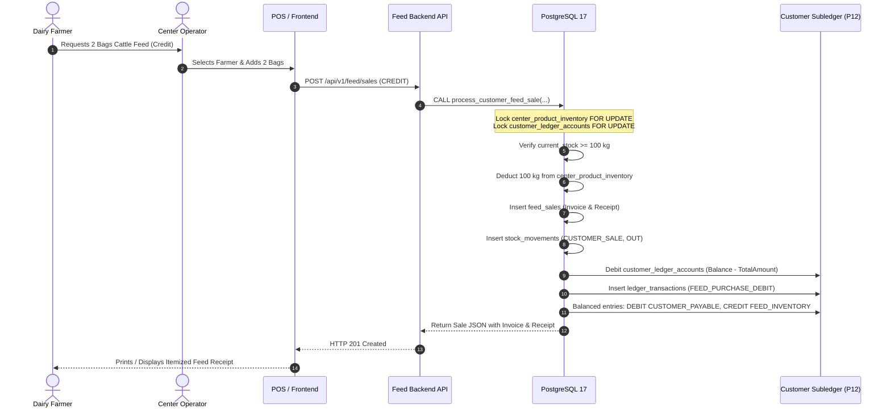

# Cattle Feed Inventory & Stock Accounting Architecture

## 1. Executive Summary & Architectural Overview

Phase 14 of DFARM delivers the enterprise **Cattle Feed Inventory, Procurement, Customer Sales & Stock Accounting Engine**. This subsystem enables dairy cooperatives, producer organizations, and private dairies to procure cattle feed products, manage multi-center warehouse inventory, sell feed to dairy farmers on credit or cash, atomically debit the customer subledger (P12), manage authorized returns with condition segregation, execute inter-center transfers, perform physical cycle count adjustments, and generate inventory valuation and stock reports.

The architecture enforces strict data integrity, auditability, and financial reconciliation:
- **Append-Only Stock Movement Ledger**: Stock quantities are never overwritten directly; all changes are driven by append-only immutable `stock_movements` records.
- **Strict Negative Stock Prohibition**: The default operational policy rejects any sale, transfer, or downward adjustment that would drive warehouse stock below zero.
- **Configurable Pack Sizes & Explicit Unit Conversions**: No uniform bag size is assumed. Products define an explicit `base_unit` (e.g. `KG`) and `pack_unit` (e.g. `BAG` with explicit `pack_size = 50.000 KG`).
- **Atomic POS & Customer Subledger Integration**: Customer feed credit sales atomically deduct warehouse stock, record sales invoices, generate append-only stock movements, and post balanced double-entry journal transactions to the Customer Subledger in a single database transaction.
- **Quarantine Segregation on Returns**: Returned items marked `DAMAGED` are quarantined via `DAMAGED_WRITE_OFF` audit movements and never returned to sellable inventory.
- **Weighted Average Costing (WAC)**: Stock valuation is calculated based on an audited Weighted Average Cost method updated upon every authorized purchase receipt.
- **Controlled Offline Boundary**: Offline sales require pre-allocated local device stock quotas and emit cryptographically unique client UUIDs; synchronization strictly rejects transactions exceeding central warehouse limits.

---

## 2. Core Stock Equation & Valuation Model

### 2.1 The Stock Balance Formula

At any center $C$ for product $P$, the current available sellable stock $S_{current}$ is calculated and maintained by the ledger relation:

$$S_{current} = S_{opening} + \sum Q_{receipts} + \sum Q_{returns}^{saleable} - \sum Q_{sales} - \sum Q_{writeoffs}^{damaged} \pm \sum Q_{transfers} \pm \sum Q_{corrections}$$

Where:
- $S_{opening}$: Opening baseline stock at center onboarding.
- $\sum Q_{receipts}$: Cumulative authorized purchase receipts (`PURCHASE_RECEIPT`).
- $\sum Q_{returns}^{saleable}$: Customer returns accepted in `SALEABLE` condition.
- $\sum Q_{sales}$: Feed sales delivered to customers (`CUSTOMER_SALE`).
- $\sum Q_{writeoffs}^{damaged}$: Customer returns accepted as `DAMAGED` or physical damage write-offs (`DAMAGED_WRITE_OFF`).
- $\sum Q_{transfers}$: Net inter-center stock transfers ($+Q$ for destination, $-Q$ for source).
- $\sum Q_{corrections}$: Authorized cycle count corrections ($+Q$ for surplus, $-Q$ for shrinkage).

### 2.2 Inventory Costing Policy: Weighted Average Cost (WAC)

DFARM employs the **Weighted Average Cost (WAC)** costing method for cattle feed inventory. When an authorized purchase order of quantity $Q_{new}$ is received at unit cost $C_{new}$:

$$WAC_{new} = \frac{(Q_{existing} \times WAC_{old}) + (Q_{new} \times C_{new})}{Q_{existing} + Q_{new}}$$

- All valuation reports and COGS (Cost of Goods Sold) calculations utilize this weighted average cost.
- Selling prices are independent of WAC and are set via the product catalog or promotional rates.

---

## 3. Append-Only Stock Movement Ledger

Stock movements are permanently recorded in `stock_movements`. The table is append-only and protected by PostgreSQL kernel triggers preventing `UPDATE` or `DELETE` operations.

```mermaid
flowchart TD
    PR["Purchase Receipt"] -->|IN (+)| SM["Append-Only Stock Movement Ledger"]
    CR_S["Customer Return (Saleable)"] -->|IN (+)| SM
    TR_IN["Center Transfer (Destination)"] -->|IN (+)| SM
    ADJ_IN["Stock Correction (Surplus)"] -->|IN (+)| SM
    
    CS["Customer Sale"] -->|OUT (-)| SM
    SR["Supplier Return"] -->|OUT (-)| SM
    CR_D["Customer Return (Damaged Quarantine)"] -->|OUT (Write-Off)| SM
    TR_OUT["Center Transfer (Source)"] -->|OUT (-)| SM
    ADJ_OUT["Stock Correction (Shrinkage)"] -->|OUT (-)| SM

    SM -->|Updates Balance Atomically| CPI["center_product_inventory (current_stock)"]
```

### Movement Types:
1. `PURCHASE_RECEIPT`: Inward movement from authorized supplier receipt.
2. `CUSTOMER_SALE`: Outward movement from POS customer feed sale.
3. `CUSTOMER_RETURN`: Inward movement for undamaged, sellable returned feed.
4. `SUPPLIER_RETURN`: Outward movement returning defective stock to supplier.
5. `DAMAGED_WRITE_OFF`: Quarantine or write-off of damaged, torn, or expired stock.
6. `STOCK_CORRECTION`: Authorized physical cycle-count adjustment.
7. `CENTER_TRANSFER`: Dual-leg atomic movement between dairy centers with linked `transfer_id`.

---

## 4. Multi-Unit Conversion Architecture

A common operational defect in dairy cooperatives is assuming all feed bags have identical weight (e.g., 50 kg). DFARM resolves this with an explicit unit conversion engine:

| Product Name | Pack Unit | Pack Size | Base Unit | Receiving Example | Stock Stored |
| :--- | :--- | :--- | :--- | :--- | :--- |
| **Super Cattle Feed 50kg** | `BAG` | `50.000` | `KG` | 100 Bags | 5,000.000 KG |
| **Mineral Mixture 5kg** | `BAG` | `5.000` | `KG` | 50 Bags | 250.000 KG |
| **Bypass Protein 25kg** | `BAG` | `25.000` | `KG` | 20 Bags | 500.000 KG |
| **Calcium Gel Bottle 1L** | `PIECE` | `1.000` | `LITRE` | 100 Bottles | 100.000 LITRE |

- Inward receiving and customer sales can be entered in either `base_unit` or `pack_unit`.
- The database always calculates and stores stock in `base_unit` (`NUMERIC(12,3)`) to maintain global arithmetic purity.

---

## 5. Customer Subledger Integration (Double-Entry Balance)

When a farmer purchases cattle feed on credit, DFARM posts a balanced double-entry accounting transaction into `ledger_transactions` and `ledger_entries` (P12):



### Ledger Journal Rules:
- **Debit Entry**: `CUSTOMER_PAYABLE` (Farmer account): Reduces the dairy's payable liability to the farmer (or increases receivable).
- **Credit Entry**: `FEED_INVENTORY` (Center store): Reduces the dairy's store asset balance.
- **Milk Settlement (P13)**: The monthly billing engine queries all `FEED_PURCHASE_DEBIT` transactions within the billing period and deducts them from gross milk payments.

---

## 6. Offline Operational Boundary & Synchronization Safety

In rural milk collection centers, internet connectivity may be intermittent. The feed inventory engine handles offline operations with strict boundaries:
1. **No Unlimited Offline Overselling**: Operators cannot create offline credit sales exceeding locally cached and reserved stock limits.
2. **Local Client UUID**: Every offline sale receives a client-side UUID (`client_sale_uuid`) generated at the moment of sale.
3. **Idempotent Sync Ingestion**: The backend checks for duplicate `idempotency_key` or `client_sale_uuid`. If already ingested, it returns the existing sale without double-deducting stock or double-debiting ledger accounts.
4. **Revalidation on Conflict**: If an offline sale attempts to sync against a center whose physical inventory was depleted by an authorized transfer or admin correction, the sync engine flags the transaction as an `INVENTORY_SYNC_CONFLICT` for supervisor review, preventing phantom negative warehouse balances.

---

## 7. Role-Based Permissions & Security Architecture

| Capability | Super Admin | Dairy Owner | Dairy Admin | Center Manager | Inventory Manager | Operator | Customer |
| :--- | :---: | :---: | :---: | :---: | :---: | :---: | :---: |
| **Create Feed Category/Product** | Yes | Yes | Yes | No | Yes | No | No |
| **Manage Suppliers** | Yes | Yes | Yes | No | Yes | No | No |
| **Create Purchase Order** | Yes | Yes | Yes | No | Yes | No | No |
| **Receive Stock into Center** | Yes | Yes | Yes | Yes | Yes | No | No |
| **Execute Customer Feed Sale** | Yes | Yes | Yes | Yes | Yes | Yes | No |
| **Approve Return / Refund** | Yes | Yes | Yes | Yes | Yes | No | No |
| **Inter-Center Stock Transfer** | Yes | Yes | Yes | Yes | Yes | No | No |
| **Stock Cycle Count Adjustment**| Yes | Yes | Yes | No | Yes | No | No |
| **View Center Stock** | Yes | Yes | Yes | Assigned Only | Assigned Only | Assigned Only | No |
| **View Own Feed Purchases** | Yes | Yes | Yes | No | No | No | Own Only |

