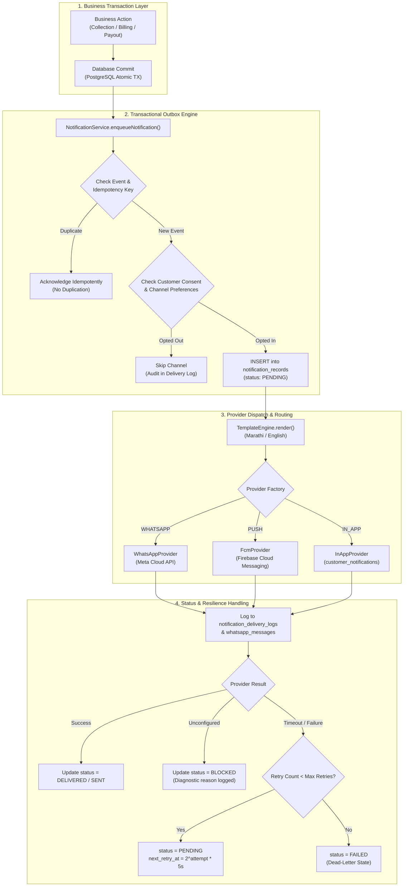

# DFarm Notification Architecture & Durable Outbox Engine

## 1. Overview & Architectural Principles

The DFarm Notification Engine is an enterprise-grade, transactional, multi-channel notification and messaging infrastructure designed for mission-critical dairy operations. It automates delivery receipts, financial ledger updates, monthly bills, and customer alerts across WhatsApp Business, Firebase Cloud Messaging (FCM) Push, and internal Customer Mobile In-App Inboxes.

### Core Architectural Axioms
1. **Financial Transaction Commit Discipline**: Notifications are **never** dispatched synchronously prior to database commit. Business transactions (milk intake, billing settlements, payouts) must successfully commit to PostgreSQL before an outbox event is enqueued.
2. **Durable Transactional Outbox Pattern**: Every outgoing notification event is persisted in PostgreSQL (`notification_records`) as `PENDING` with full metadata and idempotency keys, insulating upstream business logic from network latency or external provider downtimes.
3. **No Fabricated External Success**: When third-party provider credentials (WhatsApp Cloud API access tokens or Firebase service accounts) are absent or misconfigured, the delivery attempt is explicitly recorded as `BLOCKED` with diagnostic failure reason. The platform never fakes external provider delivery.
4. **Multi-Channel Orchestration**: Events can route to WhatsApp (`WHATSAPP`), Firebase Push (`PUSH`), and Mobile In-App (`IN_APP`), with independent provider execution, delivery logging, and status tracking.
5. **Replay & Idempotency Protection**: Every notification event has a deterministic `eventId` and `idempotencyKey` ensuring identical business events do not generate redundant customer messages.

---

## 2. Notification Pipeline & Data Flow



---

## 3. Database Schema Entities

The Notification Engine is powered by 7 core database entities defined in migration `023_notification_engine_push_and_whatsapp_automation.sql`:

| Table Name | Purpose | Primary Columns & Constraints |
| :--- | :--- | :--- |
| `notification_templates` | Canonical message templates for SMS, Push, WhatsApp, and In-App | `id`, `event_type`, `channel`, `language`, `title_template`, `body_template`, `whatsapp_template_name` |
| `notification_records` | Durable transactional outbox records | `id`, `organization_id`, `center_id`, `customer_id`, `event_type`, `event_id`, `idempotency_key`, `channel`, `recipient_phone`, `recipient_token`, `title`, `body`, `metadata`, `status`, `retry_count`, `max_retries`, `next_retry_at` |
| `notification_delivery_logs` | Immutable audit trail for every external provider HTTP dispatch | `id`, `notification_record_id`, `channel`, `provider`, `provider_message_id`, `status`, `response_code`, `response_payload`, `error_message`, `latency_ms` |
| `whatsapp_customer_mappings` | Customer mobile mapping, language preference, and opt-in/opt-out status | `id`, `organization_id`, `customer_id`, `phone_number`, `is_opted_in`, `preferred_language`, `opt_out_timestamp`, `opt_out_reason` |
| `whatsapp_messages` | Full lifecycle tracking for outbound and inbound WhatsApp messages | `id`, `organization_id`, `customer_id`, `notification_record_id`, `direction`, `wamid`, `phone_number`, `template_name`, `status`, `sent_at`, `delivered_at`, `read_at` |
| `customer_device_tokens` | Registered customer mobile push tokens (FCM) | `id`, `customer_id`, `device_id`, `device_platform`, `fcm_token`, `is_active`, `last_registered_at`, `deactivated_at`, `deactivation_reason` |
| `provider_event_records` | External provider webhook events for replay prevention | `id`, `provider`, `event_id`, `event_type`, `raw_payload`, `processed_status`, `processed_at` |

---

## 4. Resilience, Retry Policy & Dead-Letter Handling

### Exponential Backoff Schedule
When a transient provider error (e.g., HTTP 500, socket timeout, 429 rate limit) occurs:
1. The record's `retry_count` is incremented.
2. A deterministic exponential backoff timestamp is calculated:
   $$\text{delaySeconds} = 2^{\text{retry\_count}} \times 5$$
   - **Attempt 1**: 10 seconds backoff
   - **Attempt 2**: 20 seconds backoff
   - **Attempt 3**: 40 seconds backoff
3. `status` remains `PENDING` and `next_retry_at` is set.
4. If `retry_count >= max_retries` (default: 3), the record transitions to `FAILED` (Dead-Letter state) and failure reasons are preserved.

### Background Retry Worker
A scheduled or API-triggered worker (`POST /api/v1/notifications/retry-pending`) queries:
```sql
SELECT * FROM notification_records
WHERE status = 'PENDING'
  AND retry_count < max_retries
  AND (next_retry_at IS NULL OR next_retry_at <= NOW())
ORDER BY created_at ASC
LIMIT 20;
```
Each matching record is dispatched through the registered channel provider.
