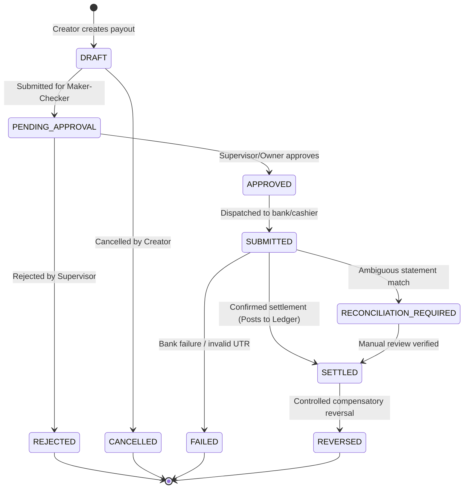

# DFarm Payment & Settlement Architecture

## 1. Architectural Overview

The DFarm Customer Payment and Settlement Management System (Phase 15) governs all monetary flows between the dairy cooperative/union and its registered farmer customers. The architecture guarantees financial integrity, atomic ledger posting, strict direction separation, and multi-channel reconciliation while adhering to double-entry accounting standards.

```mermaid
flowchart TD
    subgraph Payment Directions
        DPC["Dairy Pays Customer (Payout)<br/>Monthly settlement, bill balance<br/>DEBIT customer liability"]
        CPD["Customer Pays Dairy (Receipt)<br/>Feed debt, advance recovery<br/>CREDIT customer liability"]
    end

    subgraph Processing Engine
        PS[Payout Service]
        RS[Receipt Service]
        BS[Batch Aggregation Service]
        RC[Reconciliation Service]
    end

    subgraph State Machine
        DRAFT --> PENDING_APPROVAL
        PENDING_APPROVAL --> APPROVED
        APPROVED --> SUBMITTED
        SUBMITTED --> SETTLED
        SUBMITTED --> FAILED
        SETTLED --> REVERSED
        PENDING_APPROVAL --> REJECTED
        DRAFT --> CANCELLED
    end

    subgraph Subledger Integration
        LT[(ledger_transactions)]
        LE[(ledger_entries)]
        CLA[(customer_ledger_accounts)]
    end

    DPC --> PS
    CPD --> RS
    PS --> BS
    PS --> State Machine
    RS --> State Machine
    State Machine -->|Only on SETTLED| LT
    LT --> LE
    LE --> CLA
    RC -->|CSV Import / Webhook| State Machine
```

---

## 2. Fundamental Payment Directions

The system explicitly decouples financial operations into two asymmetric flows:

| Property | Dairy Pays Customer (Payout) | Customer Pays Dairy (Receipt) |
| :--- | :--- | :--- |
| **Business Context** | Monthly milk settlement, authorized customer payout, milk bill balance | Cattle feed purchases, advance loan recovery, customer receivable collection |
| **Direction Enum** | `DAIRY_PAYS_CUSTOMER` | `CUSTOMER_PAYS_DAIRY` |
| **Entity Table** | `customer_payouts` | `customer_receipts` |
| **Customer Ledger Effect** | **DEBIT** to `CUSTOMER_PAYABLE` (reduces dairy's liability to farmer) | **CREDIT** to `CUSTOMER_PAYABLE` (reduces farmer's receivable debt to dairy) |
| **Balancing Entry** | **CREDIT** to `CASH_BANK` asset account | **DEBIT** to `CASH_BANK` asset account |
| **Approval Requirement** | Mandatory 2-step verification (Maker-Checker, separation of duties) | Authorized cashier / teller confirmation receipt |

---

## 3. Financial State Machine

Payment lifecycle transitions follow strict state enforcement. No financial posting is permitted in intermediate or pre-settlement states.



### State Definitions & Financial Invariants:
1. `DRAFT`: Local draft created by cashier or operator. No financial liability change.
2. `PENDING_APPROVAL`: Queued for supervisor/dairy owner approval.
3. `APPROVED`: Approved by an independent supervisor. Awaiting execution or batch packaging.
4. `SUBMITTED`: Dispatched to bank via NEFT/RTGS batch or presented for cash disbursement. **Never posts to ledger.**
5. `SETTLED`: Confirmed by authoritative bank UTR, statement match, or cash receipt voucher. **Atomically creates double-entry journal records.**
6. `FAILED`: Bank transaction rejected (e.g. invalid IFSC, account closed). No ledger debit.
7. `RECONCILIATION_REQUIRED`: Mismatched amount or unverified reference flagged for manual finance review.
8. `REVERSED`: Settled payment reversed via an explicit compensatory journal voucher. Finalized historical ledger rows are immutable and never deleted.

---

## 4. Provider Adapter Architecture

To guarantee vendor independence and avoid simulated payment successes, payment gateways and bank channels interact through a pluggable provider interface.

```typescript
export interface PaymentProvider {
  readonly providerId: string;
  submitPayment(payout: CustomerPayout): Promise<PaymentSubmissionResult>;
  verifyPayment(payoutId: string, reference: string): Promise<PaymentVerificationResult>;
  verifyWebhook(payload: string, signature: string, timestamp: string): Promise<WebhookVerificationResult>;
  checkTransactionStatus(providerRef: string): Promise<PaymentStatusResult>;
}
```

### Pluggable Implementations:
- **`ManualReconciliationProvider` (Default):** Used for manual cash, cheque, and manual bank NEFT uploads. Requires human supervisor authorization and bank statement matching.
- **`ConfiguredBankWebhookAdapter`:** Used when genuine banking APIs (ICICI CIB, HDFC SmartHub, SBI e-Pay) are configured. Enforces cryptographic HMAC-SHA256 signature verification, 300s replay window, and idempotency tracking.

---

## 5. Double-Entry Subledger Integration

All settled payments interface directly with the Customer Subledger (`customer_ledger_accounts`, `ledger_transactions`, `ledger_entries`):

### Payout Settlement Journal (Dairy Pays Farmer ₹10,000):
```
Debit:   2000-CUSTOMER_PAYABLE    ₹10,000.00  (Reduces Dairy Liability)
Credit:  1000-CASH_BANK           ₹10,000.00  (Asset Outflow)
```

### Debt Repayment Settlement Journal (Farmer Repays Feed ₹2,500):
```
Debit:   1000-CASH_BANK           ₹2,500.00   (Asset Inflow)
Credit:  2000-CUSTOMER_PAYABLE    ₹2,500.00   (Clears Farmer Debt / Liability)
```

### Non-Negotiable Invariants:
- Absolute append-only storage: database triggers prevent `DELETE` and `UPDATE` on `ledger_transactions`.
- Mathematical zero balance: $\sum \text{debits} - \sum \text{credits} = 0.00$ on every transaction.
- High-precision monetary arithmetic using PostgreSQL `NUMERIC(12,2)`.
