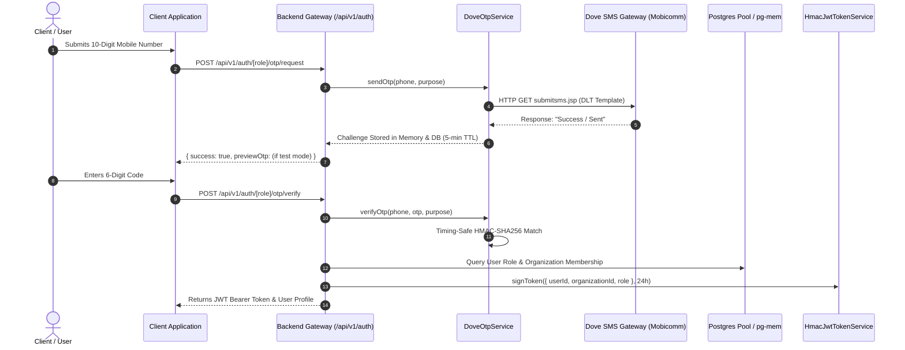

# AUTHENTICATION AND DEV MODE AUDIT

**Audit Document Reference:** `DFARM-AUDIT-006`  
**Version:** `1.0.0-PROMPT0-AUDIT`  
**Status:** `READ-ONLY TECHNICAL BASELINE`  
**Classification:** `Authentication Security, Session Hardening & Dev Mode Audit`  
**Evaluator:** DFarm Principal Solution Architect & Cybersecurity Auditor  

---

## 1. Authentication Architecture Across All Four Applications

| Application | Intended User Class | Intended Authentication Mechanism | Current Implementation Reality | Security Rating |
| :--- | :--- | :--- | :--- | :---: |
| **Customer Mobile App** | Milk Farmer / Supplier | Real Mobile OTP via SMS Gateway | Real Dove SMS via `DoveSmsService`; in test mode returns `previewOtp`. Bearer JWT session. | **Moderate** |
| **Dairy Admin Web** | Primary Dairy Admin | Mobile OTP + Verified Email Link | Admin OTP via `VerifyAdminOtpUseCase`. Hardcoded to Gokul in seed and mock server. | **Critical Risk** |
| **Collection Kiosk App** | Collection Operator | Mobile OTP + Center Assignment | Operator OTP via `VerifyOperatorOtpUseCase`. Fallback to mock session in `mock-backend.ts`. | **High Risk** |
| **Super Admin Web** | Platform Super Administrator| Hardened Mobile OTP + Role Scopes | Super Admin OTP via `apiClient.verifyOtp`. Session cached in localStorage without token rotation. | **Moderate** |



---

## 2. Inventory of Dev Modes, Bypasses & Test Credentials

### Finding AUTH-001: `ALLOW_TEST_PREVIEW_OTP` Leakage in Production Responses
- **Location:** `services/backend/src/infrastructure/otp/DoveOtpService.ts` (lines 175-184), `services/backend/src/config/env.ts` (line 80)
- **Code:**
  ```typescript
  const isTestMode = process.env['NODE_ENV'] === 'test' || config.ALLOW_TEST_PREVIEW_OTP;
  ...
  const previewOtp = isTestMode ? rawOtp : undefined;
  return {
    success: true,
    message: `Verification code sent successfully to ${maskedPhone}`,
    previewOtp,
  };
  ```
- **Risk:** If `ALLOW_TEST_PREVIEW_OTP=true` is accidentally enabled in `.env` in staging or production, the 6-digit OTP is returned directly in the HTTP JSON response body, enabling full authentication bypass without physical phone access.
- **Severity:** `P0 - Critical`
- **Remediation:** Remove `ALLOW_TEST_PREVIEW_OTP` from production environment schemas. Restrict `previewOtp` strictly to `NODE_ENV === 'test'` within isolated mock test drivers.

---

### Finding AUTH-002: Hardcoded Whitelisted Admin Phones
- **Location:** `services/backend/src/config/env.ts` (line 78), `apps/dfarm-dairy-admin/src/api/mock-server.ts` (lines 72-84)
- **Code:**
  ```typescript
  ADMIN_PHONE_NUMBER: z.string().default('+917755995615,+919876543210,7755995615')
  ```
- **Risk:** Phone numbers `+917755995615` and `+919876543210` are embedded as default environment variables and frontend whitelist arrays. Any user logging in with these numbers bypasses normal database tenant verification in mock modes.
- **Severity:** `P1 - High`
- **Remediation:** Remove hardcoded phone numbers from default configuration. Admin authorization must be strictly determined by querying `users` table where `status = 'ACTIVE'` and `role IN ('SUPER_ADMIN', 'DAIRY_ADMIN')`.

---

### Finding AUTH-003: Unverified Header-Based Tenant Spoofing (`X-Dairy-Id`)
- **Location:** `services/backend/src/presentation/routes/customers.routes.ts` (lines 38-46, 180), `collections.routes.ts`
- **Code:**
  ```typescript
  let organizationId = req.user?.organizationId;
  if (!organizationId) {
    organizationId = (req.query['organizationId'] as string) || 
                     (req.headers['x-dairy-id'] as string) || 
                     (req.headers['x-dairy-tenant-id'] as string);
  }
  ```
- **Risk:** In endpoints utilizing `optionalAuthenticate`, if the caller provides no token or a token without an `organizationId`, the endpoint accepts any arbitrary UUID supplied in `X-Dairy-Id` or query parameters. An unauthenticated caller can query customer records of any dairy tenant (`IDOR` vulnerability).
- **Severity:** `P0 - Critical`
- **Remediation:** Enforce strict `authenticate` middleware on all operational routes. Forbid extracting `organizationId` from headers or query parameters unless `req.user.role === 'SUPER_ADMIN'`.

---

### Finding AUTH-004: Default Fallback JWT Secret
- **Location:** `services/backend/src/config/env.ts` (line 61)
- **Code:**
  ```typescript
  JWT_SECRET: z.string().default('super-secret-jwt-token-with-at-least-32-characters-long')
  ```
- **Risk:** If `JWT_SECRET` is not explicitly defined in production `.env`, the server defaults to a publicly visible 32-character string from the source repository. An attacker can forge arbitrary JWTs with `role: 'super_admin'`.
- **Severity:** `P0 - Critical`
- **Remediation:** Eliminate the default value in `env.ts`. Require `JWT_SECRET` to be provided in environment variables, failing startup if undefined in `production`.

---

### Finding AUTH-005: Client-Side Session Storage Without Invalidation
- **Location:** `apps/dfarm-super-admin/src/api/client.ts` (lines 89-105), `apps/dfarm-dairy-admin/src/api/client.ts` (lines 40-56)
- **Code:**
  ```typescript
  localStorage.setItem('dfarm_super_admin_session', JSON.stringify(session));
  ```
- **Risk:** Session tokens and permission arrays are stored as raw JSON objects in browser `localStorage`. There is no token blacklist table or server-side revocation mechanism on logout.
- **Severity:** `P2 - Medium`
- **Remediation:** In Prompt 2, store refresh tokens in secure HttpOnly cookies and implement server-side session revocation in `user_sessions`.

---

## 3. Safe Bypass Removal & Testing Isolation Plan

To comply with the owner's permanent rules (Rule 4: Real data only; Rule 5: Testing must be isolated):
1. **Production Hardening (Prompt 11):** Strip all `mock-server.ts`, `mockBackend.ts`, and `previewOtp` fallbacks from production build targets.
2. **Automated Testing Preservation:**
   - Keep automated unit/integration tests running in dedicated test files (e.g. `tests/*.test.js`) using isolated mocks.
   - Tests must use isolated in-memory fixtures (`pg-mem`) created strictly within test runners, completely separate from production runtime code.
   - Seed scripts must **never** write sample business records into live operational Dairy databases.
