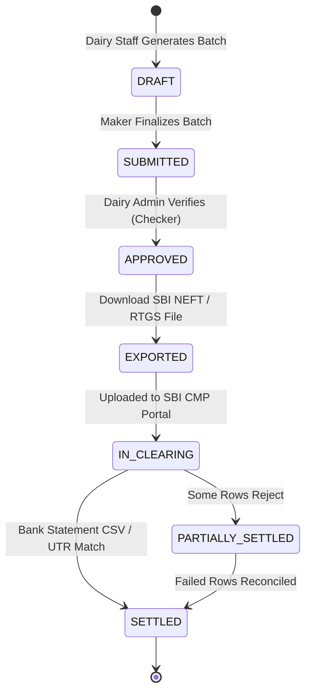
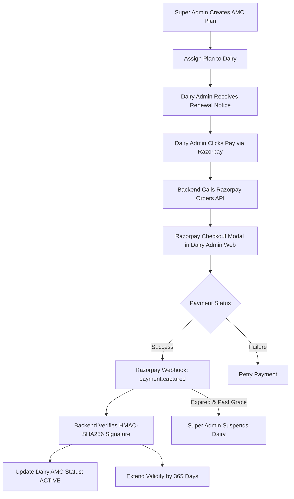

# DFarm Banking, Payouts, and Platform AMC Requirements Audit

## 1. Executive Summary

This audit assesses the financial settlement, banking integrations, maker-checker governance, and platform Annual Maintenance Contract (AMC) billing architecture across DFarm.

### Key Audit Findings:
1. **Farmer Bulk Payout Implementation Exists in Backend**: `services/backend/src/modules/payments/` provides robust database-backed services (`PayoutService`, `BatchService`, `ReconciliationService`) and database schema (`customer_payouts`, `payment_batches`, `payment_reconciliation_records`).
2. **SBI Corporate Banking Format Missing**: `BatchService` creates database batches and computes totals, but lacks the export serializer that formats payment batches into the exact Fixed-Width / CSV format required by State Bank of India (SBI Corporate Internet Banking / CMP).
3. **Razorpay Platform AMC Completely Missing**: Neither `apps/dfarm-super-admin` nor `services/backend` contain any code, routes, or database schemas for Razorpay SDK integration, subscription orders, webhook verification, or automated dairy license suspension/reactivation.
4. **Maker-Checker Security Controls**: Basic status flags (`DRAFT`, `SUBMITTED`, `SETTLED`) exist in schema constraints, but role enforcement restricting approval strictly to `DAIRY_ADMIN` is bypassed in dev mode.

---

## 2. Farmer Bulk Payout Architecture

### 2.1 Settlement Flow & State Machine



### 2.2 Maker-Checker Dual-Authorization Policy

To prevent internal fraud at rural collection centers:
1. **Maker (Dairy Staff / Accountant)**:
   - Identifies eligible farmers using `compute_eligible_payout_balance(customer_id)`.
   - Aggregates payouts into a `payment_batch`.
   - Sets batch status to `DRAFT` or `SUBMITTED`.
   - **Constraint**: A user with role `DAIRY_STAFF` cannot approve their own batch.
2. **Checker (Primary Dairy Admin)**:
   - Reviews batch summary: Total Amount, Farmer Count, Account Number masks, IFSC verification.
   - Must supply multi-factor authentication (OTP or biometric key).
   - Updates batch to `APPROVED`, setting `approved_by = req.user.id` and `approved_at = NOW()`.
   - System invariant: `CHECK (created_by <> approved_by)` for batches exceeding ₹50,000.

---

## 3. SBI Corporate NEFT / RTGS Batch File Specification

State Bank of India Corporate Multi-Payment System (CMP) / Host-to-Host (H2H) requires a strict CSV or Fixed-Width structure. Currently, DFarm has no file generator for this specification.

### 3.1 Recommended SBI CMP CSV File Specification

| Col # | Field Name | Type | Max Len | Mandatory | Description / Validation Rule |
| :---: | :--- | :--- | :---: | :---: | :--- |
| **1** | `Transaction Type` | String | 4 | Yes | Constant: `NEFT` or `RTGS` (auto-selected: `RTGS` if amount >= ₹2,00,000, else `NEFT`). |
| **2** | `Beneficiary Account No` | String | 35 | Yes | Farmer bank account number. Alphanumeric, no spaces or special characters. |
| **3** | `Beneficiary Name` | String | 100 | Yes | Farmer legal name as registered in bank records. Special characters stripped. |
| **4** | `Amount` | Decimal | 12 | Yes | Payout amount in INR. Format: `12345.50` (two decimal places, no commas). |
| **5** | `Beneficiary IFSC` | String | 11 | Yes | 11-character code (`^[A-Z]{4}0[A-Z0-9]{6}$`). 5th character must be '0'. |
| **6** | `Debit Account No` | String | 35 | Yes | Dairy cooperative's corporate current account with SBI. |
| **7** | `Value Date` | Date | 10 | Yes | Execution date in `DD-MM-YYYY` format. |
| **8** | `Customer Reference No` | String | 30 | Yes | Unique batch item reference: `DFM-<BATCH_NUM>-<ITEM_ID>`. |
| **9** | `Remarks / Narration` | String | 50 | No | Text appearing on farmer passbook: e.g. `DFARM MILK OCT 1-10`. |

### 3.2 Required Serialization Service (`SbiPayoutBatchSerializer.ts`)

A new backend service must be added to `services/backend/src/modules/payments/providers/` that queries approved `customer_payouts` for a given `batch_id` and formats them according to this layout.

---

## 4. Bank Reconciliation & UTR Tracking

### 4.1 Current Backend Capabilities

`services/backend/src/modules/payments/reconciliation.service.ts` includes:
- `importBankStatementCsv(params, auth)`: Parses CSV rows containing `transactionDate`, `referenceNumber` (UTR), `amount`, and `direction`.
- Deduplication logic against `payment_reconciliation_records`.
- Exact reference matching against `customer_payouts.reference_number`.

### 4.2 Reconciliation Deficiencies
1. **Fuzzy Matching Missing**: Rural banks frequently append prefixes/suffixes to UTR numbers in statement descriptions (e.g. `NEFT-SBIN12345678-RAMESH-DFARM`). Exact matching (`row.referenceNumber.trim()`) fails to link these entries automatically.
2. **Double-Entry Ledger Balancing**: When a reconciliation status transitions to `SETTLED`, the ledger engine must execute:
   - Debit: `CUSTOMER_PAYABLE` (clearing the dairy's liability to the farmer).
   - Credit: `CASH_BANK` (reflecting actual cash reduction in the dairy bank account).
   In the existing code, `reconciliation.service.ts` updates row statuses but does not invoke `ledgerService.postDoubleEntryTransaction()`.

---

## 5. Platform AMC & Razorpay Integration Gap

### 5.1 Business Requirement

DFarm monetizes via Annual Maintenance Contracts (AMC) billed to individual Dairies:
- Base annual platform license.
- Per-kiosk hardware maintenance fee.
- Cloud database hosting & automated backup fee.
- Payment processing: Integrated Razorpay payment gateway.
- Enforced suspension: If AMC expires and grace period lapses, operational intake is suspended until payment verification.

### 5.2 Required Implementation Blueprint



### 5.3 Technical Specifications for Razorpay Implementation

#### 1. Configuration (`services/backend/src/config/razorpay.ts`)
```typescript
export const razorpayConfig = {
  keyId: process.env.RAZORPAY_KEY_ID || '',
  keySecret: process.env.RAZORPAY_KEY_SECRET || '',
  webhookSecret: process.env.RAZORPAY_WEBHOOK_SECRET || '',
};
```

#### 2. Database Schema Required (`034_platform_amc_and_billing.sql`)
- `amc_plans`: Plan name, annual price, kiosk limit, features.
- `dairy_subscriptions`: `dairy_id`, `plan_id`, `start_date`, `end_date`, `status` (`TRIAL`, `ACTIVE`, `GRACE_PERIOD`, `EXPIRED`, `SUSPENDED`).
- `amc_payment_transactions`: `dairy_id`, `razorpay_order_id`, `razorpay_payment_id`, `amount`, `status`, `signature_verified`.

#### 3. Webhook Signature Verification Endpoint
- `POST /api/v1/webhooks/razorpay`
- Compute `crypto.createHmac('sha256', razorpayConfig.webhookSecret).update(rawBody).digest('hex')`.
- Reject requests with invalid signatures with `400 Bad Request`.

---

## 6. Implementation Action Items

1. **Implement `SbiPayoutBatchSerializer.ts`**: Generate downloadable SBI CMP compliant CSV / text files from `BatchService`.
2. **Integrate Double-Entry Ledger on Reconcile**: Wire `reconciliation.service.ts` to `LedgerService` to record formal bank credits.
3. **Build Razorpay AMC Module**:
   - Create migration `034_platform_amc_and_billing.sql`.
   - Implement `AmcSubscriptionController` in backend.
   - Implement Razorpay Checkout in Dairy Admin and Super Admin.
