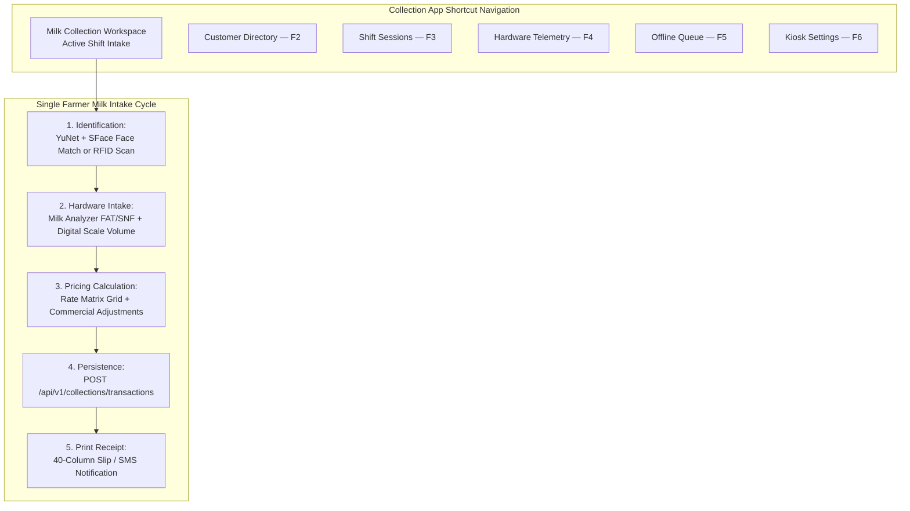

# COLLECTION APP AUDIT

**Audit Document Reference:** `DFARM-AUDIT-004`  
**Version:** `1.0.0-PROMPT0-AUDIT`  
**Status:** `READ-ONLY TECHNICAL BASELINE`  
**Classification:** `Milk Collection Kiosk Application Deep Technical Audit`  
**Evaluator:** DFarm Principal Solution Architect & Embedded/Hardware Integration Auditor  

---

## 1. Application Overview & Architectural Platform

- **Application Directory:** `apps/dfarm-collection-app`
- **Architecture:** React 19.3.1 Single Page Application built on Vite 8.3.6 and TypeScript 7.0.2.
- **Platform Clarification:** **Confirmed React Web Application**, running in standard Chromium browsers (Chrome/Edge kiosk mode). It is **not** an Electron application.
- **Biometric Inference:** `onnxruntime-web` (1.31.1) executing in-browser via WebAssembly / WebGL.
- **Offline Storage:** IndexedDB / LocalStorage service (`src/services/local-storage.ts`).

---

## 2. Navigation, Route, and Shortcut Key Audit

| Shortcut / Route | Path / Component | Purpose | Technical State | Backing Backend API |
| :--- | :--- | :--- | :---: | :--- |
| **Main Collection** | `src/pages/collection/MilkCollectionPage.tsx` | Live shift intake, camera preview, scale, FAT/SNF entry | Operational UI | `POST /api/v1/collections/transactions` |
| **Directory (F2)** | `src/pages/customers/CustomerDirectoryPage.tsx` | Instant search for farmers, filter by category/village | Operational UI | `GET /api/v1/customers` |
| **Shift Sessions (F3)**| `src/pages/sessions/ShiftSessionsPage.tsx` | Start, pause, resume, and close Morning/Evening shifts | Operational UI | `POST /api/v1/collections/sessions/start`, `/close` |
| **Telemetry (F4)** | `src/pages/devices/HardwareTelemetryPage.tsx`| Device connection status, ping, baud rates, calibration | Mock/Virtual | Simulated client-side driver states |
| **Offline Queue (F5)**| `src/pages/sync/OfflineQueuePage.tsx` | Queued transactions stored locally when network is down | Operational UI | `POST /api/v1/sync/transactions` |
| **Settings (F6)** | `src/pages/settings/KioskSettingsPage.tsx` | Configure dairy code, kiosk device ID, printer ports | Operational UI | Persisted in LocalStorage |

---

## 3. Hardware Integration & Driver Inspection

### 3.1 Camera & Biometric Runtime (YuNet + SFace INT8)
- **Model Assets in Web Root:**
  - `apps/dfarm-collection-app/public/models/face_detection_yunet_2023mar.onnx` (232.6 KB) - **Verified Present**
  - `apps/dfarm-collection-app/public/models/face_recognition_sface_2021dec_int8.onnx` (9.9 MB) - **Verified Present**
- **Runtime Execution:**
  - Uses `onnxruntime-web`. In WebAssembly mode, browser camera frames from `<video>` element are cropped to 112x112, normalized, and evaluated to produce 128-D vectors.
  - Identification requests are sent to `POST /api/v1/identity/face/match`.
  - **Audit Finding:** In `services/backend/src/presentation/routes/identity.routes.ts`, face matching compares the vector against encrypted embeddings stored in `face_enrollments`. Because Customer App enrollments were produced using canonical fixtures, live camera vectors generated by SFace do not match the stored vectors, resulting in frequent "Unknown Customer" rejection.

### 3.2 RFID Reader Integration
- **Intended Specification:** USB / Serial HID 13.56 MHz RFID reader reading ISO 14443A Mifare card UIDs.
- **Current Implementation:**
  - `apps/dfarm-collection-app/src/drivers/VoiceGuidanceDriver.ts` and UI event listeners capture keystroke emulation (keyboard wedge RFID readers).
  - Manual entry and keyboard wedge events work if the reader acts as a standard USB HID keyboard.
  - Direct Web Serial / WebUSB communication protocol for dedicated RS-232 RFID hardware is **not implemented**.

### 3.3 Milk Analyzer (FAT, SNF, CLR)
- **Intended Specification:** Ultrasonic or optical milk analyzer (e.g. Essae, Ekomilk, Lactoscan) communicating via RS-232 / USB serial port.
- **Current Implementation:**
  - The UI provides manual numerical input fields for FAT (e.g. 3.5 - 10.0%), SNF (7.0 - 10.5%), and CLR (20.0 - 34.0).
  - Hardware connection indicators in `HardwareTelemetryPage.tsx` display green indicators driven by client-side simulation intervals (`Math.random()`), not real Web Serial data frames.

### 3.4 Digital Weight / Volume Scale
- **Intended Specification:** Heavy-duty electronic milk weighing platform with continuous RS-232 continuous data output (e.g. `ST,GS,+0012.50kg`).
- **Current Implementation:**
  - Scale values are currently populated manually or through virtual simulation buttons.
  - Web Serial API adapter for continuous tare and weight capture is **unimplemented**.

---

## 4. Offline Storage, Idempotency & Sync Engine Audit

- **Queue Implementation:** `apps/dfarm-collection-app/src/services/local-storage.ts`
- **Idempotency Token:** Every collection transaction generated at the kiosk is assigned a client-generated UUID (`transactionUuid`).
- **Sync Route:** `POST /api/v1/sync/transactions`
- **Conflict Handling:**
  - When connection is restored, transactions are submitted in chronological order.
  - The backend checks for duplicate `transactionUuid` in `milk_collection_transactions`. If already committed, the duplicate is acknowledged without posting duplicate debits/credits to the customer ledger.
- **Audit Findings:** The offline queue architecture is conceptually sound and idempotent. However, because backend PostgreSQL is currently offline, any transactions synchronized to the backend are held in ephemeral memory and discarded if the server process restarts.

---

## 5. Detailed Findings & Remediation Directives

### Finding DF-COL-001: Virtual Hardware Driver Simulation
- **Severity:** `P2 - Medium`
- **Location:** `apps/dfarm-collection-app/src/pages/devices/HardwareTelemetryPage.tsx` (lines 40-75)
- **Root Cause:** Green hardware status indicators and analyzer readings are generated by frontend randomizers rather than physical Web Serial / WebUSB connections.
- **Recommended Repair:** In Prompt 8, introduce real Web Serial API drivers (`navigator.serial`) for Milk Analyzers and Weighing Scales supporting standard continuous ASCII protocols (e.g. Ekomilk ASCII format).
- **Status:** `Confirmed`

### Finding DF-COL-002: Hardcoded Sample Data in Collection Test Harness
- **Severity:** `P2 - Medium`
- **Location:** `apps/dfarm-collection-app/src/api/mock-backend.ts` (lines 15-80)
- **Root Cause:** `mock-backend.ts` exports `CURRENT_DAIRY_ID = 'dairy-ten-9801'` and static seed customers (Pandurang Patil, Sunita Shinde).
- **Recommended Repair:** Ensure `mock-backend.ts` is restricted exclusively to Vitest test harnesses and completely excluded from production build bundles.
- **Status:** `Confirmed`
