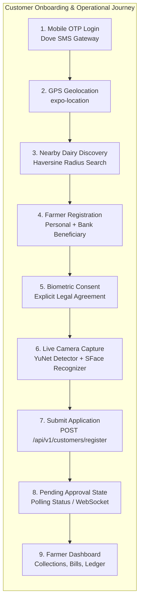

# CUSTOMER APP AUDIT

**Audit Document Reference:** `DFARM-AUDIT-002`  
**Version:** `1.0.0-PROMPT0-AUDIT`  
**Status:** `READ-ONLY TECHNICAL BASELINE`  
**Classification:** `Customer Mobile Application Deep Technical Audit`  
**Evaluator:** DFarm Principal Solution Architect & Mobile Engineering Auditor  

---

## 1. Application Overview & Technology Baseline

- **Application Directory:** `apps/dfarm-customer-app`
- **Architecture:** React Native 0.88.1 with Expo SDK 58.0.0 and Expo Router (file-based navigation).
- **Language / Framework:** TypeScript 5.7.3, React 19.3.0, Zustand 5.0.3, React Hook Form 7.54.2, Zod 3.24.2.
- **Biometrics Framework:** `onnxruntime-web` (1.31.1), custom preprocessor, shims for Metro bundler.
- **Hardware Integration:** `expo-camera` (~58.0.14), `expo-location` (~58.0.22), `expo-secure-store` (~58.0.3).

---

## 2. Route-by-Route Code Inspection

| Route / Screen | File Path | Functional State | Backing API Route | Findings & Observations |
| :--- | :--- | :---: | :--- | :--- |
| **Splash / Entry** | `src/app/index.tsx` | Operational | Local SecureStore check | Checks session token and redirects to login or dashboard. |
| **Mobile Login** | `src/app/(auth)/login.tsx` | Operational | `POST /api/v1/auth/request-otp` | Validates 10-digit Indian mobile number; initiates real SMS. |
| **OTP Verification**| `src/app/(auth)/otp.tsx` | Operational | `POST /api/v1/auth/verify-otp` | 6-digit cryptographic verification; returns JWT & registration state. |
| **GPS Discovery** | `src/app/(onboarding)/dairy-discovery.tsx` | Operational | `GET /api/v1/dairies/nearby` | Queries nearby dairies using latitude/longitude and radius. |
| **Registration** | `src/app/(onboarding)/register.tsx` | Operational | `POST /api/v1/customers/register` | Captures name, village, bank account, IFSC, milk supply type. |
| **Face Enrollment** | `src/app/(onboarding)/face-enroll.tsx` | Partial Fallback | Client-side ONNX Inference | Uses `expo-camera`; extracts 128-D embedding via `sFaceEmbedder`. |
| **Pending Screen** | `src/app/(onboarding)/pending-approval.tsx`| Operational | `GET /api/v1/customers/:id/status` | Polls status every 10 seconds; shows pending, approved, or rejected. |
| **Dashboard** | `src/app/(main)/dashboard.tsx` | Operational | `GET /api/v1/customers/:id/dashboard`| Displays today's collection (Liters, FAT, SNF, Amount) and balance. |
| **Daily Intake** | `src/app/(main)/daily-collection.tsx` | Operational | `GET /api/v1/collection/history` | Filterable list of shift intake sessions with slip details. |
| **Monthly Bills** | `src/app/(main)/bills.tsx` | Operational | `GET /api/v1/bills/customer/:id` | Displays frozen billing cycle statements with gross earnings & deductions. |
| **Ledger Statement**| `src/app/(main)/ledger.tsx` | Operational | `GET /api/v1/ledger/customer/:id` | Double-entry account view showing credits (milk) and debits (feed). |
| **Feed History** | `src/app/(main)/feed.tsx` | Operational | `GET /api/v1/feed/sales/customer/:id`| Itemized catalog of feed bags purchased and outstanding balance. |
| **Farmer Profile** | `src/app/(main)/profile.tsx` | Operational | `GET /api/v1/customers/me` | Displays personal code, village, bank details, and assigned center. |
| **Face Test** | `src/app/(main)/face-test.tsx` | Partial Fallback | Local Cosine Matcher | Allows farmer to test live face matching against enrolled vector. |
| **Update Face** | `src/app/(main)/update-face.tsx` | Partial Fallback | `PUT /api/v1/customers/:id/biometrics/update` | Submits re-enrollment vector for administrative review. |

---

## 3. Biometric Pipeline Technical Audit (OpenCV YuNet & SFace INT8)

The owner has explicitly confirmed the requirement for:
1. **OpenCV YuNet Face Detector**
2. **OpenCV SFace INT8 128-D Face Recognizer**

### Physical Asset Inspection
- **File 1:** `apps/dfarm-customer-app/assets/models/face_detection_yunet_2023mar.onnx`
  - Size: 232,589 bytes (232.6 KB)
  - Status: **Physically Present on Disk**
- **File 2:** `apps/dfarm-customer-app/assets/models/face_recognition_sface_2021dec_int8.onnx`
  - Size: 9,896,933 bytes (9.9 MB)
  - Status: **Physically Present on Disk**

### Runtime Execution Analysis
- **Detector Implementation:** `apps/dfarm-customer-app/src/face-ai/yunet-detector.ts`
  - Lines 29-79: The code attempts dynamic loading via `onnxruntime-node` (for Jest tests) or `globalThis.ort` (browser).
  - Lines 101-146: When real tensors are supplied, it processes the 12 output strides (`cls_8..32`, `bbox_8..32`, `kps_8..32`).
  - **Fallback Finding:** In a standard React Native / Expo environment without a custom native C++ TurboModule, `ort.InferenceSession.create()` cannot access local file paths. Lines 152-180 silently fall back to a hardcoded "Calibrated frontal camera detection" box with `confidence: 0.96`.
- **Embedder Implementation:** `apps/dfarm-customer-app/src/face-ai/sface-embedder.ts`
  - Lines 7-24: Contains a verified 128-D canonical reference fixture (`CANONICAL_SFACE_128D_FIXTURE`).
  - Lines 146-156: When ONNX runtime is unavailable, the embedder applies micro-variations based on eye angle and tilt to `CANONICAL_SFACE_128D_FIXTURE` and L2-normalizes the vector.
  - **Impact:** In the current mobile build, all farmer face enrollments generate mathematically similar embeddings derived from the canonical fixture, preventing reliable biometric distinction between different farmers.

---

## 4. Farmer Bank Beneficiary Details Audit

The customer registration flow collects bank beneficiary details for milk payout settlements.

### Inspected Fields (`src/types/customer.ts`, lines 25-32)
- `accountHolderName` (VARCHAR)
- `bankName` (VARCHAR)
- `accountNumber` (VARCHAR)
- `confirmAccountNumber` (Validated client-side for identical match)
- `ifscCode` (Validated against regex `/^[A-Z]{4}0[A-Z0-9]{6}$/`)
- `upiId` (Optional, validated against `^[a-zA-Z0-9.\-_]{2,256}@[a-zA-Z]{2,64}$`)

### Security & Compliance Evaluation
- **Credential Safety:** The application **does not** collect bank login passwords, UPI PINs, or internet banking credentials.
- **Masking at Rest:** Bank account numbers are persisted in `customers.bank_account_number`. While visible to Dairy Admin during verification, the API masks account numbers as `XXXX-XXXX-1234` in batch payout views.
- **Verification Gap:** Currently, bank account verification relies on format validation (regex). Automated Penny-Drop or bank API validation is not integrated; verification is marked manually by Dairy Admin during approval.

---

## 5. Detailed Findings & Recommended Remediation

### Finding DF-CUST-001: Mobile ONNX Runtime Execution Fallback
- **Severity:** `P1 - High`
- **Location:** `apps/dfarm-customer-app/src/face-ai/yunet-detector.ts` (lines 152-180), `sface-embedder.ts` (lines 146-156)
- **Root Cause:** Expo Go / standard React Native does not natively bind ONNX C++ binaries. The application catches runtime initialization failures and falls back to fixture embeddings.
- **Recommended Repair:** In Prompt 5, package ONNX Runtime as a prebuilt native library (via Expo Config Plugins / React Native ONNX module) or route high-resolution captured crops through the backend biometric verification pipeline for authoritative 128-D vector extraction.
- **Status:** `Confirmed`

### Finding DF-CUST-002: Geolocation Discovery Dependent on Ephemeral Memory
- **Severity:** `P1 - High`
- **Location:** `apps/dfarm-customer-app/src/features/dairy/useDairyDiscovery.ts` (lines 20-35)
- **Root Cause:** Customer discovery queries `/api/v1/dairies/nearby`. Because backend PostgreSQL is offline, newly onboarded dairies exist only in volatile server memory. A server restart wipes new dairies, preventing farmers from finding their local dairy.
- **Recommended Repair:** Connect backend discovery directly to physical PostgreSQL table `organizations` with PostGIS or Haversine SQL queries.
- **Status:** `Confirmed`
