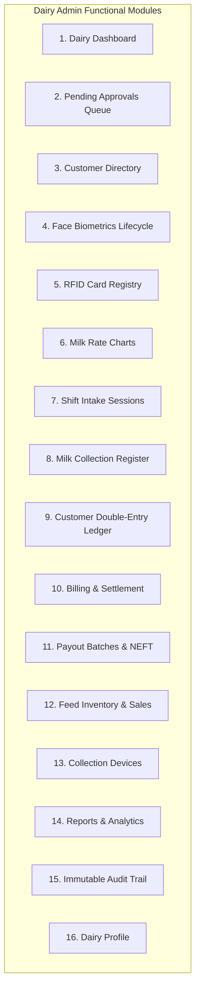

# DAIRY ADMIN AUDIT

**Audit Document Reference:** `DFARM-AUDIT-003`  
**Version:** `1.0.0-PROMPT0-AUDIT`  
**Status:** `READ-ONLY TECHNICAL BASELINE`  
**Classification:** `Dairy Administrator Web Application Audit & Root Cause Analysis`  
**Evaluator:** DFarm Principal Solution Architect & Full-Stack Audit Team  

---

## 1. Application Overview & Architectural Role

- **Application Directory:** `apps/dfarm-dairy-admin`
- **Architecture:** Vite 8.3.6 with React 19.3.1, TypeScript 7.0.2, Tailwind CSS v4, React Router DOM 7.18.5, TanStack Query 5.107.1.
- **Role:** Centralized operational governance interface for exactly one authorized Dairy cooperative tenant.
- **Target Backend Mapping:** Must connect to that specific Dairy's dedicated operational PostgreSQL database (`dfarm_tenant_[code]_[uuid8]`).



---

## 2. Module-by-Module Code & API Inspection

| Module | Source Page Path | Backing API Client Method | Target DB Tables | Functional State & Findings |
| :--- | :--- | :--- | :--- | :--- |
| **Dairy Dashboard** | `src/pages/dashboard/Dashboard.tsx` | `api.dashboard.getSummary()` | `collections`, `customers`, `ledger` | Connected to `/api/v1/dashboard/summary`. Returns zeros when empty; falls back if backend is offline. |
| **Pending Approvals** | `src/pages/customers/PendingApprovals.tsx` | `api.customers.getPending()` | `customers`, `customer_addresses` | Connected to `GET /api/v1/customers/pending`. Displays 0 due to Gokul tenant mismatch (Finding `DF-DA-001`). |
| **Customer Directory**| `src/pages/customers/CustomerDirectory.tsx` | `api.customers.list()` | `customers`, `customer_ledger_accounts` | Connected to `GET /api/v1/customers`. Client contains `mock-server.ts` fallback containing fake customers. |
| **Face Biometrics** | `src/pages/biometrics/FaceBiometrics.tsx` | `api.biometrics.list()` | `face_enrollments`, `face_model_versions` | Displays YuNet & SFace metadata, template versions, and consent status. |
| **RFID Card Registry**| `src/pages/rfid/RfidRegistry.tsx` | `api.rfid.list()` | `rfid_cards`, `rfid_card_assignments` | Manages card UIDs, active assignments, and lost card revocation. |
| **Collection Sessions**| `src/pages/collection/CollectionSessions.tsx` | `api.sessions.list()` | `shift_sessions` | Displays Morning/Evening sessions. Data is blank unless collection app syncs. |
| **Milk Register** | `src/pages/collection/MilkRegister.tsx` | `api.collections.list()` | `milk_collection_transactions` | Displays individual intake slips (Weight, FAT, SNF, CLR, Total Amount). |
| **Quality Trends** | `src/pages/quality/QualityTrends.tsx` | `api.quality.getTrends()` | `milk_collection_transactions` | Recharts FAT/SNF distribution curves based on real collection entries. |
| **Milk Rate Charts** | `src/pages/rate-charts/RateCharts.tsx` | `api.rates.getCharts()` | `rate_charts`, `rate_chart_grids` | 2D matrix editor for COW/BUFFALO FAT-SNF rates with effective dates. |
| **Customer Ledger** | `src/pages/ledger/CustomerLedger.tsx` | `api.ledger.getEntries()` | `customer_ledger_accounts`, `ledger_entries` | Full double-entry subledger tracking collection credits and feed debits. |
| **Billing & Settlement**| `src/pages/billing/BillingSettlement.tsx` | `api.billing.getCycles()` | `monthly_billing_cycles`, `customer_bills` | Generates 15-day/monthly bills, itemizing milk revenue and deductions. |
| **Payments & Receipts**| `src/pages/payments/PaymentsReceipts.tsx`| `api.payments.getPayouts()` | `payment_batches`, `customer_payouts` | Maker-checker approval and NEFT bank file generation. |
| **Feed Inventory** | `src/pages/feed/FeedInventory.tsx` | `api.feed.getInventory()` | `feed_products`, `feed_inventory_movements` | Stock balance, procurement inwards, and stock adjustments. |
| **Customer Feed Sales**| `src/pages/feed/CustomerFeedSales.tsx` | `api.feed.getSales()` | `customer_feed_sales`, `ledger_entries` | Debits cattle feed bag purchases directly to farmer ledger accounts. |
| **Collection Devices**| `src/pages/devices/CollectionDevices.tsx` | `api.devices.list()` | `devices` | Manages hardware assignments (analyzers, scales, RFID readers). |
| **Reports Hub** | `src/pages/reports/ReportsHub.tsx` | `api.reports.generate()` | All tenant tables | Generates shift, quality, and financial summaries; exports CSV/JSON. |
| **Staff & Permissions**| `src/pages/staff/StaffPermissions.tsx` | `api.staff.list()` | `users`, `user_center_assignments` | Manages center operators, accountants, and supervisor roles. |
| **Audit Trail** | `src/pages/audit/AuditTrail.tsx` | `api.audit.list()` | `audit_logs` | Append-only operational audit log of dairy administrative events. |
| **Dairy Profile** | `src/pages/profile/DairyProfile.tsx` | `api.profile.get()` | `organizations`, `dairy_centers` | Address, contact details, shifts, and collection center coordinates. |

---

## 3. Investigation of Owner-Reported Symptoms & Root Cause Analysis

### Diagnostic Issue 1: Hardcoded Dairy Identity (Gokul Primary Cooperative / GOKUL-01)
- **Reported Symptom:** The Dairy Admin displays "Gokul Primary Cooperative" / "DF-GOKUL-01" even when another Dairy Admin is logged in.
- **Root Cause Confirmed:**
  1. In `services/backend/src/infrastructure/database/PostgresPool.ts` (lines 238-249), the platform owner's mobile number (`+917755995615`) is explicitly inserted into the `users` table as belonging to `dairyAId` (`00000000-0000-0000-0000-000000000001` - Gokul Primary Cooperative).
  2. When the administrator logs in via `POST /api/v1/auth/admin/otp/verify`, `VerifyAdminOtpUseCase` runs a SQL query:
     ```sql
     SELECT u.id, u.organization_id, o.name AS org_name, o.code AS org_code
     FROM users u LEFT JOIN organizations o ON o.id = u.organization_id
     WHERE u.phone_number LIKE '%7755995615' LIMIT 1;
     ```
     This query resolves to Gokul's organization ID.
  3. In `apps/dfarm-dairy-admin/src/api/mock-server.ts` (lines 30-36), the local fallback server also hardcodes:
     ```typescript
     export const CURRENT_DAIRY_ID = 'dairy-ten-9801';
     export const SEED_DAIRY: DairyProfile = {
       id: CURRENT_DAIRY_ID,
       dairyCode: 'DF-GOKUL-01',
       name: 'Gokul Dairy Farmers Cooperative',
     };
     ```
  4. Both the backend seed and the frontend client mock are hardcoded to Gokul.

---

### Diagnostic Issue 2: Pending Customer Registrations Shows "0"
- **Reported Symptom:** Pending Customer Registrations shows 0 even after a farmer has successfully registered under a dairy.
- **Root Cause Confirmed:**
  1. A farmer registers using the Customer Mobile App, selecting their local dairy (e.g. `kalpna mlik's` - `e363070f-0004-492f-b759-e51038c0e35a`).
  2. The registration writes to Kalpna's tenant database/memory partition.
  3. The owner opens Dairy Admin and logs in with `+917755995615`.
  4. Because of Diagnostic Issue 1, the owner's session resolves to Gokul (`00000000-0000-0000-0000-000000000001`).
  5. Dairy Admin issues `GET /api/v1/customers/pending?organizationId=00000000-0000-0000-0000-000000000001`.
  6. The backend queries Gokul's pending queue, which is naturally 0 because the farmer registered under Kalpna.
  7. Furthermore, since PostgreSQL is offline, any restart of `services/backend` clears all tenant memory databases, wiping out registrations regardless of dairy selection.

---

### Diagnostic Issue 3: Customer Directory Displays Fake Customers
- **Reported Symptom:** Customer Directory displays sample farmers who do not actually exist.
- **Root Cause Confirmed:**
  1. In `apps/dfarm-dairy-admin/src/api/mock-server.ts` (lines 97-200), an in-memory array contains demo customers: "Pandurang Mahadev Patil" (C-101), "Sunita Tukaram Shinde" (C-102), "Aniket Ganpatrao Jadhav" (C-103), etc.
  2. If the backend API call fails or times out, or if the user tests without starting the backend, `apps/dfarm-dairy-admin/src/api/index.ts` falls back to `mock-server.ts`, displaying fake customers.

---

### Diagnostic Issue 4: Collection Sessions Show Fake Data or Fail
- **Reported Symptom:** Collection Sessions show fake data or do not sync with the Dairy Admin.
- **Root Cause Confirmed:**
  1. Collection App and Dairy Admin connect to the backend as separate clients.
  2. In `apps/dfarm-collection-app/src/api/mock-backend.ts`, the kiosk app maintains its own internal collection journal.
  3. In `services/backend/src/presentation/routes/collections.routes.ts`, session creation requires an active operator token with an explicit `organizationId`.
  4. When the collection app submits transactions to the backend while PostgreSQL is down, transactions are held in volatile memory. If the backend is restarted or the Dairy Admin queries an unaligned tenant ID, the sessions do not appear in Dairy Admin.

---

## 4. Remediation Plan for Dairy Admin

1. **Prompt 2:** Remove hardcoded Gokul seed in `PostgresPool.ts`. Allow dynamic administrator authentication where an administrator's session correctly resolves to the Dairy they were invited to administer.
2. **Prompt 6:** Remove `mock-server.ts` fallback data from `apps/dfarm-dairy-admin/src/api/index.ts`. All directory, pending approval, session, and financial views must strictly return live data from the authorized tenant's physical PostgreSQL database.
3. **Prompt 6:** Ensure the pending approvals queue displays honest zero states when no registrations exist, and accurately reflects incoming registrations from Customer App.
