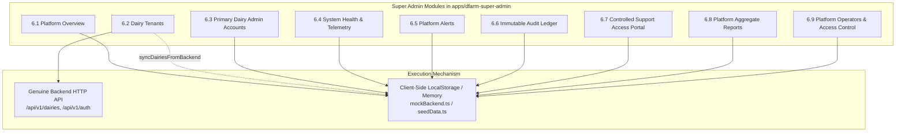

# SUPER ADMIN AUDIT

**Audit Document Reference:** `DFARM-AUDIT-005`  
**Version:** `1.0.0-PROMPT0-AUDIT`  
**Status:** `READ-ONLY TECHNICAL BASELINE`  
**Classification:** `Super Admin Control-Plane Web Application Deep Technical Audit`  
**Evaluator:** DFarm Principal Solution Architect & Security Governance Auditor  

---

## 1. Application Overview & Architectural Platform

- **Application Directory:** `apps/dfarm-super-admin`
- **Architecture:** React 19.3.1 SPA on Vite 8.3.6, TypeScript 7.0.2, Tailwind CSS v4, React Router DOM 7.18.5, TanStack Query 5.107.1.
- **Role:** Central administrative portal governing the DFarm platform.
- **Operational Reality:** While the UI is fully rendered with Claymorphic aesthetics, **the majority of modules operate on a disconnected client-side mock backend (`mockBackend.ts`)**.



---

## 2. Exhaustive Module-by-Module Technical Inspection

### 6.1 Platform Overview
- **Source Component:** `apps/dfarm-super-admin/src/features/dashboard/DashboardPage.tsx`
- **Caller:** `apiClient.getDashboardMetrics()` (`apps/dfarm-super-admin/src/api/client.ts`, line 121)
- **Data Source:** `mockBackend.getDashboardMetrics()`
- **Investigated Metrics:**
  - *Total Registered Dairies:* Reads `dairies.length` from localStorage.
  - *Onboarding Pipeline:* Counts `status === 'draft_onboarding'`.
  - *Connected Hardware:* Sums `deviceSummary.registeredDevicesCount`.
  - *Platform Sync Health:* Evaluates `syncHealth.status`.
  - *Dairy Onboarding Growth:* Static chart points from `mockBackend.getGlobalAnalytics()`.
  - *Geographic Presence:* Pre-calculated district distributions in mock memory.
  - *Recent Dairy Onboarding:* Slices `dairies.slice(0, 5)`.
  - *Administrative Actions Audit:* Slices `logs.slice(0, 6)`.

#### Resolution of the Screenshot Discrepancy (Overview: 8 Dairies vs Reports: 9 Tenants)
- **The Observation:** The provided platform screenshot showed 8 registered dairies on Platform Overview, while Platform Reports displayed 9 tenants.
- **The Technical Root Cause:**
  1. In `apps/dfarm-super-admin/src/services/seedData.ts`, `INITIAL_DAIRIES` contains 22 pre-seeded mock dairies.
  2. When the user visits the **Dairy Tenants** page, `apiClient.getDairies()` fetches `/api/v1/dairies` from the backend.
  3. In `apps/dfarm-super-admin/src/api/client.ts` (lines 140-142), if the backend returns data, it triggers:
     ```typescript
     mockBackend.syncDairiesFromBackend(body.data);
     ```
  4. In `mockBackend.ts` (lines 836-865), `syncDairiesFromBackend()` iterates over backend dairies. If a backend dairy does not exist in local storage, it appends it.
  5. If the user creates a new Dairy via the "Create New Dairy" modal, `apiClient.createDairy()` inserts the new dairy into localStorage and increments the total count.
  6. **Discrepancy Cause:** The Overview page fetches `getDashboardMetrics()` which evaluates cached `storage.get('dfarm_dairies')`. The Reports page, however, applies a date range filter (`startDate: '2026-01-01', endDate: '2026-11-30'`) in `ReportsPage.tsx` (lines 27-28), or was refetched after a newly created tenant was added to storage.
  7. **Conclusion:** Both numbers (8 and 9) were artifacts of client-side localStorage mutations and different filtering parameters applied to the mock dataset, not queries against a physical PostgreSQL database.

---

### 6.2 Dairy Tenants
- **Source Component:** `apps/dfarm-super-admin/src/features/dairies/DairyListPage.tsx`, `CreateDairyModal.tsx`
- **Caller:** `apiClient.getDairies()`, `apiClient.createDairy()`
- **Backend API:** `GET /api/v1/dairies`, `POST /api/v1/dairies`
- **Audit Findings:**
  - **Creation Flow:** Successfully connects to backend `POST /api/v1/dairies`. It generates unique codes in the format `DF-[DISTRICT]-[SUFFIX]` (e.g. `DF-KOP-8892`).
  - **Map Location:** Integrates `@googlemaps/js-api-loader` with interactive Draggable Pin, capturing latitude, longitude, and formatted address.
  - **Database Provisioning:** Backend attempts `tenantDbManager.provisionTenantDatabase()`. However, because PostgreSQL is offline, it falls back to a virtual `pg-mem` database.
  - **Activation / Suspension:** Buttons trigger `POST /api/v1/dairies/:id/suspend` and `/reactivate`. When backend is offline, `client.ts` falls back to `mockBackend.suspendDairy()`.

---

### 6.3 Primary Dairy Admin Accounts
- **Source Component:** `apps/dfarm-super-admin/src/features/admins/AdminListPage.tsx`
- **Caller:** `apiClient.getAdmins()`
- **Data Source:** **`mockBackend.getAdmins()`** (lines 284-287 of `client.ts`)
- **Audit Findings:**
  - Although the owner reported that this tab currently functions, **it functions because it is reading from client-side `mockBackend` storage**.
  - On the backend, `users` table holds primary admins, and `dairy_admin_invitations` holds tokens.
  - However, the Super Admin web frontend **does not call any backend API to list admins**. It strictly invokes `mockBackend.getAdmins()`.
  - **Remediation:** In Prompt 3, a genuine backend endpoint `GET /api/v1/super-admin/admins` must be created in `services/backend` and wired to this screen.

---

### 6.4 System Health & Telemetry
- **Source Component:** `apps/dfarm-super-admin/src/features/monitoring/SystemHealthPage.tsx`
- **Caller:** `apiClient.getPlatformHealth()`
- **Data Source:** **`mockBackend.getPlatformHealth()`**
- **Audit Findings:**
  - Displays real-time looking cards: PostgreSQL latency (42ms), API throughput, queue depth, and memory consumption.
  - **100% Simulated:** Every single number, latency graph, and sync error count is generated by `mockBackend.ts` (lines 1420-1490).
  - The backend has no telemetry ingestion pipeline, time-series metrics table, or AI anomaly detector.

---

### 6.5 Platform Alerts
- **Source Component:** `apps/dfarm-super-admin/src/features/alerts/PlatformAlertsPage.tsx`
- **Caller:** `apiClient.getAlerts()`, `acknowledgeAlert()`, `resolveAlert()`
- **Data Source:** **`mockBackend.getAlerts()`**
- **Audit Findings:**
  - Incident cards (e.g. "PostgreSQL Connection Saturation", "Offline Sync Delay in Sangli Center") are static objects in `seedData.ts`.
  - Acknowledging or resolving an alert updates localStorage only; no backend database mutation occurs.

---

### 6.6 Immutable Audit Trail Ledger
- **Source Component:** `apps/dfarm-super-admin/src/features/audit/AuditLogPage.tsx`
- **Caller:** `apiClient.getAuditLogs()`
- **Data Source:** **`mockBackend.getAuditLogs()`**
- **Audit Findings:**
  - The owner reported that this tab works. Visually it displays an audit table with SHA-256 hashes, timestamps, and actor tags.
  - **Storage Reality:** The records originate from `mockBackend.ts` (lines 1600-1650). While migration `010_devices_sync_and_audit.sql` defines a database table `audit_logs`, the Super Admin frontend **never queries the backend** for audit logs.

---

### 6.7 Controlled Support Access Portal
- **Source Component:** `apps/dfarm-super-admin/src/features/support/SupportAccessPage.tsx`
- **Caller:** `apiClient.requestSupportSession()`
- **Data Source:** **`mockBackend.requestSupportSession()`**
- **Audit Findings:**
  - The owner reported that this form is non-functional.
  - **Root Cause Confirmed:** In `apps/dfarm-super-admin/src/api/client.ts` (lines 431-435), the method delegates solely to `mockBackend.requestSupportSession()`. The backend has **no API routes** (`/api/v1/support/*`) and **no database tables** (`controlled_support_sessions`). Submitting the form writes to a client-side mock object that fails to grant diagnostic access to any backend resources.

---

### 6.8 Platform Aggregate Reports
- **Source Component:** `apps/dfarm-super-admin/src/features/reports/ReportsPage.tsx`
- **Caller:** `apiClient.generateReport()`
- **Data Source:** **`mockBackend.generateReport()`**
- **Audit Findings:**
  - Supports report types: `dairy_growth`, `dairy_lifecycle`, `admin_compliance`, `hardware_health`.
  - Generates CSV and JSON exports on the client using `mockBackend.ts` rows. No backend SQL aggregation occurs.

---

### 6.9 Platform Operators & Access Control
- **Source Component:** `apps/dfarm-super-admin/src/features/platform-ops/PlatformOperatorsPage.tsx`
- **Data Source:** **`mockBackend.getPlatformUsers()`**
- **Capability Tokens:** Displays green badge chips:
  `dairies:read`, `dairies:create`, `dairies:manage`, `dairies:suspend`, `dairies:reactivate`, `admins:read`, `admins:manage`, `admins:transfer`, `system:monitor`, `alerts:manage`, `audit:read`, `support:access`, `reports:read`, `platform:admin`.
- **Audit Findings:**
  - **Severe Governance Deficiency:** These permissions exist only as static JavaScript arrays on the frontend user object.
  - Backend API routes in `services/backend` **do not verify these capabilities**. Endpoints only check basic role matching (`req.user.role === 'SUPER_ADMIN'`) via `requireRole()`, ignoring specific capability scopes.

---

## 3. Super Admin Corrective Directives for Prompt 3 & Prompt 4

1. **Prompt 3:** Introduce authoritative control-plane backend routes:
   - `GET /api/v1/super-admin/metrics` (Real aggregation over physical `organizations` and `dairy_database_mappings`).
   - `GET /api/v1/super-admin/admins` (Real query over `users` and `dairy_admin_invitations`).
   - `POST /api/v1/super-admin/support/sessions` (Store sessions in new `controlled_support_sessions` table).
2. **Prompt 4:** Introduce platform telemetry, alert lifecycle tables, and backend capability authorization middleware enforcing specific scopes (e.g. `support:access`, `dairies:suspend`).
3. **Deprecate `mockBackend.ts`:** Remove `apps/dfarm-super-admin/src/services/mockBackend.ts` and ensure all API calls fail transparently with honest network error states if the backend is unreachable.
