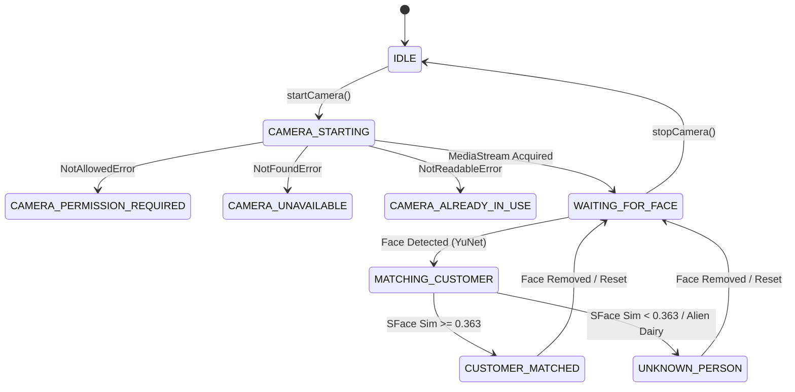

# DFarm Collection App — Hardware Camera Diagnostics & Troubleshooting

**Module:** `useCamera` hook & `CustomerIdentityPanel`  
**Protocol:** HTML5 MediaDevices / WebRTC `getUserMedia()`  

---

## 1. Hardware State Machine

The camera subsystem in `apps/dfarm-collection-app/src/hooks/useCamera.ts` implements a deterministic state machine:

---

## 2. Common Camera Failure Modes & Solutions

### 1. "Camera access was denied (Permission Required)"
* **Error Type:** `NotAllowedError` / `PermissionDeniedError`
* **Root Cause:** The operator denied browser camera permissions on the initial prompt.
* **Resolution:**
  1. Click the lock/tune icon in the browser address bar.
  2. Toggle **Camera** permission to **Allow**.
  3. Click **Retry Camera** in the collection app.

### 2. "Camera unavailable (Insecure Context)"
* **Error Type:** `TypeError: navigator.mediaDevices is undefined`
* **Root Cause:** WebRTC APIs are restricted to **Secure Contexts** (`https://` or `http://localhost`). Accessing over raw IP (e.g. `http://192.168.1.50:5173`) disables `getUserMedia()`.
* **Resolution:**
  - Access the application via `http://localhost:5173` or set up an SSL reverse proxy (e.g. Nginx or Cloudflare Tunnel).

### 3. "Camera already in use by another application"
* **Error Type:** `NotReadableError` / `TrackStartError`
* **Root Cause:** Another browser tab, Zoom, Teams, or OpenCV Python process has locked the webcam hardware.
* **Resolution:**
  - Close external video applications or competing browser tabs, then click **Retry Camera**.

### 4. "No camera detected on workstation"
* **Error Type:** `NotFoundError` / `DevicesNotFoundError`
* **Root Cause:** The workstation has no connected USB camera or built-in webcam.
* **Resolution:**
  - Connect a USB UVC-compliant webcam (e.g. Logitech C920).
  - In demo/testing environments without a webcam, operators can use the **Simulate Face (C-101 / C-102)** or **Manual Search (F2)** buttons directly in `CustomerIdentityPanel`.
