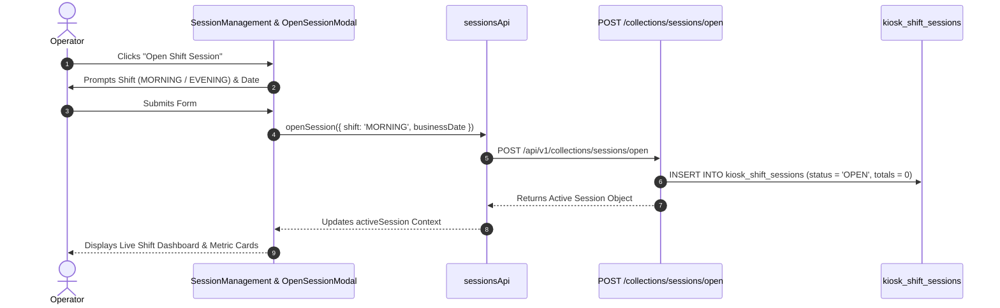

# DFarm Collection Shift Session Lifecycle & Operational Flow

**Module:** Shift Management (`apps/dfarm-collection-app/src/pages/sessions`)  
**Backend:** `kiosk_shift_sessions` & `collections.routes.ts`  

---

## 1. Operational Shift Lifecycle

Milk collection occurs in structured **Morning (सकाळ)** and **Evening (संध्याकाळ)** operational shifts.

---

## 2. Shift Reconciliation & Closure

When milk intake ends for the shift:
1. Operator navigates to **Shift Session Management (F3)**.
2. The summary cards display real-time shift aggregates:
   - **Total Milk Intake:** Net liters across Cow and Buffalo categories.
   - **Gross Payout:** Cumulative payout computed via rate matrix.
   - **Weighted Quality:** Real-time volume-weighted Average Fat % and Average SNF %.
   - **Patron Deliveries:** Total intake count with 100% verified identities.
3. Operator clicks **Conclude Shift**:
   - `CloseSessionModal` shows the confirmation dialog with total volume and transactions.
   - Operator confirms: invokes `closeSession(sessionCode)` which calls `POST /api/v1/collections/sessions/close`.
   - Backend sets `status = 'CLOSED'`, records `closed_at`, and finalizes the shift totals.
   - Kiosk status switches to `CLOSED`, and the operator can generate a **Shift Summary Receipt**.
