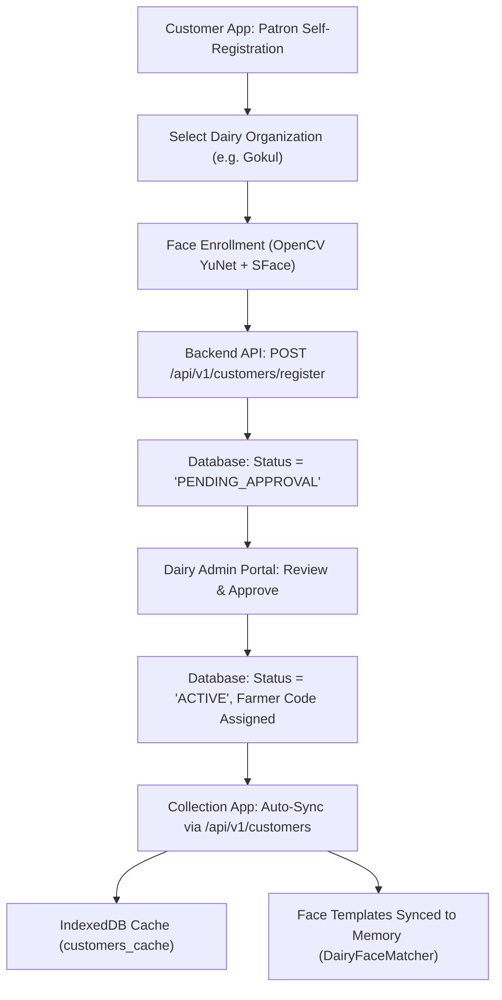

# DFarm Customer Data Loading & Biometric Enrollment Lifecycle

**Scope:** End-to-End Customer Registration, Approval, and Collection App Ingestion  
**Integration:** Customer App (`apps/dfarm-customer-app`) ↔ Backend ↔ Collection App (`apps/dfarm-collection-app`)  

---

## 1. End-to-End Patron Lifecycle

---

## 2. Ingestion & Filtering Rules for Collection Kiosks

1. **Strict Dairy Filtering:**
   - Kiosks query `GET /api/v1/customers`.
   - The backend enforces `WHERE organization_id = req.user.organizationId`.
   - Customers from other dairies are never transmitted over the wire.

2. **Active Status Requirement:**
   - Only patrons with `status = 'ACTIVE'` are returned for collection operations.
   - Patrons with `status = 'PENDING_APPROVAL'`, `'SUSPENDED'`, or `'DEACTIVATED'` are excluded from the active collection cache.

3. **Biometric Template Loading:**
   - The kiosk loads enrolled biometric templates via `GET /api/v1/identity/face/templates`.
   - Templates belonging to suspended or deleted customers are excluded at query time.
   - If a customer's face enrollment is revoked or re-enrolled, the client updates its internal `enrolledTemplates` set on the next sync cycle.

---

## 3. Offline Data Resiliency (IndexedDB)

1. **`customers_cache` Store:**
   - Upon successful fetch, the collection app caches customer records and active templates into IndexedDB.
   - If the kiosk loses internet connectivity during milk collection, it seamlessly falls back to the local IndexedDB cache, allowing uninterrupted intakes.

2. **Delta Sync & Reconciliation:**
   - When the kiosk comes back online, `refreshCustomersAndTemplates()` executes in the background to fetch updated balances and newly approved farmers.
