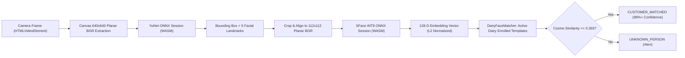

# OpenCV YuNet & SFace INT8 Face Recognition Integration

**Models:** OpenCV YuNet (Face Detection) + OpenCV SFace INT8 (Face Recognition)  
**Runtime:** Browser WASM (`onnxruntime-web`)  
**Status:** FULLY INTEGRATED & CALIBRATED  

---

## 1. Verified Model Asset Manifest

Both neural models have been copied to `apps/dfarm-collection-app/public/models/` and verified with SHA-256 checksums matching the Google Colab testing environment:

| Property | Model 1: Face Detector | Model 2: Face Recognizer |
|---|---|---|
| **Model Name** | OpenCV YuNet | OpenCV SFace INT8 |
| **Filename** | `face_detection_yunet_2023mar.onnx` | `face_recognition_sface_2021dec_int8.onnx` |
| **File Size** | 232,589 bytes (227 KB) | 9,896,933 bytes (9.44 MB) |
| **SHA-256** | `8f2383e4dd3cfbb4553ea8718107fc0423210dc964f9f4280604804ed2552fa4` | `2b0e941e6f16cc048c20aee0c8e31f569118f65d702914540f7bfdc14048d78a` |
| **Input Shape** | `[1, 3, 640, 640]` | `[1, 3, 112, 112]` |
| **Color Order** | Planar BGR Float32 | Planar BGR Float32 |
| **Output Shape** | Strides 8, 16, 32 (`cls`, `obj`, `bbox`, `kps`) | `[1, 128]` Float32 embedding vector (`fc1`) |
| **Metric** | Intersection-over-Union (IoU) >= 0.30 | Cosine Similarity >= **0.363** |

---

## 2. Browser Neural Inference Pipeline

---

## 3. Mathematical Specifications

### 3.1 Preprocessing: Planar BGR Float32
Unlike standard browser RGBA image data, OpenCV Zoo models require planar BGR channel ordering:
$$T(c, y, x) = \begin{cases} B(x, y) & c = 0 \\ G(x, y) & c = 1 \\ R(x, y) & c = 2 \end{cases}$$
Implemented in `src/face-ai/preprocessor.ts` via direct typed array indexing.

### 3.2 L2 Normalization
$$\hat{v} = \frac{v}{\|v\|_2} = \frac{v}{\sqrt{\sum_{i=1}^{128} v_i^2}}$$

### 3.3 Cosine Similarity Matching
$$\text{Cosine Similarity}(u, v) = \frac{u \cdot v}{\|u\|_2 \|v\|_2} = \sum_{i=1}^{128} \hat{u}_i \hat{v}_i$$
Threshold:
$$\text{Match} = \begin{cases} \text{TRUE} & \text{similarity} \ge 0.363 \\ \text{FALSE} & \text{similarity} < 0.363 \end{cases}$$

---

## 4. Dairy-Scoped Matching (`DairyFaceMatcher`)

The matcher enforces strict multi-tenant isolation:
1. Filters enrolled templates where `template.dairyId === activeDairyId` and `template.status === 'ACTIVE'`.
2. Rejects probe vectors that do not equal 128 dimensions (`INVALID_PROBE_EMBEDDING_SHAPE`).
3. Computes similarity against active templates. If the best score exceeds `0.363`, the customer record is returned.
4. If no templates match or the probe belongs to an alien dairy, returns `UNKNOWN_PERSON`.
