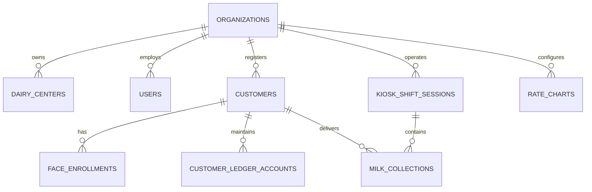

# Multi-Dairy Logical Data Isolation Architecture & Tenant Security

**Version:** 1.0  
**Scope:** DFarm Multi-Tenant Relational Isolation Model  
**Target:** Super Admin, Dairy Admin, Collection App Operators  

---

## 1. Architectural Decision: Shared Schema with Tenant Scoping

DFarm uses a **shared-database, shared-schema** multi-tenant architecture with column-level tenant scoping (`organization_id`).

### Rationale:
1. **Migration Manageability:** Avoids the operational hazards, migration drift, and schema bloat associated with dynamic per-dairy schemas or dynamic table names.
2. **Referential Integrity:** Enforces foreign keys and unique constraints scoped to `(organization_id, ...)`.
3. **Connection Efficiency:** Single managed connection pool (`pg.Pool`) with centralized telemetry and SSL encryption.
4. **Row-Level Security (RLS) Ready:** Compatible with PostgreSQL RLS policies where `organization_id = current_setting('app.current_organization_id', true)`.

---

## 2. Tenant Entity Relationships & Domain Scoping

All tenant-owned domain tables contain a foreign key `organization_id REFERENCES organizations(id)`:



### Critical Scoped Tables:
1. **`organizations`**: Master tenant record (Dairy ID, name, code, contact, subscription).
2. **`dairy_centers`**: Village collection centers and BMCs belonging to an organization.
3. **`users`**: Dairy Admins and Operators linked via `organization_id`.
4. **`customers`**: Farmers registered under the dairy. Scoped unique constraint: `UNIQUE (organization_id, farmer_code)`.
5. **`face_enrollments`**: Biometric templates encrypted at rest via AES-256-GCM. Scoped to `customer_id` and verified against `customer.organization_id`.
6. **`kiosk_shift_sessions`**: Shift sessions for counter intake. Scoped via `organization_id`.
7. **`milk_collections`**: Transaction records. Scoped via `organization_id` and customer foreign key.
8. **`customer_ledger_accounts`**: Double-entry financial balances per customer per dairy.

---

## 3. Server-Side Tenant Authorization Rules

**Rule 1: Never Trust Frontend-Supplied `dairy_id`**
- The frontend `X-Dairy-Id` header is treated purely as a hint or context selector.
- The authoritative tenant identity is extracted server-side from the verified JWT:
  ```typescript
  const tenantId = req.user.organizationId;
  ```

**Rule 2: Repository Tenant Binding**
- Every SQL query generated by repository implementations includes an explicit tenant predicate:
  ```sql
  SELECT * FROM customers 
  WHERE organization_id = $1 AND status = 'ACTIVE'
  ```

**Rule 3: Cross-Dairy Access Prevention**
- If an operator tries to query or transact on a customer ID belonging to another dairy, the server aborts the transaction with `403 Forbidden`:
  ```typescript
  if (customer.organizationId !== req.user.organizationId) {
    res.status(403).json({
      success: false,
      error: 'Access denied. Customer belongs to a different dairy organization.',
    });
    return;
  }
  ```

---

## 4. Frontend Biometric Isolation Rules (`DairyFaceMatcher`)

In the browser, face recognition matches against pre-loaded enrolled templates for speed. To prevent biometric leakage:

1. **Dairy-Scoped Cache:** The collection app queries `/api/v1/identity/face/templates`. The backend only returns templates where `organization_id = req.user.organizationId`.
2. **Client-Side Validator:** The `DairyFaceMatcher` enforces:
   ```typescript
   const dairyTemplates = enrolledTemplates.filter(
     (t) => t.dairyId === activeDairyId && t.status === 'ACTIVE'
   );
   ```
3. **No Cross-Dairy Fallback:** If Dairy A patron C-101 presents their face at Dairy B's kiosk, `DairyFaceMatcher` evaluates only Dairy B's templates and returns `UNKNOWN_PERSON` with confidence below `0.363`.

---

## 5. Migration and Data Quarantine Strategy

If historical customer records exist without a valid `organization_id`:
1. **Never guess tenant ownership.** Ambiguous records are quarantined in a `quarantined_records` table.
2. Database migration `002_create_tenants.sql` seeds primary organizations:
   - Dairy A: Gokul Primary (`00000000-0000-0000-0000-000000000001`)
   - Dairy B: Warna Sahakari (`00000000-0000-0000-0000-000000000004`)
3. All customer registrations from the Customer App are created with the selected dairy's ID and require Dairy Admin approval before being marked `ACTIVE`.

---

## 6. Verification Test Matrix

| Test Scenario | Expected Outcome | Verification |
|---|---|---|
| Operator A lists customers | Receives Dairy A customers only | `GET /customers` unit & integration tests |
| Operator A requests Dairy B customer details | `403 Forbidden` | `GET /customers/:id` route guard |
| Operator A scans Dairy B patron face | No match / `UNKNOWN_PERSON` | `DairyFaceMatcher` vitest suite |
| Operator B opens collection shift | Shift scoped to Dairy B ID | `POST /sessions/open` |
| Milk intake recorded | Scoped to Dairy A `organization_id` | `milk_collections` transaction test |
