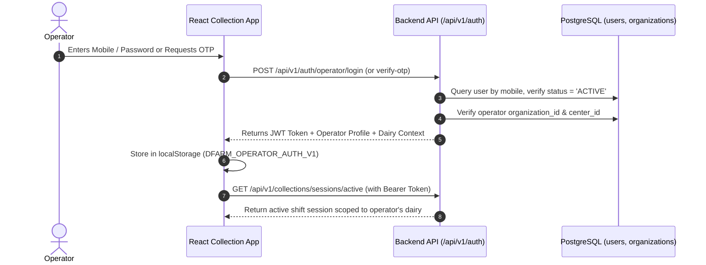

# DFarm Operator Authorization & Access Scope Architecture

**Scope:** Operator Authentication, Dairy Scoping, and Operational RBAC  
**Applicability:** Collection App (`apps/dfarm-collection-app`) & Backend Auth Routes  

---

## 1. Authentication Lifecycle

The Collection App operates under an authenticated operator session.

---

## 2. Role-Based Access Control (RBAC) Matrix

| Resource / Action | Super Admin | Dairy Admin | Operator | Customer |
|---|---|---|---|---|
| Create New Dairy | ✅ Allowed | ❌ Denied | ❌ Denied | ❌ Denied |
| Create Operator Accounts | ✅ Allowed | ✅ For Own Dairy | ❌ Denied | ❌ Denied |
| Approve Customer Enrolment | ✅ Allowed | ✅ For Own Dairy | ❌ Denied | ❌ Denied |
| Open Collection Shift | ❌ Denied | ✅ For Own Dairy | ✅ For Own Center | ❌ Denied |
| Record Milk Intake | ❌ Denied | ✅ For Own Dairy | ✅ For Own Shift | ❌ Denied |
| Reconcile & Close Shift | ❌ Denied | ✅ For Own Dairy | ✅ For Own Shift | ❌ Denied |
| View Financial Ledgers | ✅ Platform-wide | ✅ Dairy-wide | ❌ Shift Totals Only | ✅ Personal Only |
| Modify Rate Charts | ✅ Allowed | ✅ For Own Dairy | ❌ Read Only | ❌ Read Only |

---

## 3. Dairy Scope Resolution Rules

1. **Single-Dairy Operator:**
   - When an operator is associated with exactly one dairy in `users.organization_id`, that dairy is automatically resolved as their active tenant. No manual dropdown is displayed.
2. **Multi-Dairy Operator:**
   - If an operator has explicit membership across multiple centers/dairies, they must choose their active operational dairy on login. The selected dairy context is embedded into their session token.
3. **Session Binding:**
   - Operators can only record milk intakes when an active `kiosk_shift_sessions` record exists in their authorized dairy and center.

---

## 4. Frontend Credential Storage & Security

- Stored in browser `localStorage` under key `DFARM_OPERATOR_AUTH_V1`:
  - `token`: Short-lived HMAC-SHA256 JWT signed with backend secret.
  - `dairyId`: Active Dairy UUID.
  - `dairyCode`: Human-readable identifier (e.g. `GOKUL-01`).
  - `operator`: Identity object (`operatorId`, `fullName`, `role`).
- Automatic session termination on 401 Unauthorized responses.
- Clear stored credentials immediately on operator logout (`clearStoredOperatorAuth()`).
