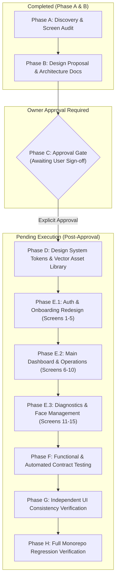

# DFARM CUSTOMER APP — COMPLETE REDESIGN IMPLEMENTATION PLAN

**Document Version:** 1.0.0  
**Date:** 2026-11-16  
**Status:** PROPOSED — PENDING OWNER APPROVAL (PHASE C)  
**Target:** `apps/dfarm-customer-app`  

---

## 1. Executive Summary & Goals

This redesign plan outlines the engineering and visual execution strategy for transforming the DFarm Customer Mobile Application into a premium Claymorphism experience.

The transformation strictly adheres to:
1. **Real Data Exclusively:** Eradicate all mock data, hardcoded customer identities, demo fallback balances, and fake statuses.
2. **Original Vector Assets:** Replace all raw emojis and low-fidelity decorations with purpose-crafted, high-resolution SVG vector illustrations adhering to the DFarm visual style.
3. **Preservation of Business Logic:** 100% preservation of authentication, SMS OTP routing, dairy geolocation discovery, producer registration validation, OpenCV YuNet & SFace INT8 biometric pipelines, and database double-entry ledger contracts.
4. **Independent UI Verification:** Mandatory verification against strict accessibility and visual consistency rubrics prior to release.

---

## 2. Phase-by-Phase Roadmap & Approval Gates

### Phase Breakdown

* **Phase A — Analyze [COMPLETED]:**
  - Audited all 15 routes and components across `(auth)`, `(onboarding)`, and `(main)`.
  - Identified all mock data and hardcoded fallback strings.
  - Inspected backend API contracts, ONNX model integrations, and unit test suites.
* **Phase B — Design Proposal [COMPLETED]:**
  - Authored `CUSTOMER_APP_SCREEN_INVENTORY.md`.
  - Authored `CUSTOMER_APP_DESIGN_SYSTEM.md`.
  - Authored `CUSTOMER_APP_REDESIGN_PLAN.md`.
  - Authored `CUSTOMER_APP_COMPONENT_GUIDE.md`.
  - Authored `CUSTOMER_APP_VECTOR_ASSET_CATALOG.md`.
  - Authored `CUSTOMER_APP_API_PRESERVATION_REPORT.md`.
* **Phase C — Approval Gate [CURRENT STAGE]:**
  - Present the comprehensive redesign plan to the project owner.
  - **Wait for explicit owner confirmation before modifying or authoring UI code.**
* **Phase D — Design System Implementation [POST-APPROVAL]:**
  - Enhance `theme.ts` with complete clay tokens and semantic surfaces.
  - Implement the original vector asset library in `src/assets/vectors/` using `react-native-svg`.
  - Implement upgraded shared components (`ClayCard`, `ClayButton`, `ClayInput`, `ClayBadge`, `ClayHeader`, `ClayModal`, `ClayOTPInput`, `ClayStateView`).
* **Phase E — Page-by-Page Redesign [POST-APPROVAL]:**
  - Transform all 15 screens in structured increments.
  - Remove all mock fallbacks and wire strictly to real backend data.
* **Phase F — Functional Testing [POST-APPROVAL]:**
  - Verify every user flow: OTP login, dairy search, registration, live camera YuNet/SFace inference, approval status polling, collection history, bills, ledger.
* **Phase G — Independent UI Consistency Verification [POST-APPROVAL]:**
  - Cross-check every screen against the `ui-consistency` rubric.
* **Phase H — Monorepo Regression [POST-APPROVAL]:**
  - Run full test suites across mobile app and backend to guarantee zero regressions.

---

## 3. Page-by-Page Transformation Plan

### 3.1 Screen 1: Mobile Number Login (`src/app/(auth)/login.tsx`)
* **Reference:** Screenshot 1.
* **Redesign Blueprint:**
  - Replace flat branding pill with `DFarmBrandMark` (custom SVG milk droplet insignia + geometric brand mark).
  - Encapsulate form in raised Clay card with warm 14px peach shadow and 1.5px specular highlight line.
  - Inset tactile mobile input (`#FFF9F5`) with dedicated `+91` flag badge and bold monospace phone formatting.
  - Primary Orange Clay CTA button with spring tactile press feedback.
  - Real-time SMS dispatch loading state and authentic Dove SMS error handling.

### 3.2 Screen 2: OTP Verification (`src/app/(auth)/verify-otp.tsx`)
* **Redesign Blueprint:**
  - 6 distinct raised clay input cells with recessed inner shadows and orange focus borders.
  - Tactile timer badge displaying circular countdown progression.
  - Direct keyboard listener with auto-submit on 6th digit.
  - Resend OTP action with authentic backend rate-limiting feedback.

### 3.3 Screen 3: Select Your Dairy (`src/app/(onboarding)/dairy-discovery.tsx`)
* **Reference:** Screenshot 2.
* **Redesign Blueprint:**
  - Inset clay search bar with custom vector search icon.
  - Horizontal scrolling regional filter chips (`GPS Live`, `Kolhapur`, `Sangli`, `Pune`, `All Areas`) with active orange fill and soft shadow.
  - Replace harsh yellow permission warning banner with a brand-coherent warm peach clay card.
  - Raised Clay Dairy cards with village map pin vector, in-charge contact pill, and live calculated distance badge.
  - Selected dairy card displays an illuminated orange border and checkmark pill.
  - Sticky bottom action container featuring `Continue with [Selected Dairy]`.

### 3.4 Screen 4: Producer Registration — Step 1 (`src/app/(onboarding)/register.tsx`)
* **Reference:** Screenshot 3.
* **Redesign Blueprint:**
  - Two-step Clay progress tracker (Step 1: Details, Step 2: Biometrics).
  - Affiliated Dairy certificate card with official society badge.
  - Inset clay inputs for Full Name and Village/Gram Panchayat with accessible labels.
  - Custom vector illustrations replacing emojis: `Cow.svg`, `Buffalo.svg`, and `Herd.svg` in segmented clay selection pills.
  - Prominent Clay Biometric Consent Card with tactile toggle switch and clear data transparency notice.

### 3.5 Screen 5: Face Biometric Enrollment — Step 2 (`src/app/(onboarding)/face-enroll.tsx`)
* **Reference:** Screenshot 4.
* **Redesign Blueprint:**
  - Tactile camera viewport framed by a raised clay bezel with soft inner bevel.
  - Live front-camera stream from `CameraView` preserved inside the viewport.
  - Animated vector scanning reticle with corner brackets and pulsing oval guide.
  - Real-time badge indicating OpenCV YuNet detection status (`Searching...` -> `Face Centered` -> `Lighting OK`).
  - Real ONNX SFace INT8 128-D embedding extraction with multi-stage progress meter.
  - Real backend template encryption and registration submission.

### 3.6 Screen 6: Registration Status (`src/app/(onboarding)/pending-approval.tsx`)
* **Reference:** Screenshot 5.
* **Redesign Blueprint:**
  - Original vector status illustrations: `dfarm-reg-pending.svg`, `dfarm-reg-approved.svg`, and `dfarm-reg-rejected.svg`.
  - Elimination of hardcoded reference (`DFT-2026-8891`) and hardcoded verified badge.
  - 3-step vertical Clay Status Timeline (1. Biometric Captured, 2. Dairy Admin Verification, 3. Member Activation).
  - Dynamic display of genuine applicant name, assigned customer UUID / farmer code, and selected dairy name.
  - Polling mechanism with live pulse indicator and manual "Check Approval Status Now" CTA.

### 3.7 Screen 7: Main Navigation Tab Shell (`src/app/(main)/_layout.tsx`)
* **Redesign Blueprint:**
  - Replace all emojis (`🏠`, `🥛`, `📖`, `🧾`, `👤`) with custom DFarm vector tab icons.
  - Floating raised clay tab bar with upward shadow elevation and rounded top corners.
  - Active tab highlighted by soft peach clay pill with primary orange icon tint.

### 3.8 Screen 8: Customer Dashboard / Home (`src/app/(main)/index.tsx`)
* **Redesign Blueprint:**
  - Warm farmer greeting header with clay avatar, society tag, and face diagnostic shortcut.
  - Hero Clay Intake Card with custom sun/moon shift vectors, bold liter typography (`14.5 L`), and FAT/SNF gauge pills.
  - Raised Clay Khata Balance card with server-verified badge and clear "Payable to You" green accent.
  - 4-cell Monthly Performance clay grid with crisp numeric typography.
  - Quick Action tiles with custom vector illustrations.

### 3.9 Screen 9: Milk Collection History (`src/app/(main)/collection.tsx`)
* **Redesign Blueprint:**
  - Segmented clay filter bar with custom animal vector icons.
  - Tactile collection transaction cards with shift vector badges, bold liter metrics, and operator identification.
  - Authentic 40-column thermal digital receipt modal with clay paper texture, serrated edge detail, and biometric verification seal.

### 3.10 Screen 10: Customer Khata Ledger (`src/app/(main)/ledger.tsx`)
* **Redesign Blueprint:**
  - Complete elimination of hardcoded balance fallbacks; display exact server data or zero-balance empty state.
  - Tactile raised Clay Khata Card with dual credit/debit summary columns and server-audit guarantee insignia.
  - Ledger transaction rows with distinct green (+) and red (-) clay badges, reference IDs, and formatted running balance.

### 3.11 Screen 11: Bills & Statements (`src/app/(main)/bills.tsx`)
* **Redesign Blueprint:**
  - Premium Clay Bill Cards with distinct status pills (`DISBURSED` green, `PENDING` orange).
  - Prominent Net Payout display with large currency typography.
  - Rich breakdown modal with clear separation of Milk Volume, Quality Multipliers, Feed Deductions, and Net Bank Transfer confirmation.

### 3.12 Screen 12: Customer Profile (`src/app/(main)/profile/index.tsx`)
* **Redesign Blueprint:**
  - Tactile farmer identity card with raised clay avatar badge, verified checkmark, and registered phone number.
  - Affiliation section highlighting Cooperative Society, Collection Center code, and Supply Animal category.
  - Biometrics Security Card showcasing the YuNet + SFace INT8 encryption status with quick action buttons.
  - Tactile Danger Clay Button for Secure Logout.

### 3.13 Screen 13: "Test My Face" Diagnostics (`src/app/(main)/profile/diagnostics.tsx`)
* **Redesign Blueprint:**
  - Clear farmer-friendly sensor health indicators ("Camera Working", "Face Detected", "Photo Clear").
  - Advanced telemetry drawer for technicians/admins.
  - Clay sensor status pills with real millisecond latency metrics.

### 3.14 Screen 14: Update Face Biometrics (`src/app/(main)/profile/update-face.tsx`)
* **Redesign Blueprint:**
  - Animated clay reticle overlay with alignment guides.
  - Real-time model initialization and alignment feedback.
  - Dedicated Success Confirmation sheet with vector checkmark and updated template version badge.

### 3.15 Screen 15: Session Gatekeeper (`src/app/index.tsx`)
* **Redesign Blueprint:**
  - Branded clay loading screen with illuminated `DFarmBrandMark` and soft cream pulse while checking credentials.

---

## 4. Original Vector Asset Plan

All icons and illustrations will be implemented as modular, type-safe React Native SVG components in `src/assets/vectors/`.

| Asset Component | Filename | Description & Style |
|---|---|---|
| `DFarmLogo` | `DFarmLogo.tsx` | Official DFarm wordmark with glowing milk droplet |
| `CowIcon` | `CowIcon.tsx` | Stylized Indian Gir/Jersey cow vector in warm orange stroke |
| `BuffaloIcon` | `BuffaloIcon.tsx` | Stylized Murrah buffalo vector in blue stroke |
| `HerdIcon` | `HerdIcon.tsx` | Combined cow and buffalo herd illustration |
| `LocationPinIcon`| `LocationPinIcon.tsx`| Dairy geolocation map pin with pulse ring |
| `GpsIcon` | `GpsIcon.tsx` | Satellite telemetry live tracking icon |
| `DairyCenterIcon`| `DairyCenterIcon.tsx`| Village cooperative milk chilling plant building |
| `FaceOvalGuide` | `FaceOvalGuide.tsx` | 5-point biometric facial landmark alignment reticle |
| `FaceSuccessIcon`| `FaceSuccessIcon.tsx`| Biometric enrollment verified seal with checkmark |
| `StatusPendingIcon`| `StatusPendingIcon.tsx`| Clock hourglass clay icon for admin review |
| `StatusApprovedIcon`|`StatusApprovedIcon.tsx`| Verified membership shield icon |
| `StatusRejectedIcon`|`StatusRejectedIcon.tsx`| Reapplication required badge icon |
| `NavHomeIcon` | `NavHomeIcon.tsx` | Tactile house emblem for main tab |
| `NavMilkIcon` | `NavMilkIcon.tsx` | Traditional stainless steel milk can vector |
| `NavKhataIcon` | `NavKhataIcon.tsx` | Double-entry ledger passbook vector |
| `NavBillsIcon` | `NavBillsIcon.tsx` | Billing statement invoice vector |
| `NavProfileIcon`| `NavProfileIcon.tsx`| Farmer profile badge vector |
| `ShiftSunIcon` | `ShiftSunIcon.tsx` | Morning shift intake solar emblem |
| `ShiftMoonIcon`| `ShiftMoonIcon.tsx`| Evening shift intake lunar emblem |

---

## 5. Strict Real Data & Security Assurance

To honor Section 8 of the project requirements:
1. **Zero Mock Fallbacks:** All strings like `'DFT-2026-8891'`, `'Vitthal Dnyandeo Patil'`, `'12,480.00'` will be deleted from code.
2. **Proper Empty States:** When the server returns zero records, display a beautiful `ClayEmptyState` rather than placeholder dummy transactions.
3. **Proper Loading States:** While queries are in flight, render `ClayLoadingState` with genuine feedback.
4. **Authentic Biometric Persistence:** The app will never display "Verified" unless the ONNX inference pipeline generates a valid 128-D vector and the backend registers it.
5. **Session Integrity:** Tokens and customer IDs remain stored exclusively in encrypted `expo-secure-store`.

---

## 6. Verification & Testing Matrix

| Test Domain | Target State | Pass Criteria |
|---|---|---|
| **Auth** | Invalid Mobile | Inline error: "Please enter a valid 10-digit mobile number" |
| **Auth** | Valid Mobile | SMS dispatched via backend gateway; navigates to OTP screen |
| **Auth** | 6-Digit OTP | Authenticates session; stores tokens in SecureStore |
| **Discovery**| GPS Granted | Dairies sorted by ascending distance from coordinates |
| **Discovery**| GPS Denied | Displays warm permission banner; shows full dairy directory |
| **Registration**| Animal Selection | Updates form state; displays custom Cow/Buffalo/Herd vectors |
| **Registration**| Biometric Consent| Checkbox mandatory; blocks submission if unchecked |
| **Biometrics**| Face Aligned | YuNet detects 5 landmarks; SFace generates 128-D unit vector |
| **Status** | Pending Review | Polls status every 10s; shows real customer UUID |
| **Dashboard**| Real Intake | Displays today's shift, liters, FAT %, SNF %, and total amount |
| **Ledger** | Server Khata | Exact double-entry running balance matching server data |
| **Regression**| Jest & TypeScript | 100% pass on all existing 5 test suites; 0 TypeScript errors |
