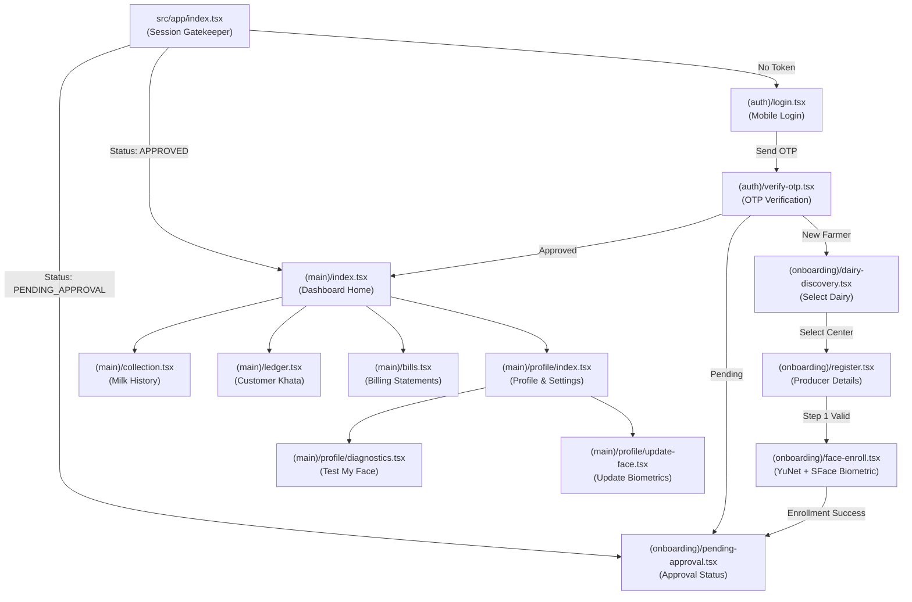

# DFARM CUSTOMER APP — SCREEN INVENTORY & AUDIT

**Document Version:** 1.0.0  
**Date:** 2026-11-16  
**Workspace:** `apps/dfarm-customer-app`  
**Platform:** React Native (Expo SDK 58), React 19.3.0, TypeScript 5.7.3  

---

## 1. Executive Summary

This screen inventory provides an exhaustive audit of every customer-facing route, screen, modal, component, and state in the DFarm Customer Mobile Application. The discovery covers 15 distinct screen components, navigation layouts, and overlays. Each screen was inspected for its current UI condition, real backend data dependencies, UX pain points, hardcoded mock values to eliminate, and proposed Claymorphism transformation.

---

## 2. Global Navigation Architecture

The app uses **Expo Router v58** with file-based routing organized into three route groups:
1. `(auth)`: Unauthenticated entry and verification.
2. `(onboarding)`: Dairy selection, producer details, live biometric enrollment, and approval tracking.
3. `(main)`: Authenticated bottom-tab shell (Home, Milk Collection, Khata Ledger, Bills, and Profile) with sub-routes for biometrics diagnostics and update.

---

## 3. Comprehensive Screen-by-Screen Inventory

### Screen 1: App Entry / Session Gatekeeper
* **File Path:** `src/app/index.tsx`
* **Route:** `/`
* **Purpose:** Initial routing checkpoint upon application launch. Inspects persisted session from `SecureStore`.
* **Current UI Condition:** Bare screen with an `ActivityIndicator` centered in `#FFF5EE`.
* **Data Source:** `useAuth().session` via `expo-secure-store`.
* **Existing Actions:** Automatic redirection (`Redirect`) to `/(auth)/login`, `/(onboarding)/pending-approval`, or `/(main)`.
* **Current UX Problems:** Abrupt jump without splash transition or branded loading state.
* **Proposed Redesign:** Introduce a branded clay loading splash featuring the `DFarmBrandMark`, subtle cream glow, and warm message "Connecting to DFarm Network..."

---

### Screen 2: Mobile Number Login (Reference Screen 1)
* **File Path:** `src/app/(auth)/login.tsx`
* **Route:** `/(auth)/login`
* **Purpose:** Primary farmer login entry. Validates 10-digit Indian mobile numbers starting with digits 6-9 and dispatches SMS OTP via the backend gateway.
* **Current UI Condition:** Basic pill badge for logo, white card, plain text input with prefix `🇮🇳 +91`, orange button, legal disclaimer text.
* **Data Source:** `useAuth().requestOtp` (`POST /api/v1/auth/request-otp`), fallback to `DirectDoveSmsService`.
* **Existing Actions:** Enter phone number, real-time regex validation, "Get OTP Verification Code" CTA, error handling.
* **Existing API Dependencies:** `POST /api/v1/auth/request-otp`.
* **Reusable Components Used:** `ClayCard`, `ClayButton`, `ClayInput`, `ClayBadge`.
* **Current UX Problems:**
  - Branding pill looks flat rather than a cohesive brand mark.
  - Prefix `🇮🇳 +91` is plain text without tactile grouping.
  - Card lacks multi-layer clay elevation and soft directional warm shadows.
  - Disabled button state lacks tactile recessed visual cue.
  - Terms copy is small and dense for rural farmers.
* **Proposed Redesign:**
  - Original vector `DFarmBrandMark` with illuminated milk droplet insignia and organic typography.
  - Raised Clay card with soft 14px peach shadow, 1.5px specular highlight, and 22px border radius.
  - Inset tactile mobile input with dedicated flag-badge slot, bold monospace number formatting (`XXXXX XXXXX`).
  - Tactile 3D Clay button with pressed spring animation and clear spinner during SMS dispatch.
  - Accessible, bilingual terms summary with clean icons.

---

### Screen 3: OTP Verification
* **File Path:** `src/app/(auth)/verify-otp.tsx`
* **Route:** `/(auth)/verify-otp`
* **Purpose:** Authenticate farmer via 6-digit one-time password received via SMS.
* **Current UI Condition:** 6-box input layout, 60s countdown timer, "Edit Phone Number" text button, verify button.
* **Data Source:** `useAuth().verifyOtp` (`POST /api/v1/auth/verify-otp`).
* **Existing Actions:** Enter 6 digits, auto-focus next, resend OTP after countdown, back button to edit phone number.
* **Existing API Dependencies:** `POST /api/v1/auth/verify-otp`, `POST /api/v1/auth/request-otp`.
* **Reusable Components Used:** `ClayCard`, `ClayButton`, `ClayOTPInput`, `ClayHeader`, `ClayBadge`.
* **Current UX Problems:**
  - OTP boxes have minimal tactile depth and flat borders.
  - Numeric keypad interaction can obscure inputs on small Android screens.
  - Resend timer is basic text without visual progress.
* **Proposed Redesign:**
  - 6 inset clay input cells with recessed inner shadow, gold focus ring, and specular shine.
  - Tactile countdown badge showing circular time progression.
  - Direct keyboard listener with automatic submission when 6th digit is typed.
  - Friendly farmer copy: "We sent an SMS to +91 98*** ***10".

---

### Screen 4: Select Your Dairy / Nearby Collection Center (Reference Screen 2)
* **File Path:** `src/app/(onboarding)/dairy-discovery.tsx`
* **Route:** `/(onboarding)/dairy-discovery`
* **Purpose:** Discover local cooperative societies and village collection centers using live GPS or manual regional filters.
* **Current UI Condition:** Search bar, horizontal area chips, location permission warning banner, list of dairy cards with name, distance, village, and admin.
* **Data Source:** `useDairyDiscovery(searchQuery, selectedCoords)` (`GET /api/v1/dairies/nearby`).
* **Existing Actions:** GPS detection, manual area chip selection ('all', 'kolhapur', 'sangli', 'pune'), search filter by name/village, dairy selection, continue CTA.
* **Existing API Dependencies:** `GET /api/v1/dairies/nearby`.
* **Reusable Components Used:** `ClayCard`, `ClayButton`, `ClayInput`, `ClayBadge`, `ClayHeader`, `ClayLoadingState`, `ClayEmptyState`.
* **Current UX Problems:**
  - Permission banner uses harsh yellow `#FFF3CD` that clashes with the warm DFarm palette.
  - Selected dairy card only changes border color; selection feedback needs a prominent clay highlight.
  - Distance badge is plain text without GPS precision indication.
  - No clear visual differentiation between cooperative headquarters and village collection points.
* **Proposed Redesign:**
  - Clay search bar with inset cavity and custom search vector icon.
  - Smooth horizontal clay chips with tactile pressed states and active orange fill.
  - Premium GPS status card with live pulse indicator and permission request flow.
  - Distinctive Dairy cards with 3D raised clay elevation, village map marker vector, contact chip, and radio-pill selection state.
  - Sticky bottom action container featuring `Continue with [Selected Dairy]` button.

---

### Screen 5: Producer Registration — Step 1 (Reference Screen 3)
* **File Path:** `src/app/(onboarding)/register.tsx`
* **Route:** `/(onboarding)/register`
* **Purpose:** Capture producer identification (Full Name, Village/Gram Panchayat, Milk Supply Animal category) and obtain mandatory biometric consent.
* **Current UI Condition:** Selected dairy card with "Change" link, full name input, village input, animal toggle (Cow, Buffalo, Both) with emojis, biometric checkbox, Next button.
* **Data Source:** Navigation params from Dairy Discovery, local form state.
* **Existing Actions:** Text input validation, animal category toggle, checkbox toggle, form submission to Step 2.
* **Reusable Components Used:** `ClayCard`, `ClayButton`, `ClayInput`, `ClayBadge`, `ClayHeader`.
* **Current UX Problems:**
  - Animal selection uses generic emojis (`🐄 Cow`, `🐃 Buffalo`, `🐄+🐃 Both`) instead of professional vector art.
  - Biometric consent checkbox is small and easily missed by farmers.
  - Selected Dairy summary looks like a generic card instead of an official affiliation banner.
* **Proposed Redesign:**
  - Two-step visual progress indicator with clay step pills (1: Details, 2: Face Biometrics).
  - Affiliated Dairy certificate card with cooperative seal and village coordinates.
  - Custom vector illustrations for **Cow**, **Buffalo**, and **Combined Herd**.
  - Inset clay input fields with clear Marathi/English helper text.
  - Prominent Clay Biometric Consent Card with tactile toggle switch and clear legal transparency terms.

---

### Screen 6: Face Biometric Enrollment — Step 2 (Reference Screen 4)
* **File Path:** `src/app/(onboarding)/face-enroll.tsx`
* **Route:** `/(onboarding)/face-enroll`
* **Purpose:** Front-camera live face capture, real-time OpenCV YuNet face detection & alignment, and OpenCV SFace INT8 128-D biometric vector extraction.
* **Current UI Condition:** Model status badge, live CameraView, oval alignment guide overlay with 5 landmark dots, tip card, capture CTA.
* **Data Source:** `expo-camera`, `yuNetDetector`, `sFaceEmbedder`, `useRegistration().register` (`POST /api/v1/customers/register`).
* **Existing Actions:** Grant camera permissions, model initialization, live camera preview, capture & landmark alignment check, 128-D embedding generation, backend registration submission.
* **Existing API Dependencies:** `POST /api/v1/customers/register`.
* **Reusable Components Used:** `ClayCard`, `ClayButton`, `ClayBadge`, `ClayHeader`.
* **Current UX Problems:**
  - Oval guide is a simple CSS border without scanning animation or depth.
  - Landmark dots are static and lack live tracking feedback.
  - Error alert uses default OS native dialog instead of a contextual clay modal.
  - Camera viewport lacks rounded clay bezel framing.
* **Proposed Redesign:**
  - Tactile camera viewport framed by a raised clay bezel with soft inner bevel.
  - Premium animated scanning reticle with corner brackets and pulsing radar guide.
  - Real-time status badge reflecting live states: `Waiting for Face`, `Face Centered`, `Checking Lighting`, `Generating Biometrics`.
  - Rich biometric guidance cards with custom vector illustrations (No Caps, Good Lighting, Single Face).
  - Clear multi-stage progress meter during ONNX model inference and backend template encryption.

---

### Screen 7: Registration Status (Reference Screen 5)
* **File Path:** `src/app/(onboarding)/pending-approval.tsx`
* **Route:** `/(onboarding)/pending-approval`
* **Purpose:** Display real-time status of farmer registration (Pending Admin Review, Approved, or Rejected with reason).
* **Current UI Condition:** Clock icon circle, status badge, heading, description, details box with hardcoded values (`DFT-2026-8891`, `YuNet + SFace Verified`), manual status check CTA.
* **Data Source:** `useRegistration().status` (`GET /api/v1/customers/:customerId/status`).
* **Existing Actions:** Poll status every 10s, manual "Check Approval Status Now" button, proceed to dashboard when approved, edit & reapply when rejected.
* **Existing API Dependencies:** `GET /api/v1/customers/:customerId/status`.
* **Reusable Components Used:** `ClayCard`, `ClayButton`, `ClayBadge`, `ClayHeader`.
* **Current UX Problems:**
  - Uses hardcoded fake application reference (`DFT-2026-8891`) instead of real `customerUuid` or assigned farmer code.
  - Displays `YuNet + SFace Verified` even before backend confirmation.
  - Emoji icons (`⏳`, `✅`, `❌`) look unprofessional.
  - Lacks a timeline showing the steps from Submission → Dairy Admin Review → Card Activation.
* **Proposed Redesign:**
  - Original vector status illustrations: `dfarm-reg-pending.svg`, `dfarm-reg-approved.svg`, `dfarm-reg-rejected.svg`.
  - 3-step vertical Clay Status Timeline (1. Biometric Enrolled, 2. Society Review, 3. Account Activated).
  - Dynamic details card displaying genuine backend registration metadata, customer UUID, selected dairy, and timestamp.
  - Auto-refreshed status pill with pulse animation.

---

### Screen 8: Main Navigation Tab Shell
* **File Path:** `src/app/(main)/_layout.tsx`
* **Route:** `/(main)/*`
* **Purpose:** Persistent bottom tab navigation bar for authenticated farmer experience.
* **Current UI Condition:** 5 tabs (Home, Collection, Ledger, Bills, Profile) using emojis (`🏠`, `🥛`, `📖`, `🧾`, `👤`).
* **Data Source:** Expo Router `Tabs`.
* **Existing Actions:** Tab switching, badge display.
* **Current UX Problems:**
  - Emojis violate the requirement: "Do not use emoji as a replacement for professional icons."
  - Tab bar is flat white with a simple top border, lacking clay elevation and tactile touch targets.
  - Active indicator is a simple color change without clay pill highlight.
* **Proposed Redesign:**
  - Custom DFarm vector tab icons: `dfarm-nav-home.svg`, `dfarm-nav-milk.svg`, `dfarm-nav-khata.svg`, `dfarm-nav-bills.svg`, `dfarm-nav-profile.svg`.
  - Floating raised clay tab bar with soft bottom elevation, peach highlight on active tab, and tactile spring feedback.
  - Bilingual label support (e.g. "Khata / खाते", "Milk / दूध").

---

### Screen 9: Customer Dashboard / Home
* **File Path:** `src/app/(main)/index.tsx`
* **Route:** `/(main)`
* **Purpose:** Central dairy operational hub for the milk producer. Shows today's shift intake, milk quantity, FAT & SNF quality readings, current Khata ledger balance, monthly performance metrics, and quick action shortcuts.
* **Current UI Condition:** Top greeting bar with test face badge, today's shift card, Khata balance card, monthly performance grid, quick action row.
* **Data Source:** `useCollection()` (`GET /collection/history`, `GET /collection/summary/monthly`), `useLedger()` (`GET /ledger/summary`), `useProfile()` (`GET /customers/:id`).
* **Existing Actions:** View today's intake, navigate to Ledger, navigate to Collections, navigate to Bills, open Face Diagnostics.
* **Existing API Dependencies:** `/collection/history`, `/collection/summary/monthly`, `/ledger/summary`, `/customers/:id`.
* **Reusable Components Used:** `ClayCard`, `ClayBadge`.
* **Current UX Problems:**
  - Top bar is crowded; greeting and dairy name truncate on small displays.
  - Metric divider lines are harsh.
  - Quick actions use emojis (`📋`, `🧾`, `🔍`).
  - Empty state for "no intake today" is plain text without visual guidance.
* **Proposed Redesign:**
  - Farmer greeting header with clay avatar, active society tag, and direct notification bell.
  - Hero Clay Intake Card with custom sun/moon shift vectors, large bold quantity typography (`14.5 L`), and FAT/SNF gauge pills.
  - Raised Clay Khata Balance card with server-verified badge and clear "Payable to You" green accent.
  - 4-cell Monthly Performance clay grid with crisp numeric typography.
  - Quick Action tiles with custom vector illustrations.

---

### Screen 10: Milk Collection History & Receipt Modal
* **File Path:** `src/app/(main)/collection.tsx`
* **Route:** `/(main)/collection`
* **Purpose:** Complete chronological log of milk deliveries across morning and evening shifts with FAT, SNF, rate/L, and digital receipt inspection.
* **Current UI Condition:** Filter row for All/Cow/Buffalo with emojis, transaction cards list, digital receipt modal with print details.
* **Data Source:** `useCollection({ animalType })` (`GET /collection/history`).
* **Existing Actions:** Filter by animal type, tap record to open Digital Collection Receipt modal, close modal.
* **Existing API Dependencies:** `GET /collection/history`.
* **Reusable Components Used:** `ClayCard`, `ClayBadge`, `ClayHeader`, `ClayModal`, `ClayEmptyState`.
* **Current UX Problems:**
  - Animal filter pills use emojis (`🐄 Cow Milk`, `🐃 Buffalo Milk`).
  - Shift indicator uses emoji (`☀️`, `🌙`).
  - Receipt modal looks like an unstyled table.
* **Proposed Redesign:**
  - Segmented clay filter bar with custom animal vector icons.
  - Tactile collection transaction cards with shift vector badges, bold liter metrics, and operator identification.
  - Authentic 40-column thermal digital receipt modal with clay paper texture, serrated edge detail, and biometric verification seal.

---

### Screen 11: Customer Khata Ledger
* **File Path:** `src/app/(main)/ledger.tsx`
* **Route:** `/(main)/ledger`
* **Purpose:** Authoritative double-entry financial ledger showing running balance, milk credits, cattle feed debits, cash advances, and bank disbursements.
* **Current UI Condition:** Summary card with hardcoded fallbacks (`12,480.00`, `28,530.00`, `16,050.00`), audit notice, list of transaction cards.
* **Data Source:** `useLedger()` (`GET /ledger/entries`, `GET /ledger/summary`).
* **Existing Actions:** Pull-to-refresh, view transaction references, verify credit/debit balances.
* **Existing API Dependencies:** `GET /ledger/entries`, `GET /ledger/summary`.
* **Reusable Components Used:** `ClayCard`, `ClayBadge`, `ClayHeader`, `ClayEmptyState`.
* **Current UX Problems:**
  - Contains hardcoded sample values (`12,480.00`, etc.) when real API returns empty or zero.
  - Transaction category tags use generic emojis (`🥛`, `🌾`, `🏦`, `⚙️`).
  - Running balance font size is small.
* **Proposed Redesign:**
  - Complete elimination of hardcoded balance fallbacks; display exact server data or zero-balance empty state.
  - Tactile raised Clay Khata Card with dual credit/debit summary columns and server-audit guarantee insignia.
  - Ledger transaction rows with distinct green (+) and red (-) clay badges, reference IDs, and formatted running balance.

---

### Screen 12: Bills & Statements
* **File Path:** `src/app/(main)/bills.tsx`
* **Route:** `/(main)/bills`
* **Purpose:** Displays 10-day settlement cycle bills, gross milk value, cattle feed deductions, and net bank payout status.
* **Current UI Condition:** List of bill cards with cycle dates, status badge, gross/deductions/net payout, and detailed breakdown modal.
* **Data Source:** `useBills()` (`GET /bills`).
* **Existing Actions:** Select bill to open statement modal, download PDF option.
* **Existing API Dependencies:** `GET /bills`, `GET /billing/bills/:id/pdf`.
* **Reusable Components Used:** `ClayCard`, `ClayBadge`, `ClayHeader`, `ClayModal`, `ClayButton`, `ClayEmptyState`.
* **Current UX Problems:**
  - Bill card grid is dense and difficult for farmers to scan quickly.
  - Modal breakdown table lacks visual hierarchy between gross earnings and deductions.
* **Proposed Redesign:**
  - Premium Clay Bill Cards with distinct status pills (`DISBURSED` green, `PENDING` orange).
  - Prominent Net Payout display with large currency typography.
  - Rich breakdown modal with clear separation of Milk Volume, Quality Multipliers, Feed Deductions, and Net Bank Transfer confirmation.

---

### Screen 13: Customer Profile & Settings
* **File Path:** `src/app/(main)/profile/index.tsx`
* **Route:** `/(main)/profile`
* **Purpose:** Farmer identity review, affiliated dairy details, biometric engine status, app build details, and secure logout.
* **Current UI Condition:** Avatar circle with first letter, name, phone, metadata rows with hardcoded fallbacks (`Vitthal Dnyandeo Patil`, `+91 98224 55678`, `a1b2c3d4...`), biometrics card, settings card, logout button.
* **Data Source:** `useProfile()` (`GET /customers/:id`), `useAuth().logout` (`POST /auth/logout`).
* **Existing Actions:** Navigate to Face Diagnostics, navigate to Update Face, toggle language, secure logout.
* **Existing API Dependencies:** `GET /customers/:id`, `POST /auth/logout`.
* **Reusable Components Used:** `ClayCard`, `ClayBadge`, `ClayButton`, `ClayHeader`.
* **Current UX Problems:**
  - Contains hardcoded mock strings in fallbacks.
  - Avatar is a simple circle without clay depth.
  - Biometrics info card is text-heavy and intimidating.
* **Proposed Redesign:**
  - Tactile farmer identity card with raised clay avatar badge, verified checkmark, and registered phone number.
  - Affiliation section highlighting Cooperative Society, Collection Center code, and Supply Animal category.
  - Biometrics Security Card showcasing the YuNet + SFace INT8 encryption status with quick action buttons.
  - Tactile Danger Clay Button for Secure Logout.

---

### Screen 14: "Test My Face" Biometric Diagnostics
* **File Path:** `src/app/(main)/profile/diagnostics.tsx`
* **Route:** `/(main)/profile/diagnostics`
* **Purpose:** Farmer self-test utility for camera sensor health, OpenCV YuNet detection latency, and OpenCV SFace INT8 128-D embedding extraction.
* **Current UI Condition:** Disclaimer card, camera preview with reticle and 5 dots, diagnostic results card with latency and status.
* **Data Source:** `runFaceDiagnostics()`, `expo-camera`, `useProfile()`.
* **Existing Actions:** Run diagnostics, grant camera access, inspect latency report.
* **Existing API Dependencies:** Local model execution + profile template match.
* **Reusable Components Used:** `ClayCard`, `ClayBadge`, `ClayButton`, `ClayHeader`.
* **Current UX Problems:**
  - Technical terms ("Unit L2", "Embedding Valid 128D") can confuse ordinary farmers.
  - Telemetry grid is plain text with emoji status lights (`🟢`, `🔴`, `🟡`).
* **Proposed Redesign:**
  - Clear farmer-friendly sensor health indicators ("Camera Working", "Face Detected", "Photo Clear").
  - Advanced telemetry drawer for technicians/admins.
  - Clay sensor status pills with real millisecond latency metrics.

---

### Screen 15: Update Face Biometrics
* **File Path:** `src/app/(main)/profile/update-face.tsx`
* **Route:** `/(main)/profile/update-face`
* **Purpose:** Re-enroll facial biometric template with version increments and encrypted template persistence.
* **Current UI Condition:** Version notice card, camera box with emoji reticle (`👤`), capture button, success view with emoji (`✅`).
* **Data Source:** `useProfile().updateFace` (`POST /customers/:id/biometrics/update`), `yuNetDetector`, `sFaceEmbedder`.
* **Existing Actions:** Initialize models, detect face, generate 128-D vector, submit template update, return to profile.
* **Existing API Dependencies:** `POST /customers/:id/biometrics/update`.
* **Reusable Components Used:** `ClayCard`, `ClayBadge`, `ClayButton`, `ClayHeader`.
* **Current UX Problems:**
  - Emoji reticle (`👤`) inside camera view.
  - Success message uses raw emojis.
  - Action card lacks progress visualization during embedding upload.
* **Proposed Redesign:**
  - Animated clay reticle overlay with alignment guides.
  - Real-time model initialization and alignment feedback.
  - Dedicated Success Confirmation sheet with vector checkmark and updated template version badge.

---

## 4. Summary of Identified Inconsistencies & Mock Data to Remove

| # | Screen | Inconsistency / Mock Data Identified | Remediation Action |
|---|---|---|---|
| 1 | `(onboarding)/pending-approval.tsx` | Hardcoded Application Reference `DFT-2026-8891` | Bind to `customerId` or backend assigned reference |
| 2 | `(onboarding)/pending-approval.tsx` | Hardcoded `Biometric Status: 🟢 YuNet + SFace Verified` | Dynamically display status verified only after confirmed registration |
| 3 | `(main)/ledger.tsx` | Hardcoded fallback balances `12,480.00`, `28,530.00`, `16,050.00` | Remove fallbacks; display genuine backend ledger data or clean zero/empty state |
| 4 | `(main)/profile/index.tsx` | Hardcoded farmer name `Vitthal Dnyandeo Patil` and phone | Bind exclusively to `profile.fullName` and `profile.mobileNumber` |
| 5 | `(main)/_layout.tsx` | Emojis used as tab icons (`🏠`, `🥛`, `📖`, `🧾`, `👤`) | Replace with custom DFarm SVG vector tab icons |
| 6 | `(onboarding)/register.tsx` | Emojis used for animals (`🐄 Cow`, `🐃 Buffalo`, `🐄+🐃 Both`) | Replace with custom Cow, Buffalo, and Herd SVG vector icons |
| 7 | `(main)/collection.tsx` | Emojis for filters and shifts (`☀️`, `🌙`) | Replace with custom vector shift and animal icons |
| 8 | `(main)/profile/update-face.tsx` | Emoji reticle (`👤`) and success emoji (`✅`) | Replace with custom vector scanning guide and verified seal |
| 9 | `(onboarding)/dairy-discovery.tsx` | Harsh yellow permission banner (`#FFF3CD`, `#856404`) | Redesign using brand-coherent soft peach / clay warning container |
| 10 | Global | Inconsistent corner radiuses and shadow depths | Harmonize using standard `DFARM_RADIUS` and `DFARM_SHADOWS` tokens |

---

## 5. Screen Inventory Matrix

| Screen Name | Route | Category | Real API Dependency | Vector Assets Required | Status |
|---|---|---|---|---|---|
| **Session Gatekeeper** | `/` | Core | `useAuth()` (SecureStore) | `dfarm-logo.svg` | Audited |
| **Mobile Login** | `/(auth)/login` | Auth | `POST /auth/request-otp` | `dfarm-logo.svg`, `dfarm-phone.svg` | Audited |
| **Verify OTP** | `/(auth)/verify-otp` | Auth | `POST /auth/verify-otp` | `dfarm-shield.svg`, `dfarm-sms.svg` | Audited |
| **Select Your Dairy** | `/(onboarding)/dairy-discovery` | Discovery | `GET /dairies/nearby` | `dfarm-location-pin.svg`, `dfarm-gps.svg`, `dfarm-dairy-center.svg` | Audited |
| **Producer Registration** | `/(onboarding)/register` | Onboarding | Form validation | `dfarm-cow.svg`, `dfarm-buffalo.svg`, `dfarm-herd.svg`, `dfarm-consent.svg` | Audited |
| **Face Biometric Enrollment** | `/(onboarding)/face-enroll` | Biometrics | `POST /customers/register` | `dfarm-scan-oval.svg`, `dfarm-camera-denied.svg`, `dfarm-face-success.svg` | Audited |
| **Registration Status** | `/(onboarding)/pending-approval` | Status | `GET /customers/:id/status` | `dfarm-reg-pending.svg`, `dfarm-reg-approved.svg`, `dfarm-reg-rejected.svg` | Audited |
| **Main Tabs Shell** | `/(main)/_layout` | Navigation | Tab Router | 5 Custom Nav SVGs | Audited |
| **Customer Dashboard** | `/(main)` | Core | `/collection/history`, `/ledger/summary` | `dfarm-shift-sun.svg`, `dfarm-shift-moon.svg`, `dfarm-khata-card.svg` | Audited |
| **Milk Collection History** | `/(main)/collection` | Operations | `GET /collection/history` | `dfarm-receipt-seal.svg`, Animal SVGs | Audited |
| **Customer Khata Ledger** | `/(main)/ledger` | Finance | `GET /ledger/entries`, `/summary` | `dfarm-passbook.svg`, `dfarm-audit-lock.svg` | Audited |
| **Bills & Statements** | `/(main)/bills` | Finance | `GET /bills`, `/bills/:id/pdf` | `dfarm-bill.svg`, `dfarm-bank-transfer.svg` | Audited |
| **Customer Profile** | `/(main)/profile` | Profile | `GET /customers/:id`, `POST /auth/logout`| `dfarm-profile-badge.svg`, `dfarm-logout.svg` | Audited |
| **Test My Face** | `/(main)/profile/diagnostics` | Diagnostics| Local YuNet + SFace | `dfarm-telemetry.svg`, `dfarm-reticle.svg` | Audited |
| **Update Face** | `/(main)/profile/update-face` | Biometrics | `POST /customers/:id/biometrics/update` | `dfarm-update-face.svg`, `dfarm-verified-seal.svg` | Audited |
