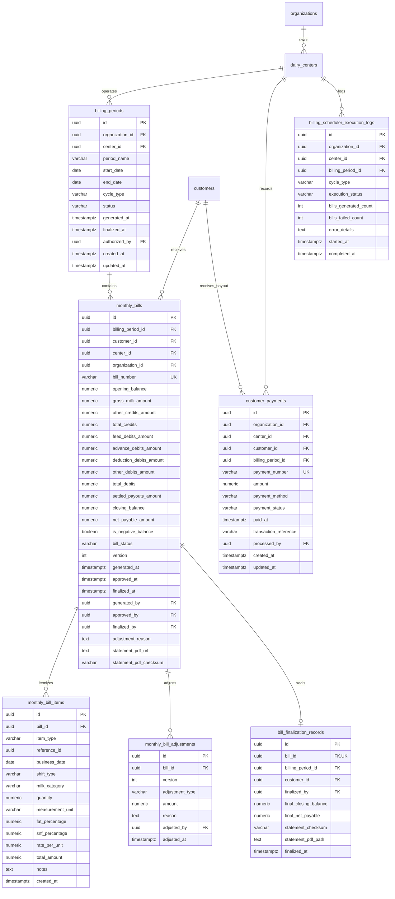

# DFarm Billing & Settlement Data Model

## 1. Overview & Schema Design

The billing data model was introduced in migration `014_automated_monthly_billing_and_settlements.sql` as an additive, non-breaking extension to the DFarm PostgreSQL relational schema.

All tables are strictly designed according to financial engineering requirements:
- Primary Keys: Canonical `UUID` with `gen_random_uuid()` defaults.
- Exact Numbers: Financial balances, totals, and per-unit rates use `NUMERIC(14,2)` or `NUMERIC(10,2)`. Floating-point types (`FLOAT`, `DOUBLE PRECISION`, `REAL`) are prohibited.
- Milk Weights: Stored as `NUMERIC(10,2)` in canonical `KG` measurement units.
- Row Level Security (RLS): Enabled on all tables.
- Referential Integrity: Foreign keys enforce `ON DELETE RESTRICT` to prevent accidental deletion of referenced periods, customers, bills, or audit records.

---

## 2. Entity-Relationship Diagram (ERD)



---

## 3. Table Catalog & Constraint Specifications

### 3.1 `billing_periods`
Manages the temporal boundaries and operational phases of billing.
- `id` (UUID PK): Unique identifier.
- `organization_id` (UUID FK $\to$ `organizations.id`): Tenant partition.
- `center_id` (UUID FK $\to$ `dairy_centers.id`): Center scope.
- `period_name` (VARCHAR): Descriptive title (e.g., "October 2026 Settlement").
- `start_date` (DATE): First day of period (inclusive).
- `end_date` (DATE): Last day of period (inclusive).
- `cycle_type` (VARCHAR): Enum constraint `['CALENDAR_MONTH', 'TEN_DAY', 'FIFTEEN_DAY', 'CUSTOM_PERIOD']`. Default: `'CALENDAR_MONTH'`.
- `status` (VARCHAR): Enum constraint `['DRAFT', 'GENERATING', 'GENERATED', 'UNDER_REVIEW', 'APPROVED', 'FINALIZED', 'CORRECTION_REQUIRED', 'CANCELLED']`. Default: `'DRAFT'`.
- `generated_at` (TIMESTAMPTZ): Timestamp when calculation was triggered.
- `finalized_at` (TIMESTAMPTZ): Timestamp when all bills were sealed.
- `authorized_by` (UUID FK $\to$ `users.id`): Operator who scheduled or created the period.

**Indexes & Constraints**:
- `chk_billing_period_dates`: `CHECK (start_date <= end_date)`.
- `idx_billing_periods_overlap`: Partial unique index on `(center_id, start_date, end_date) WHERE status <> 'CANCELLED'` preventing overlapping active periods.

---

### 3.2 `monthly_bills`
Stores summary settlement figures for a specific customer in a given billing period.
- `id` (UUID PK): Unique identifier.
- `billing_period_id` (UUID FK $\to$ `billing_periods.id`): Parent period.
- `customer_id` (UUID FK $\to$ `customers.id`): Canonical customer UUID.
- `center_id` (UUID FK $\to$ `dairy_centers.id`): Center location.
- `bill_number` (VARCHAR): Unique serial (e.g., `BILL-202610-FARMERA123`).
- `opening_balance` (`NUMERIC(14,2)`): Prior ledger balance.
- `gross_milk_amount` (`NUMERIC(14,2)`): Value of all milk deliveries.
- `other_credits_amount` (`NUMERIC(14,2)`): Incentives or bonus credits.
- `total_credits` (`NUMERIC(14,2)`): Gross Milk + Other Credits.
- `feed_debits_amount` (`NUMERIC(14,2)`): Total feed purchases.
- `advance_debits_amount` (`NUMERIC(14,2)`): Cash advances.
- `deduction_debits_amount` (`NUMERIC(14,2)`): Mandatory or voluntary deductions.
- `other_debits_amount` (`NUMERIC(14,2)`): Equipment or penalty charges.
- `total_debits` (`NUMERIC(14,2)`): Sum of all debits.
- `settled_payouts_amount` (`NUMERIC(14,2)`): Only `SUCCESSFUL` or `RECONCILED` payouts.
- `closing_balance` (`NUMERIC(14,2)`): Mathematical closing position.
- `net_payable_amount` (`NUMERIC(14,2)`): Payable liability ($\ge 0.00$).
- `is_negative_balance` (BOOLEAN): `TRUE` if closing balance $< 0.00$.
- `bill_status` (VARCHAR): State of the individual statement.
- `version` (INT): Incremented on versioned corrections. Default: 1.
- `statement_pdf_checksum` (VARCHAR): SHA-256 hash of the rendered PDF.

**Indexes & Constraints**:
- `uq_customer_bill_per_period`: `UNIQUE (billing_period_id, customer_id)`. Prevents duplicate bills.
- `idx_bills_customer_date`: `(customer_id, created_at DESC)`. Fast mobile lookup.

---

### 3.3 `monthly_bill_items`
Provides granular line-by-line auditability for every intake delivery, debit, and adjustment.
- `id` (UUID PK): Unique identifier.
- `bill_id` (UUID FK $\to$ `monthly_bills.id` ON DELETE CASCADE): Parent bill.
- `item_type` (VARCHAR): `['MILK_COLLECTION', 'FEED_PURCHASE', 'CASH_ADVANCE', 'DEDUCTION', 'QUALITY_INCENTIVE', 'MANUAL_ADJUSTMENT', 'PAYMENT_PAYOUT']`.
- `reference_id` (UUID): Points to underlying `milk_collections.id`, `ledger_transactions.id`, or `customer_deductions.id`.
- `business_date` (DATE): Date of the activity.
- `shift_type` (VARCHAR): `'MORNING'` or `'EVENING'`.
- `milk_category` (VARCHAR): `'COW'` or `'BUFFALO'`.
- `quantity` (`NUMERIC(10,2)`): Net weight in canonical `KG`.
- `measurement_unit` (VARCHAR): Canonical unit (always `'KG'`).
- `fat_percentage` (`NUMERIC(5,2)`): Fat content.
- `snf_percentage` (`NUMERIC(5,2)`): SNF content.
- `rate_per_unit` (`NUMERIC(10,2)`): Applied rate per kg.
- `total_amount` (`NUMERIC(14,2)`): Exact line value.

---

### 3.4 `monthly_bill_adjustments`
Immutable audit log of all manual adjustments made to a generated or finalized bill.
- `id` (UUID PK): Unique identifier.
- `bill_id` (UUID FK $\to$ `monthly_bills.id`): Target bill.
- `version` (INT): Bill version created by this adjustment.
- `adjustment_type` (VARCHAR): `'CREDIT'` or `'DEBIT'`.
- `amount` (`NUMERIC(14,2)`): Exact adjustment value ($> 0.00$).
- `reason` (TEXT): Mandatory explanation.
- `adjusted_by` (UUID FK $\to$ `users.id`): Authorized actor.
- `adjusted_at` (TIMESTAMPTZ): Timestamp.

---

### 3.5 `bill_finalization_records`
Cryptographic seal and audit snapshot created upon final sign-off.
- `id` (UUID PK): Unique identifier.
- `bill_id` (UUID FK $\to$ `monthly_bills.id`, UNIQUE): Pinned bill.
- `final_closing_balance` (`NUMERIC(14,2)`): Immutable balance at seal.
- `final_net_payable` (`NUMERIC(14,2)`): Immutable payable at seal.
- `statement_checksum` (VARCHAR): SHA-256 hash.
- `statement_pdf_path` (TEXT): Storage path.
- `finalized_by` (UUID FK $\to$ `users.id`): Dairy Owner or Super Admin.
- `finalized_at` (TIMESTAMPTZ): Timestamp.

---

### 3.6 PostgreSQL Triggers

```sql
CREATE OR REPLACE FUNCTION enforce_finalized_period_immutability()
RETURNS TRIGGER AS $$
DECLARE
  v_period_status VARCHAR;
BEGIN
  SELECT status INTO v_period_status
  FROM billing_periods
  WHERE id = COALESCE(NEW.billing_period_id, OLD.billing_period_id);

  IF v_period_status = 'FINALIZED' THEN
    IF TG_OP = 'UPDATE' AND (NEW.version > OLD.version) THEN
      RETURN NEW; -- Permit versioned adjustments
    END IF;
    RAISE EXCEPTION 'Cannot insert or alter bills in a FINALIZED billing period'
      USING ERRCODE = '22000';
  END IF;

  RETURN NEW;
END;
$$ LANGUAGE plpgsql;
```
This trigger protects `monthly_bills` and `billing_periods` from rogue direct SQL modifications once finalized.
