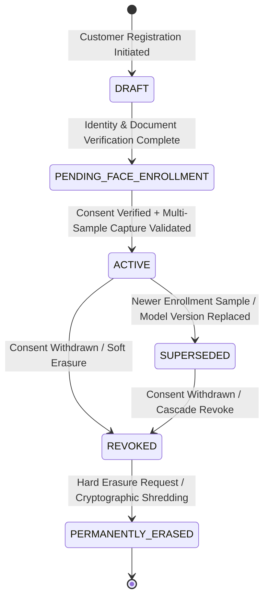

# DFarm Biometric Data Lifecycle & Retention Architecture

## 1. Lifecycle State Machine

Biometric templates follow a strict, auditable lifecycle state machine enforcing privacy, consent, and re-enrollment isolation.



### State Definitions

| State | Description | Matching Availability | Cryptographic Status |
| :--- | :--- | :--- | :--- |
| **`ACTIVE`** | Validated template currently linked to active customer. | **Enabled** for 1:1 and 1:N local matching. | Encrypted with AES-256-GCM + Customer AAD. |
| **`SUPERSEDED`** | Prior template replaced by a newer enrollment or updated model. | **Disabled**. Kept for audit trace. | Encrypted; barred from active matcher queries. |
| **`REVOKED`** | Consent withdrawn by customer under DPDP Act right to erasure. | **Disabled**. | Flagged `REVOKED`; timestamp and reason recorded. |
| **`PERMANENTLY_ERASED`** | Physically shredded template. | **Disabled**. | Payload and IV set to `NULL`; irreversible. |

---

## 2. Retention Policies & Audit Trails

Biometric data retention is governed by the `biometric_retention_records` table:

```sql
CREATE TABLE biometric_retention_records (
    id UUID PRIMARY KEY DEFAULT gen_random_uuid(),
    customer_id UUID NOT NULL REFERENCES customers(id) ON DELETE CASCADE,
    face_enrollment_id UUID NOT NULL REFERENCES face_enrollments(id) ON DELETE CASCADE,
    retention_policy_name VARCHAR(64) NOT NULL DEFAULT 'POLICY_SUBJECT_TO_CONSENT',
    retention_status VARCHAR(32) NOT NULL DEFAULT 'ACTIVE',
    scheduled_purge_at TIMESTAMPTZ,
    purged_at TIMESTAMPTZ,
    created_at TIMESTAMPTZ NOT NULL DEFAULT NOW()
);
```

### Policy Specifications
- **`POLICY_SUBJECT_TO_CONSENT`**: Biometric data is retained solely for the duration that customer consent remains active and the customer remains an active milk supplier.
- **Inactivity Purge**: If a customer record is soft-deleted (`is_deleted = true`) or suspended for $\ge 180$ days without activity, a scheduled purge job flags templates for review.
- **Audit Logging**: Every transition is recorded in `audit_logs` capturing the operating officer's user ID, IP address, timestamp, previous status, and justification reason.

---

## 3. Cryptographic Shredding

Under Section 12 of the DPDP Act (Right to Erasure), when a farmer exercises their right to have biometric records permanently expunged:
1. The database row in `face_enrollments` is updated with `status = 'PERMANENTLY_ERASED'`.
2. The columns `embedding_encrypted`, `embedding_iv`, and `embedding_auth_tag` are explicitly overwritten with `NULL` or cryptographically random entropy.
3. The retention record in `biometric_retention_records` is updated with `purged_at = NOW()`.
4. Any edge device caching that customer's local template is commanded to delete the cached template during the next periodic sync.

Because the ciphertext and IV are irrevocably expunged, template recovery is mathematically impossible.
