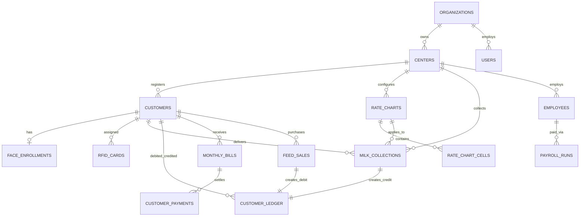

# DFarm: Database Architecture & Schema Specification

This document details the relational data model, table definitions, integrity constraints, indexing strategies, and Row Level Security (RLS) policies for the authoritative central PostgreSQL database (`packages/database/`).

---

## 1. Entity-Relationship (ER) Diagram



---

## 2. Core Relational Schemas

### 2.1 Multi-Tenant & Center Master Tables

#### `organizations`
- `id` (UUID PK, DEFAULT gen_random_uuid())
- `name` (VARCHAR(150) NOT NULL)
- `code` (VARCHAR(20) UNIQUE NOT NULL)
- `created_at` (TIMESTAMPTZ DEFAULT NOW())

#### `centers`
- `id` (UUID PK, DEFAULT gen_random_uuid())
- `organization_id` (UUID FK -> organizations.id NOT NULL)
- `name` (VARCHAR(150) NOT NULL)
- `code` (VARCHAR(20) NOT NULL)
- `morning_shift_start` (TIME NOT NULL DEFAULT '06:00:00')
- `morning_shift_end` (TIME NOT NULL DEFAULT '10:00:00')
- `evening_shift_start` (TIME NOT NULL DEFAULT '17:00:00')
- `evening_shift_end` (TIME NOT NULL DEFAULT '21:00:00')
- `is_active` (BOOLEAN DEFAULT TRUE)
- `created_at` (TIMESTAMPTZ DEFAULT NOW())
- `CONSTRAINT uq_center_code_per_org UNIQUE (organization_id, code)`

---

### 2.2 Customer & Identity Management

#### `customers`
- `customer_uuid` (UUID PK) — Canonical identity across all modules
- `center_id` (UUID FK -> centers.id NOT NULL)
- `organization_id` (UUID FK -> organizations.id NOT NULL)
- `farmer_code` (VARCHAR(30) NOT NULL) — Human-readable center slip number
- `full_name` (VARCHAR(150) NOT NULL)
- `mobile_number` (VARCHAR(20) NOT NULL) — E.164 formatted
- `permitted_milk_categories` (VARCHAR(20) NOT NULL) — CHECK (permitted_milk_categories IN ('COW', 'BUFFALO', 'BOTH'))
- `status` (VARCHAR(20) NOT NULL DEFAULT 'DRAFT') — CHECK (status IN ('DRAFT', 'PENDING_FACE_ENROLLMENT', 'PENDING_RFID_ASSIGNMENT', 'PENDING_SYNC', 'ACTIVE', 'SUSPENDED', 'SOFT_DELETED'))
- `biometric_consent` (BOOLEAN NOT NULL DEFAULT FALSE)
- `biometric_consent_timestamp` (TIMESTAMPTZ)
- `biometric_consent_officer_id` (UUID FK -> users.id)
- `is_deleted` (BOOLEAN DEFAULT FALSE)
- `deleted_at` (TIMESTAMPTZ)
- `deleted_by` (UUID FK -> users.id)
- `deletion_reason` (TEXT)
- `version` (BIGINT NOT NULL DEFAULT 1)
- `created_at` (TIMESTAMPTZ DEFAULT NOW())
- `updated_at` (TIMESTAMPTZ DEFAULT NOW())
- `CONSTRAINT uq_customer_mobile_per_org UNIQUE (organization_id, mobile_number)`
- `CONSTRAINT uq_farmer_code_per_center UNIQUE (center_id, farmer_code)`

#### `face_enrollments`
- `id` (UUID PK, DEFAULT gen_random_uuid())
- `customer_uuid` (UUID UNIQUE FK -> customers.customer_uuid ON DELETE RESTRICT)
- `model_version` (VARCHAR(50) NOT NULL)
- `embedding_encrypted` (BYTEA NOT NULL) — AES-256-GCM encrypted 512D float array
- `embedding_iv` (BYTEA NOT NULL)
- `embedding_auth_tag` (BYTEA NOT NULL)
- `quality_score` (NUMERIC(4,3) NOT NULL)
- `is_active` (BOOLEAN DEFAULT TRUE)
- `enrolled_by` (UUID FK -> users.id NOT NULL)
- `enrolled_at` (TIMESTAMPTZ DEFAULT NOW())

#### `rfid_cards`
- `id` (UUID PK, DEFAULT gen_random_uuid())
- `organization_id` (UUID FK -> organizations.id NOT NULL)
- `customer_uuid` (UUID FK -> customers.customer_uuid ON DELETE RESTRICT)
- `card_uid` (VARCHAR(64) NOT NULL) — Normalized hexadecimal string
- `status` (VARCHAR(20) NOT NULL DEFAULT 'ACTIVE') — CHECK (status IN ('ACTIVE', 'REVOKED', 'LOST', 'UNASSIGNED'))
- `assigned_at` (TIMESTAMPTZ DEFAULT NOW())
- `revoked_at` (TIMESTAMPTZ)
- `CONSTRAINT uq_card_uid_per_org UNIQUE (organization_id, card_uid)`

#### `identification_audit_logs`
- `id` (UUID PK, DEFAULT gen_random_uuid())
- `center_id` (UUID FK -> centers.id NOT NULL)
- `session_id` (UUID NOT NULL)
- `customer_uuid` (UUID FK -> customers.customer_uuid NOT NULL)
- `method` (VARCHAR(30) NOT NULL) — CHECK (method IN ('FACE_RECOGNITION', 'RFID_VERIFICATION', 'SUPERVISOR_MANUAL'))
- `supervisor_id` (UUID FK -> users.id)
- `reason_code` (VARCHAR(100))
- `confidence_score` (NUMERIC(5,4))
- `timestamp` (TIMESTAMPTZ DEFAULT NOW())

---

### 2.3 Pricing & Rate Charts

#### `rate_charts`
- `id` (UUID PK, DEFAULT gen_random_uuid())
- `center_id` (UUID FK -> centers.id NOT NULL)
- `name` (VARCHAR(100) NOT NULL)
- `milk_category` (VARCHAR(20) NOT NULL) — CHECK (milk_category IN ('COW', 'BUFFALO'))
- `effective_from` (TIMESTAMPTZ NOT NULL)
- `effective_to` (TIMESTAMPTZ)
- `pricing_type` (VARCHAR(20) NOT NULL DEFAULT 'GRID') — CHECK (pricing_type IN ('GRID', 'FORMULA'))
- `created_at` (TIMESTAMPTZ DEFAULT NOW())

#### `rate_chart_cells`
- `id` (UUID PK, DEFAULT gen_random_uuid())
- `rate_chart_id` (UUID FK -> rate_charts.id ON DELETE CASCADE NOT NULL)
- `fat_percentage` (NUMERIC(3,1) NOT NULL)
- `snf_percentage` (NUMERIC(3,1) NOT NULL)
- `rate_per_kg` (NUMERIC(6,2) NOT NULL)
- `CONSTRAINT uq_chart_cell UNIQUE (rate_chart_id, fat_percentage, snf_percentage)`

---

### 2.4 Milk Collections & Financial Ledgers

#### `milk_collections`
- `collection_id` (UUID PK)
- `center_id` (UUID FK -> centers.id NOT NULL)
- `customer_uuid` (UUID FK -> customers.customer_uuid NOT NULL)
- `session_type` (VARCHAR(10) NOT NULL) — CHECK (session_type IN ('MORNING', 'EVENING'))
- `milk_category` (VARCHAR(20) NOT NULL) — CHECK (milk_category IN ('COW', 'BUFFALO'))
- `weight_kg` (NUMERIC(6,2) NOT NULL) — CHECK (weight_kg > 0)
- `fat_percentage` (NUMERIC(3,1) NOT NULL)
- `snf_percentage` (NUMERIC(3,1) NOT NULL)
- `rate_chart_id` (UUID FK -> rate_charts.id NOT NULL)
- `applied_rate` (NUMERIC(6,2) NOT NULL)
- `total_amount` (NUMERIC(10,2) NOT NULL)
- `idempotency_key` (VARCHAR(128) UNIQUE NOT NULL)
- `identification_method` (VARCHAR(30) NOT NULL)
- `supervisor_id` (UUID FK -> users.id)
- `created_at` (TIMESTAMPTZ NOT NULL)
- `synced_at` (TIMESTAMPTZ DEFAULT NOW())

#### `customer_ledger`
- `transaction_id` (UUID PK)
- `organization_id` (UUID FK -> organizations.id NOT NULL)
- `center_id` (UUID FK -> centers.id NOT NULL)
- `customer_uuid` (UUID FK -> customers.customer_uuid NOT NULL)
- `transaction_type` (VARCHAR(30) NOT NULL) — CHECK (transaction_type IN ('MILK_CREDIT', 'FEED_DEBIT', 'ADVANCE_DEBIT', 'DEDUCTION_DEBIT', 'PAYMENT_CREDIT'))
- `amount` (NUMERIC(10,2) NOT NULL) — Positive number; type dictates balance impact
- `reference_type` (VARCHAR(30) NOT NULL) — CHECK (reference_type IN ('COLLECTION', 'FEED_SALE', 'ADVANCE', 'BILL_SETTLEMENT', 'MANUAL_ADJUSTMENT'))
- `reference_id` (UUID NOT NULL)
- `description` (TEXT)
- `created_at` (TIMESTAMPTZ NOT NULL)

---

### 2.5 Billing, Settlements & Feed Inventory

#### `monthly_bills`
- `id` (UUID PK, DEFAULT gen_random_uuid())
- `center_id` (UUID FK -> centers.id NOT NULL)
- `customer_uuid` (UUID FK -> customers.customer_uuid NOT NULL)
- `period_start` (DATE NOT NULL)
- `period_end` (DATE NOT NULL)
- `gross_milk_amount` (NUMERIC(10,2) NOT NULL DEFAULT 0.00)
- `total_feed_deductions` (NUMERIC(10,2) NOT NULL DEFAULT 0.00)
- `total_advance_deductions` (NUMERIC(10,2) NOT NULL DEFAULT 0.00)
- `total_other_deductions` (NUMERIC(10,2) NOT NULL DEFAULT 0.00)
- `net_payable_amount` (NUMERIC(10,2) NOT NULL)
- `status` (VARCHAR(20) NOT NULL DEFAULT 'PENDING') — CHECK (status IN ('PENDING', 'APPROVED', 'PAID', 'CANCELLED'))
- `generated_at` (TIMESTAMPTZ DEFAULT NOW())
- `CONSTRAINT uq_customer_bill_period UNIQUE (customer_uuid, period_start, period_end)`

#### `customer_payments`
- `id` (UUID PK, DEFAULT gen_random_uuid())
- `bill_id` (UUID FK -> monthly_bills.id)
- `customer_uuid` (UUID FK -> customers.customer_uuid NOT NULL)
- `amount_paid` (NUMERIC(10,2) NOT NULL)
- `payment_mode` (VARCHAR(20) NOT NULL) — CHECK (payment_mode IN ('CASH', 'BANK_TRANSFER', 'UPI', 'CHEQUE'))
- `transaction_reference` (VARCHAR(100))
- `disbursed_at` (TIMESTAMPTZ DEFAULT NOW())

#### `feed_inventory` & `feed_sales`
- `feed_inventory`: `id`, `center_id`, `item_name`, `sku`, `unit_pack_kg`, `cost_price`, `selling_price`, `stock_quantity`, `updated_at`.
- `feed_sales`: `id`, `center_id`, `customer_uuid`, `feed_item_id`, `quantity`, `unit_price`, `total_amount`, `is_debited_to_ledger`, `sold_at`.

---

### 2.6 Independent Employee Payroll Master

To guarantee financial isolation between farmer settlements and internal dairy staff, payroll tables are strictly segregated:

#### `employees`
- `id` (UUID PK, DEFAULT gen_random_uuid())
- `center_id` (UUID FK -> centers.id NOT NULL)
- `user_id` (UUID UNIQUE FK -> users.id)
- `full_name` (VARCHAR(150) NOT NULL)
- `role` (VARCHAR(50) NOT NULL)
- `monthly_base_salary` (NUMERIC(10,2) NOT NULL)
- `is_active` (BOOLEAN DEFAULT TRUE)

#### `payroll_runs`
- `id` (UUID PK, DEFAULT gen_random_uuid())
- `center_id` (UUID FK -> centers.id NOT NULL)
- `employee_id` (UUID FK -> employees.id NOT NULL)
- `month` (SMALLINT NOT NULL)
- `year` (INTEGER NOT NULL)
- `days_worked` (NUMERIC(4,1) NOT NULL)
- `gross_salary` (NUMERIC(10,2) NOT NULL)
- `deductions` (NUMERIC(10,2) NOT NULL DEFAULT 0.00)
- `net_salary` (NUMERIC(10,2) NOT NULL)
- `payment_status` (VARCHAR(20) DEFAULT 'PENDING')
- `paid_at` (TIMESTAMPTZ)
- `CONSTRAINT uq_employee_payroll_month UNIQUE (employee_id, month, year)`

---

## 3. Row Level Security (RLS) Strategy

1. **Multi-Center Isolation:** Center operators, registration officers, and supervisors access data filtered by `center_id`:
   ```sql
   CREATE POLICY center_isolation_policy ON milk_collections
       FOR ALL
       USING (center_id = (auth.jwt() ->> 'center_id')::UUID);
   ```
2. **Customer Self-Service Isolation:** Mobile customer JWT tokens are restricted to querying rows matching their own `customer_uuid`:
   ```sql
   CREATE POLICY customer_self_access_policy ON customer_ledger
       FOR SELECT
       USING (customer_uuid = (auth.jwt() ->> 'customer_uuid')::UUID);
   ```
3. **Supervisor Override Authorization:** Only users with `role IN ('SUPERVISOR', 'ADMIN')` may insert into `identification_audit_logs`.

