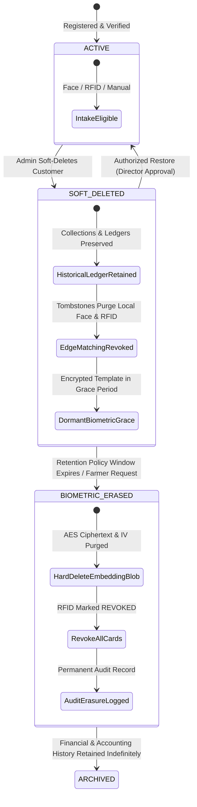

# DFarm: Deletion, Restoration & Biometric Data Retention Architecture
**Phase 03 of 20: Privacy Compliance & Lifecycle Engineering**

---

## 1. Lifecycle Overview & Policy Separation

DFarm enforces strict architectural separation between **Customer Profile Soft Deletion**, **Financial Record Immutability**, and **Biometric Template Erasure**.



---

## 2. Customer Soft Deletion & Restoration

### 2.1 Soft Deletion Rules
- **No Cascade Deletion:** Executing an `UPDATE customers SET is_deleted = TRUE` **never** cascades to `milk_collections`, `customer_ledger_accounts`, `ledger_transactions`, or `monthly_bills`.
- **Reason Documentation:** `deletion_reason` is mandatory. The application rejects any soft-delete request without a documented justification code.
- **Tombstone Generation:** An automated trigger inserts a record into `sync_tombstones`, which propagates downstream to collection terminals to revoke local intake eligibility.

### 2.2 Restoration Policy
- **Authorized Roles:** Only users holding the `DAIRY_OWNER` or `SUPER_ADMIN` role can restore a soft-deleted customer. Collection supervisors cannot restore deleted accounts.
- **Biometric Re-enrollment Requirement:**
  - If the customer is restored **within the biometric grace period**, the dormant face template is re-activated.
  - If the customer is restored **after the biometric template was purged**, the customer transitions to `PENDING_FACE_ENROLLMENT` status, requiring fresh consent and enrollment before facial recognition can be used.

---

## 3. Policy-Driven Biometric Template Erasure

> [!IMPORTANT]
> **Cardinal Privacy Rule:** A customer soft deletion does **NOT** grant the dairy permission to retain biometric facial templates indefinitely. Biometric data is governed by data privacy laws and must be permanently erased according to the approved privacy policy.

### 3.1 Policy Configuration & Retention Records
Biometric retention is managed through `biometric_retention_records`:
- `retention_policy_name`: Configurable organizational policy (e.g. `'IMMEDIATE_ON_DELETION'`, `'GRACE_PERIOD_30_DAYS'`, `'GRACE_PERIOD_60_DAYS'`).
- `scheduled_erasure_at`: Concrete timestamp computed when soft deletion occurs.
- `retention_status`: `'ACTIVE'` $\rightarrow$ `'GRACE_PERIOD'` $\rightarrow$ `'ERASED'`.

### 3.2 Permanent Cryptographic Erasure Procedure
When a scheduled erasure fires or a farmer exercises their legal right to be forgotten:
1. The row in `face_enrollments` is hard-deleted or its `embedding_encrypted`, `embedding_iv`, and `embedding_auth_tag` fields are zeroed out (cryptographically shredded).
2. All assigned RFID cards are transitioned to `status = 'REVOKED'`.
3. An immutable audit record is committed to `audit_logs` documenting that biometric data was destroyed:
   ```json
   {
     "event": "BIOMETRIC_DATA_PURGED",
     "customer_id": "c1a2b3c4-...",
     "policy": "POLICY_SUBJECT_TO_CONSENT",
     "erased_at": "2026-12-15T04:00:00Z"
   }
   ```
4. All milk collections, weights, fat/SNF records, and financial ledger transactions remain intact.

---

## 4. Historical Financial Record Retention

Under statutory cooperative and tax regulations, dairy financial records must be preserved for accounting audits:
- `milk_collections`: Retained permanently.
- `customer_ledger_accounts` & `ledger_transactions`: Retained permanently.
- `monthly_bills` & `customer_payments`: Retained for a minimum of 8 years (or indefinitely per organization policy).
- `audit_logs`: Retained permanently in an append-only state.

---

## 5. Offline Tombstone Pruning Strategy

To prevent edge counter SQLite databases from accumulating millions of historical tombstones indefinitely:
1. Tombstones in `sync_tombstones` are assigned a monotonically increasing `tombstone_sequence`.
2. Edge terminals acknowledge their processed `downstream_cursor`.
3. Server-side maintenance cron jobs safely purge tombstones older than 180 days **only after all registered active devices have confirmed sync past that sequence**.

