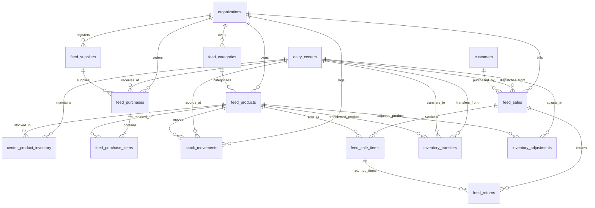

# Cattle Feed Inventory & Procurement Data Model

## 1. Overview & Migration Scope

Migration `014_feed_inventory_procurement_and_sales.sql` introduces 12 additive tables, 5 stored procedures, 3 immutability triggers, and Row-Level Security (RLS) policies into the PostgreSQL database.

All tables strictly enforce:
- Canonical UUID primary keys (`gen_random_uuid()`).
- Organization multi-tenancy isolation (`organization_id REFERENCES organizations(id)`).
- Exact arithmetic precision using `NUMERIC(12,3)` for quantities and `NUMERIC(10,2)` / `NUMERIC(12,2)` for financial values (Zero `FLOAT` / `DOUBLE PRECISION`).
- Idempotency key uniqueness across all financial and inventory transactions.
- Foreign key integrity (`ON DELETE RESTRICT`) protecting against accidental cascade deletion of historical records.

---

## 2. Entity-Relationship Diagram (ERD)

---

## 3. Database Tables Reference

### 3.1 `feed_categories`
Product classification categories (e.g. "Compound Cattle Feed", "Mineral Mixtures", "Supplements", "Fodder Seeds").

| Column | Type | Constraints | Description |
| :--- | :--- | :--- | :--- |
| `id` | `UUID` | `PRIMARY KEY` | Category identifier |
| `organization_id`| `UUID` | `NOT NULL, FK -> organizations` | Multi-tenant organization |
| `code` | `VARCHAR(50)` | `NOT NULL` | Category code (e.g. `CAT-COMPOUND`) |
| `name` | `VARCHAR(100)` | `NOT NULL` | Display name |
| `description` | `TEXT` | `NULL` | Category details |
| `status` | `VARCHAR(20)` | `NOT NULL, CHECK IN ('ACTIVE', 'INACTIVE')` | Active status |
| `created_at` | `TIMESTAMPTZ` | `NOT NULL DEFAULT NOW()` | Creation timestamp |
| `updated_at` | `TIMESTAMPTZ` | `NOT NULL DEFAULT NOW()` | Last modification timestamp |

*Unique Key*: `(organization_id, code)`

---

### 3.2 `feed_products`
Cattle feed catalog with configurable pack sizes, units, pricing, and weighted average cost.

| Column | Type | Constraints | Description |
| :--- | :--- | :--- | :--- |
| `id` | `UUID` | `PRIMARY KEY` | Product UUID |
| `organization_id`| `UUID` | `NOT NULL, FK -> organizations` | Tenant organization |
| `category_id` | `UUID` | `NOT NULL, FK -> feed_categories` | Category relation |
| `code` | `VARCHAR(50)` | `NOT NULL` | Unique product SKU/code |
| `name` | `VARCHAR(150)` | `NOT NULL` | Product name |
| `description` | `TEXT` | `NULL` | Product specifications |
| `base_unit` | `VARCHAR(20)` | `NOT NULL, CHECK IN ('KG', 'BAG', 'PIECE', 'LITRE')` | Base unit for inventory storage |
| `pack_size` | `NUMERIC(10,3)`| `NOT NULL, CHECK (pack_size > 0)` | Multiplier from pack to base unit |
| `pack_unit` | `VARCHAR(20)` | `NOT NULL` | Commercial packaging unit (e.g. `BAG`) |
| `default_purchase_price` | `NUMERIC(10,2)` | `NOT NULL DEFAULT 0.00` | Standard procurement price |
| `selling_price`| `NUMERIC(10,2)`| `NOT NULL CHECK (selling_price >= 0)` | Retail selling price to farmers |
| `tax_rate_percent` | `NUMERIC(5,2)` | `NOT NULL DEFAULT 0.00` | Applicable GST rate (0% - 100%) |
| `hsn_code` | `VARCHAR(20)` | `NULL` | HSN / SAC code for tax compliance |
| `status` | `VARCHAR(20)` | `NOT NULL, CHECK IN ('ACTIVE', 'INACTIVE', 'DISCONTINUED')` | Product catalog status |
| `minimum_stock_level` | `NUMERIC(12,3)` | `NOT NULL DEFAULT 0.000` | Center reorder threshold |
| `weighted_avg_cost` | `NUMERIC(10,2)` | `NOT NULL DEFAULT 0.00` | Audited Weighted Average Cost |

*Unique Key*: `(organization_id, code)`

---

### 3.3 `feed_suppliers`
Registered suppliers of feed ingredients, premixes, and finished cattle feed.

| Column | Type | Constraints | Description |
| :--- | :--- | :--- | :--- |
| `id` | `UUID` | `PRIMARY KEY` | Supplier identifier |
| `organization_id`| `UUID` | `NOT NULL, FK -> organizations` | Tenant organization |
| `supplier_code` | `VARCHAR(50)` | `NOT NULL` | Unique supplier code |
| `name` | `VARCHAR(150)` | `NOT NULL` | Company / Supplier name |
| `contact_person`| `VARCHAR(100)`| `NULL` | Contact representative |
| `phone_number` | `VARCHAR(20)` | `NOT NULL` | Official phone number |
| `email` | `VARCHAR(100)` | `NULL` | Official email |
| `address` | `TEXT` | `NULL` | Physical address |
| `gst_number` | `VARCHAR(15)` | `NULL` | 15-character GSTIN |
| `outstanding_balance` | `NUMERIC(12,2)` | `NOT NULL DEFAULT 0.00` | Cumulative payable to supplier |
| `status` | `VARCHAR(20)` | `NOT NULL, CHECK IN ('ACTIVE', 'INACTIVE', 'BLOCKED')` | Account status |

*Unique Key*: `(organization_id, supplier_code)`

---

### 3.4 `center_product_inventory`
Live stock balance table per dairy center and product.

| Column | Type | Constraints | Description |
| :--- | :--- | :--- | :--- |
| `id` | `UUID` | `PRIMARY KEY` | Record identifier |
| `organization_id`| `UUID` | `NOT NULL, FK -> organizations` | Tenant organization |
| `center_id` | `UUID` | `NOT NULL, FK -> dairy_centers` | Center location |
| `product_id` | `UUID` | `NOT NULL, FK -> feed_products` | Product reference |
| `current_stock` | `NUMERIC(12,3)`| `NOT NULL DEFAULT 0.000, CHECK (>= 0)` | Available physical stock in `base_unit` |
| `reserved_stock`| `NUMERIC(12,3)`| `NOT NULL DEFAULT 0.000, CHECK (>= 0)` | Stock allocated to pending orders |
| `reorder_threshold` | `NUMERIC(12,3)` | `NOT NULL DEFAULT 0.000` | Center-specific alert limit |
| `last_movement_at` | `TIMESTAMPTZ` | `NULL` | Timestamp of last stock change |

*Unique Key*: `(center_id, product_id)`

---

### 3.5 `stock_movements` (Append-Only Ledger)
Permanent, immutable transaction ledger of all inventory increments and decrements.

| Column | Type | Constraints | Description |
| :--- | :--- | :--- | :--- |
| `id` | `UUID` | `PRIMARY KEY` | Movement UUID |
| `organization_id`| `UUID` | `NOT NULL, FK -> organizations` | Tenant organization |
| `center_id` | `UUID` | `NOT NULL, FK -> dairy_centers` | Center location |
| `product_id` | `UUID` | `NOT NULL, FK -> feed_products` | Product reference |
| `movement_type` | `VARCHAR(40)` | `NOT NULL, CHECK IN ('PURCHASE_RECEIPT', 'CUSTOMER_SALE', 'CUSTOMER_RETURN', 'SUPPLIER_RETURN', 'DAMAGED_WRITE_OFF', 'STOCK_CORRECTION', 'CENTER_TRANSFER')` | Movement classification |
| `direction` | `VARCHAR(10)` | `NOT NULL, CHECK IN ('IN', 'OUT')` | Physical flow |
| `quantity` | `NUMERIC(12,3)`| `NOT NULL CHECK (quantity > 0)` | Absolute quantity moved in base unit |
| `quantity_delta`| `NUMERIC(12,3)`| `NOT NULL` | Signed delta ($+Q$ or $-Q$) |
| `base_unit` | `VARCHAR(20)` | `NOT NULL` | Base unit (`KG`, `BAG`, etc.) |
| `balance_after` | `NUMERIC(12,3)`| `NOT NULL CHECK (balance_after >= 0)` | Warehouse balance immediately after movement |
| `unit_cost` | `NUMERIC(10,2)`| `NULL` | Applicable WAC or unit procurement cost |
| `reference_transaction_type` | `VARCHAR(50)` | `NOT NULL` | `FEED_PURCHASE`, `FEED_SALE`, `FEED_RETURN`, `INVENTORY_ADJUSTMENT`, `CENTER_TRANSFER` |
| `reference_id` | `UUID` | `NOT NULL` | Parent entity identifier |
| `batch_number` | `VARCHAR(100)`| `NULL` | Lot or batch code |
| `actor_id` | `UUID` | `NOT NULL, FK -> users` | Operator performing the action |
| `approved_by` | `UUID` | `NULL, FK -> users` | Authorizing supervisor |
| `idempotency_key` | `VARCHAR(128)`| `NOT NULL UNIQUE` | Idempotent key |
| `movement_timestamp` | `TIMESTAMPTZ` | `NOT NULL DEFAULT NOW()` | Execution timestamp |
| `notes` | `TEXT` | `NULL` | Operational audit note |

*Database Trigger*: `trigger_prevent_stock_movement_mutation` prevents any `UPDATE` or `DELETE` statement.

---

### 3.6 `feed_sales` & `feed_sale_items`
Customer POS invoice headers and itemized purchase breakdown.

`feed_sales` Header:
- `invoice_number` (`INV-FEED-YYYYMMDD-XXXXXXXX`): Sequential, human-readable tax invoice code.
- `receipt_number` (`RCP-FEED-YYYYMMDD-XXXXXXXX`): Payment receipt reference.
- `payment_mode`: `CREDIT` (farmer ledger debit) or `CASH`.
- `status`: `COMPLETED`, `PARTIALLY_RETURNED`, `RETURNED`, `CANCELLED`.
- `ledger_transaction_id`: Foreign key reference to `ledger_transactions(id)` (P12).
- `client_sale_uuid`: Unique client event ID for offline transaction synchronization.

---

## 4. Stored Procedures & Atomic Business Logic

All state mutations occur inside PostgreSQL `SECURITY DEFINER` stored procedures ensuring full atomic ACID rollback on any constraint violation:

1. **`receive_feed_purchase(p_purchase_id, p_received_by, p_idempotency_key, p_notes)`**:
   - Verifies purchase is in `ORDERED` status.
   - Updates `feed_products.weighted_avg_cost` dynamically.
   - Increases `center_product_inventory.current_stock`.
   - Records `PURCHASE_RECEIPT` into `stock_movements`.
   - Increments `feed_suppliers.outstanding_balance`.
   - Emits `sync_events`.

2. **`process_customer_feed_sale(p_organization_id, p_center_id, p_customer_id, p_operator_id, p_payment_mode, p_items, p_discount_amount, p_discount_approved_by, p_idempotency_key, p_client_sale_uuid)`**:
   - Locks center inventory rows `FOR UPDATE`.
   - Locks customer subledger account `FOR UPDATE`.
   - Verifies customer belongs to organization and is active.
   - Validates stock availability; strictly rejects if stock is insufficient.
   - Deducts stock from `center_product_inventory`.
   - Inserts `feed_sales` and `feed_sale_items`.
   - Inserts `stock_movements` with `direction = 'OUT'`.
   - If `payment_mode = 'CREDIT'`, posts `FEED_PURCHASE_DEBIT` to `ledger_transactions` and balanced entries to `ledger_entries`.
   - Emits `sync_events`.

3. **`process_feed_return(p_organization_id, p_sale_id, p_sale_item_id, p_return_quantity, p_stock_condition, p_reason, p_approved_by, p_idempotency_key)`**:
   - Verifies approver role (`DAIRY_OWNER`, `CENTER_MANAGER`, `INVENTORY_MANAGER`).
   - Ensures return quantity does not exceed original purchased minus already returned.
   - If `stock_condition = 'SALEABLE'`: Adds back to `current_stock` and creates `CUSTOMER_RETURN` movement.
   - If `stock_condition = 'DAMAGED'`: Does not increase sellable stock; records `DAMAGED_WRITE_OFF` quarantine audit movement.
   - Posts `LEDGER_ADJUSTMENT_CREDIT` to farmer ledger and balanced journal entries.

4. **`process_inventory_transfer(p_organization_id, p_source_center_id, p_destination_center_id, p_product_id, p_quantity, p_unit, p_initiated_by, p_approved_by, p_idempotency_key, p_notes)`**:
   - Locks source and destination center stock `FOR UPDATE`.
   - Checks sufficient source stock.
   - Deducts source center, increments destination center.
   - Creates dual linked movements in `stock_movements` sharing one `transfer_id`.

5. **`process_inventory_adjustment(p_organization_id, p_center_id, p_product_id, p_adjustment_type, p_quantity, p_direction, p_reason, p_approved_by, p_idempotency_key)`**:
   - Handles physical cycle count adjustments or write-offs.
   - Enforces non-negative resulting stock.

