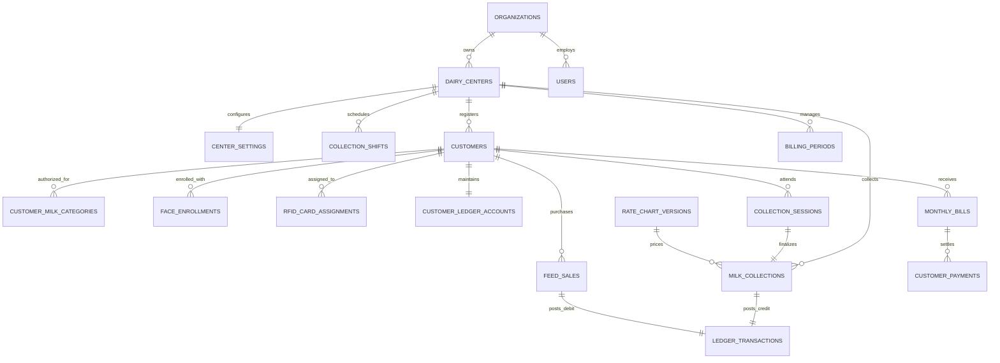
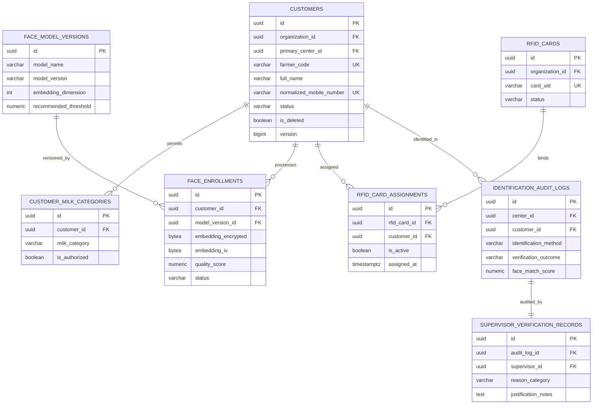
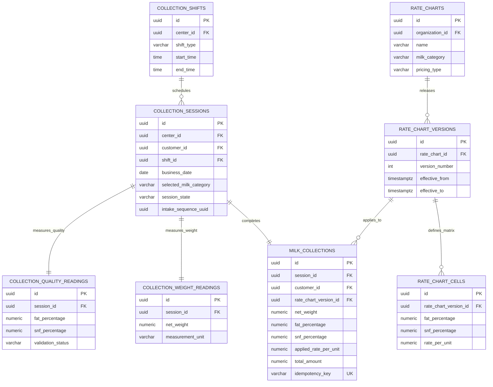
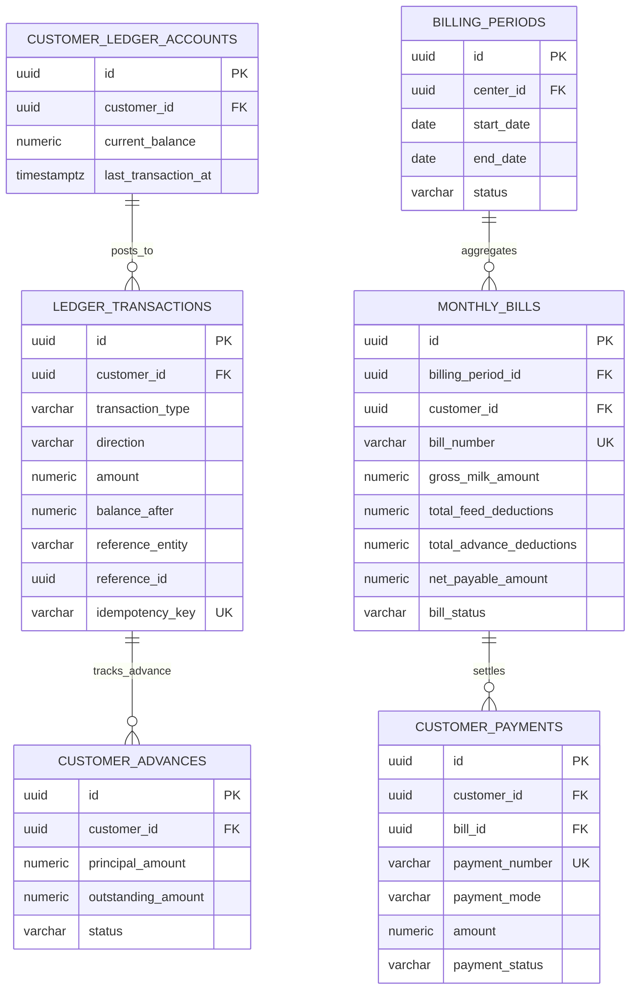
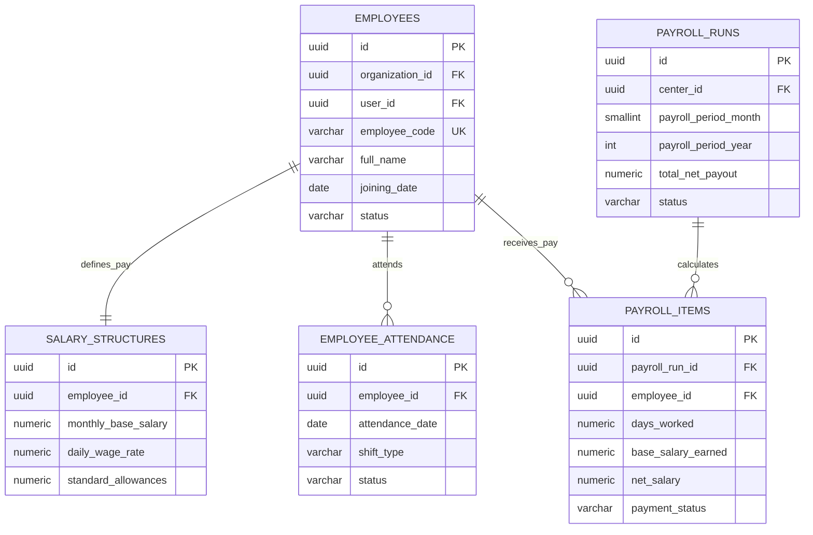
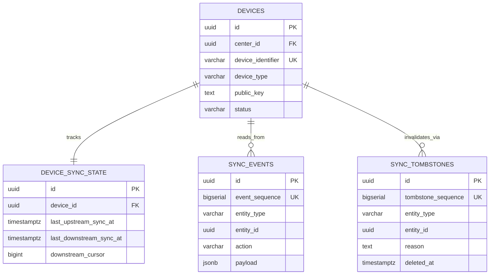

# DFarm: Complete Entity-Relationship (ER) Diagrams
**Phase 03 of 20: Visual Database Architecture & Relationship Schemas**

---

## 1. Complete System Entity-Relationship Architecture

---

## 2. Customer Identity, Biometric & RFID Subgraph

---

## 3. Milk Intake, Quality & Rate Snapshots Subgraph

---

## 4. Farmer Financial Ledger & Billing Subgraph

---

## 5. Employee Master & Isolated Payroll Subgraph

---

## 6. Offline Synchronization & Replication Subgraph

