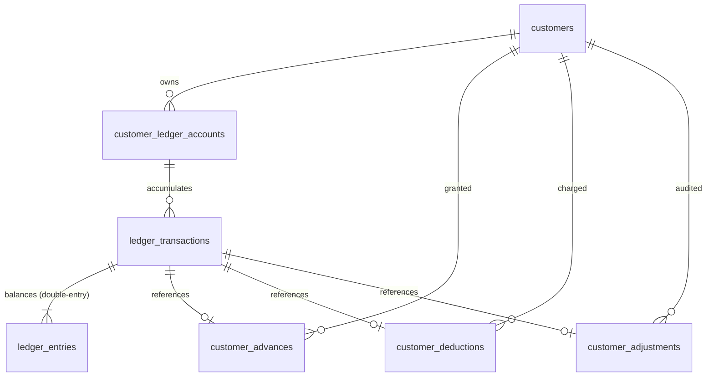

# DFarm: Customer Financial Ledger & Accounting Data Model
**Phase 12 of 20: Relational Schema, Constraints, Triggers & Stored Procedures**

---

## 1. Schema Overview

The financial subsystem comprises 6 interconnected relational tables in the public schema of PostgreSQL:



---

## 2. Table Specifications

### 2.1 `customer_ledger_accounts`
Maintains the authoritative running balance and lifecycle status of each customer's account.

| Column | Type | Constraints | Description |
| :--- | :--- | :--- | :--- |
| `id` | `UUID` | `PRIMARY KEY, DEFAULT gen_random_uuid()` | Unique ledger account identifier. |
| `customer_id` | `UUID` | `NOT NULL, UNIQUE, REFERENCES customers(id)` | Canonical customer reference. |
| `organization_id` | `UUID` | `NOT NULL, REFERENCES organizations(id)` | Tenant organization boundary. |
| `currency` | `VARCHAR(3)`| `NOT NULL, DEFAULT 'INR'` | ISO 4217 currency code. |
| `current_balance`| `NUMERIC(12,2)`| `NOT NULL, DEFAULT 0.00` | Authoritative running liability balance. |
| `status` | `VARCHAR(20)`| `NOT NULL, DEFAULT 'ACTIVE'` | Account status (`ACTIVE`, `FROZEN`, `CLOSED`). |
| `last_transaction_at`| `TIMESTAMPTZ`| `NULL` | Timestamp of latest committed transaction. |
| `created_at` | `TIMESTAMPTZ`| `NOT NULL, DEFAULT NOW()` | Record creation timestamp. |
| `updated_at` | `TIMESTAMPTZ`| `NOT NULL, DEFAULT NOW()` | Record update timestamp. |

### 2.2 `ledger_transactions`
Append-only journal of business transactions affecting customer accounts.

| Column | Type | Constraints | Description |
| :--- | :--- | :--- | :--- |
| `id` | `UUID` | `PRIMARY KEY, DEFAULT gen_random_uuid()` | Canonical transaction UUID. |
| `organization_id` | `UUID` | `NOT NULL, REFERENCES organizations(id)` | Tenant organization boundary. |
| `center_id` | `UUID` | `NULL, REFERENCES dairy_centers(id)` | Procurement center origin. |
| `customer_id` | `UUID` | `NOT NULL, REFERENCES customers(id)` | Target customer reference. |
| `transaction_type`| `VARCHAR(40)`| `NOT NULL, CHECK (chk_ledger_txn_type)` | Business transaction type code. |
| `direction` | `VARCHAR(10)`| `NOT NULL, CHECK in ('CREDIT', 'DEBIT')` | Financial sign direction. |
| `amount` | `NUMERIC(10,2)`| `NOT NULL, CHECK (amount > 0.00)` | Positive monetary transaction value. |
| `balance_after` | `NUMERIC(12,2)`| `NOT NULL` | Running balance immediately following posting. |
| `reference_entity`| `VARCHAR(30)`| `NOT NULL, CHECK (chk_ledger_ref_entity)`| Source module entity type. |
| `reference_id` | `UUID` | `NOT NULL` | Primary key of source event/document. |
| `description` | `TEXT` | `NULL` | Human-readable explanation. |
| `idempotency_key` | `VARCHAR(128)`| `NULL, UNIQUE` | Unique client/event idempotency token. |
| `created_by` | `UUID` | `NULL, REFERENCES users(id)` | Authorizing user or system actor. |
| `created_at` | `TIMESTAMPTZ`| `NOT NULL, DEFAULT NOW()` | Tamper-evident creation timestamp. |

### 2.3 `ledger_entries`
General ledger balanced double-entry accounting records.

| Column | Type | Constraints | Description |
| :--- | :--- | :--- | :--- |
| `id` | `UUID` | `PRIMARY KEY, DEFAULT gen_random_uuid()` | Unique entry identifier. |
| `transaction_id`| `UUID` | `NOT NULL, REFERENCES ledger_transactions(id)`| Parent transaction link. |
| `account_id` | `UUID` | `NOT NULL` | Center, customer account, or ledger ID. |
| `account_type` | `VARCHAR(40)`| `NOT NULL, CHECK (chk_ledger_account_type)` | Chart of accounts classification. |
| `entry_type` | `VARCHAR(10)`| `NOT NULL, CHECK in ('DEBIT', 'CREDIT')` | Double-entry journal leg. |
| `amount` | `NUMERIC(10,2)`| `NOT NULL, CHECK (amount > 0.00)` | Entry monetary amount. |
| `created_at` | `TIMESTAMPTZ`| `NOT NULL, DEFAULT NOW()` | Creation timestamp. |

### 2.4 `customer_advances`
Tracks loans and disbursements, recovery types, and outstanding balances.

| Column | Type | Constraints | Description |
| :--- | :--- | :--- | :--- |
| `id` | `UUID` | `PRIMARY KEY, DEFAULT gen_random_uuid()` | Unique advance UUID. |
| `customer_id` | `UUID` | `NOT NULL, REFERENCES customers(id)` | Receiving customer. |
| `center_id` | `UUID` | `NOT NULL, REFERENCES dairy_centers(id)` | Originating center. |
| `requested_amount`| `NUMERIC(10,2)`| `NOT NULL, CHECK (amount > 0.00)` | Initially requested sum. |
| `approved_amount` | `NUMERIC(10,2)`| `NOT NULL, CHECK (amount > 0.00)` | Granted loan principal. |
| `recovered_amount`| `NUMERIC(10,2)`| `NOT NULL, DEFAULT 0.00` | Cumulative amount repaid. |
| `status` | `VARCHAR(20)`| `NOT NULL, DEFAULT 'PENDING'` | `PENDING`, `APPROVED`, `ACTIVE`, `FULLY_RECOVERED`, `REJECTED`. |
| `recovery_type` | `VARCHAR(30)`| `NOT NULL, DEFAULT 'MONTHLY_BILL_DEDUCTION'` | Repayment mechanism. |
| `reason` | `TEXT` | `NOT NULL` | Justification for advance. |
| `approved_by` | `UUID` | `NULL, REFERENCES users(id)` | Authorizing supervisor. |
| `ledger_transaction_id`| `UUID` | `NULL, REFERENCES ledger_transactions(id)`| Associated ledger debit record. |
| `idempotency_key` | `VARCHAR(128)`| `NULL, UNIQUE` | Unique disbursement idempotency key. |

---

## 3. Database Triggers & Stored Procedures

### 3.1 Immutability Trigger
```sql
CREATE OR REPLACE FUNCTION public.trigger_enforce_ledger_immutability()
RETURNS TRIGGER AS $$
BEGIN
    IF TG_OP = 'UPDATE' THEN
        RAISE EXCEPTION 'CANNOT_MUTATE_LEDGER: Finalized ledger transactions are strictly immutable and cannot be updated.'
            USING ERRCODE = '22000';
    ELSIF TG_OP = 'DELETE' THEN
        RAISE EXCEPTION 'CANNOT_DELETE_LEDGER: Finalized ledger transactions are strictly immutable and cannot be deleted.'
            USING ERRCODE = '22000';
    END IF;
    RETURN NULL;
END;
$$ LANGUAGE plpgsql;

CREATE TRIGGER trg_ledger_transactions_immutable
BEFORE UPDATE OR DELETE ON ledger_transactions
FOR EACH ROW EXECUTE FUNCTION public.trigger_enforce_ledger_immutability();
```

### 3.2 Key Stored Procedures (`plpgsql`)

1. **`post_customer_advance`**: Validates requested sum, locks customer account with `FOR UPDATE`, posts `CUSTOMER_ADVANCE_DEBIT` ledger transaction, writes balanced journal entries (`CUSTOMER_PAYABLE` Debit, `CASH_BANK` Credit), and activates the advance record.
2. **`recover_customer_advance`**: Locks advance record with `FOR UPDATE`, rejects over-recoveries exceeding remaining principal, posts `ADVANCE_RECOVERY_CREDIT` to liability ledger, creates balanced journal entries (`CASH_BANK` Debit, `CUSTOMER_PAYABLE` Credit), and updates advance status to `FULLY_RECOVERED` when principal is fully repaid.
3. **`post_customer_deduction`**: Inserts authorized fee (Veterinary, AI, Insurance, Feed, etc.), posts `AUTHORIZED_DEDUCTION_DEBIT`, and creates double-entry journal (`CUSTOMER_PAYABLE` Debit, `DEDUCTION_INCOME` Credit).
4. **`post_customer_opening_balance`**: Validates Admin authority, checks that customer does not already have an opening balance, posts initial credit or debit, and initializes or adjusts running balance against `OPENING_BALANCE_EQUITY`.
5. **`post_customer_adjustment`**: Enforces Supervisor/Admin role, mandatory textual justification, posts audited credit or debit, and records replacement transaction.
6. **`reconcile_customer_ledger`**: Audits customer ledger consistency by verifying that:
   - Account running balance equals sum of historical credits minus debits.
   - All transactions have equal double-entry debit and credit entries.
   - Milk collections have matching collection credit transactions.
   - Active advances reflect recorded recovery debits and credits.
