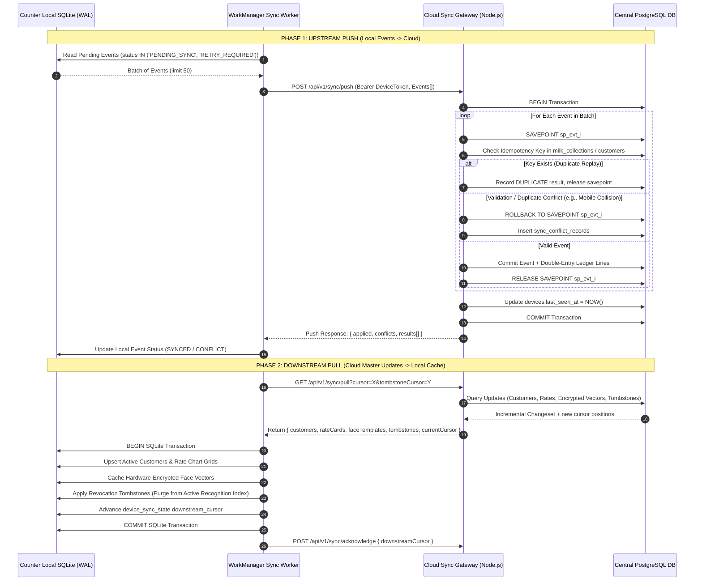

# DFarm: Local + Cloud Offline Synchronization Architecture

This document specifies the synchronization protocol, replication topologies, offline journal queues, conflict resolution strategies, and idempotency guarantees between edge collection terminals (`apps/collection-app/`, `apps/registration-android/`) and the central cloud database (`packages/database/`, `services/backend/`).

---

## 1. Bi-Directional Synchronization Architecture

The central Supabase PostgreSQL database serves as the single authoritative source of truth for customer identities, organizational permissions, and rate charts. Edge collection counters operate on an autonomous local SQLite database during rural internet disruptions and reconcile with the cloud using an append-only sync journal.



---

## 2. Local Database Schemas (SQLite / Room with WAL Mode)

Local persistence on edge Android devices is implemented with SQLite with `PRAGMA journal_mode=WAL;` and `PRAGMA foreign_keys=ON;` enabled for concurrent read-while-write performance and ACID durability.

### 2.1 Registration App (`apps/registration-android`)

#### `registration_drafts`
```sql
CREATE TABLE IF NOT EXISTS registration_drafts (
    local_id TEXT PRIMARY KEY,
    farmer_code TEXT,
    full_name TEXT NOT NULL,
    mobile_number TEXT NOT NULL,
    aadhaar_last_four TEXT,
    date_of_birth TEXT,
    gender TEXT,
    address_village TEXT,
    address_taluka TEXT,
    address_district TEXT,
    address_state TEXT,
    address_pincode TEXT,
    bank_account_number TEXT,
    bank_ifsc TEXT,
    bank_name TEXT,
    bank_branch TEXT,
    preferred_category TEXT DEFAULT 'COW',
    permitted_categories TEXT,
    consent_obtained INTEGER DEFAULT 0,
    consent_timestamp TEXT,
    sync_status TEXT NOT NULL DEFAULT 'LOCAL_ONLY',
    server_customer_id TEXT,
    created_at TEXT NOT NULL,
    updated_at TEXT NOT NULL
);
CREATE INDEX IF NOT EXISTS idx_reg_drafts_status ON registration_drafts(sync_status);
```

#### `registration_sync_events`
```sql
CREATE TABLE IF NOT EXISTS registration_sync_events (
    event_id TEXT PRIMARY KEY,
    draft_id TEXT NOT NULL,
    idempotency_key TEXT NOT NULL UNIQUE,
    event_type TEXT NOT NULL,
    payload TEXT NOT NULL,
    sync_status TEXT NOT NULL DEFAULT 'PENDING_SYNC',
    retry_count INTEGER DEFAULT 0,
    last_error TEXT,
    created_at TEXT NOT NULL,
    synced_at TEXT,
    FOREIGN KEY(draft_id) REFERENCES registration_drafts(local_id) ON DELETE CASCADE
);
CREATE INDEX IF NOT EXISTS idx_reg_events_status ON registration_sync_events(sync_status);
```

---

### 2.2 Collection Terminal App (`apps/collection-app`)

#### `cached_customers`
```sql
CREATE TABLE IF NOT EXISTS cached_customers (
    customer_id TEXT PRIMARY KEY,
    farmer_code TEXT NOT NULL,
    full_name TEXT NOT NULL,
    mobile_phone TEXT NOT NULL,
    primary_center_id TEXT,
    status TEXT NOT NULL DEFAULT 'ACTIVE',
    rfid_card_number TEXT,
    preferred_milk_category TEXT DEFAULT 'COW',
    permitted_milk_categories TEXT,
    updated_at TEXT NOT NULL
);
CREATE INDEX IF NOT EXISTS idx_cached_cust_code ON cached_customers(farmer_code);
CREATE INDEX IF NOT EXISTS idx_cached_cust_rfid ON cached_customers(rfid_card_number);
```

#### `cached_face_templates`
```sql
CREATE TABLE IF NOT EXISTS cached_face_templates (
    template_id TEXT PRIMARY KEY,
    customer_id TEXT NOT NULL,
    model_name TEXT NOT NULL,
    model_version TEXT NOT NULL,
    crypto_nonce TEXT NOT NULL,
    auth_tag TEXT NOT NULL,
    encrypted_embedding TEXT NOT NULL,
    status TEXT NOT NULL DEFAULT 'ACTIVE',
    updated_at TEXT NOT NULL,
    FOREIGN KEY(customer_id) REFERENCES cached_customers(customer_id) ON DELETE CASCADE
);
CREATE INDEX IF NOT EXISTS idx_face_cust_id ON cached_face_templates(customer_id);
```

#### `cached_rate_cells`
```sql
CREATE TABLE IF NOT EXISTS cached_rate_cells (
    id TEXT PRIMARY KEY,
    rate_chart_version_id TEXT NOT NULL,
    fat_percentage REAL NOT NULL,
    snf_percentage REAL NOT NULL,
    rate_per_unit REAL NOT NULL
);
CREATE INDEX IF NOT EXISTS idx_rate_chart_lookup ON cached_rate_cells(rate_chart_version_id, fat_percentage, snf_percentage);
```

#### `local_collection_sessions`
```sql
CREATE TABLE IF NOT EXISTS local_collection_sessions (
    session_id TEXT PRIMARY KEY,
    center_id TEXT NOT NULL,
    device_id TEXT NOT NULL,
    operator_user_id TEXT NOT NULL,
    business_date TEXT NOT NULL,
    shift_type TEXT NOT NULL,
    status TEXT NOT NULL DEFAULT 'OPEN',
    total_intakes INTEGER DEFAULT 0,
    total_quantity_liters REAL DEFAULT 0.0,
    total_amount REAL DEFAULT 0.0,
    opened_at TEXT NOT NULL,
    closed_at TEXT
);
```

#### `local_milk_collections`
```sql
CREATE TABLE IF NOT EXISTS local_milk_collections (
    collection_id TEXT PRIMARY KEY,
    session_id TEXT NOT NULL,
    customer_id TEXT NOT NULL,
    center_id TEXT NOT NULL,
    device_id TEXT NOT NULL,
    business_date TEXT NOT NULL,
    shift_type TEXT NOT NULL,
    milk_category TEXT NOT NULL,
    quantity_liters REAL NOT NULL,
    fat_percentage REAL NOT NULL,
    snf_percentage REAL NOT NULL,
    rate_per_liter REAL NOT NULL,
    total_amount REAL NOT NULL,
    identification_method TEXT NOT NULL,
    client_intake_uuid TEXT NOT NULL,
    idempotency_key TEXT NOT NULL UNIQUE,
    sync_status TEXT NOT NULL DEFAULT 'LOCAL_ONLY',
    created_at TEXT NOT NULL,
    FOREIGN KEY(session_id) REFERENCES local_collection_sessions(session_id)
);
CREATE INDEX IF NOT EXISTS idx_local_col_sync ON local_milk_collections(sync_status);
```

#### `sync_journal`
```sql
CREATE TABLE IF NOT EXISTS sync_journal (
    event_id TEXT PRIMARY KEY,
    entity_type TEXT NOT NULL,
    entity_id TEXT NOT NULL,
    action TEXT NOT NULL,
    payload TEXT NOT NULL,
    idempotency_key TEXT NOT NULL UNIQUE,
    sync_status TEXT NOT NULL DEFAULT 'PENDING_SYNC',
    retry_count INTEGER DEFAULT 0,
    last_error TEXT,
    created_at TEXT NOT NULL,
    synced_at TEXT
);
CREATE INDEX IF NOT EXISTS idx_sync_journal_status ON sync_journal(sync_status);
```

#### `revocation_tombstones`
```sql
CREATE TABLE IF NOT EXISTS revocation_tombstones (
    id TEXT PRIMARY KEY,
    entity_type TEXT NOT NULL,
    entity_id TEXT NOT NULL,
    reason TEXT NOT NULL,
    revoked_at TEXT NOT NULL,
    applied_locally INTEGER DEFAULT 0
);
CREATE INDEX IF NOT EXISTS idx_tombstone_entity ON revocation_tombstones(entity_type, entity_id);
```

#### `device_sync_state`
```sql
CREATE TABLE IF NOT EXISTS device_sync_state (
    device_id TEXT PRIMARY KEY,
    downstream_cursor INTEGER NOT NULL DEFAULT 0,
    downstream_tombstone_cursor INTEGER NOT NULL DEFAULT 0,
    last_successful_sync_at TEXT,
    max_offline_hours INTEGER NOT NULL DEFAULT 72,
    client_app_version TEXT NOT NULL DEFAULT '1.0.0'
);
```

---

## 3. Sync Status Lifecycle State Machine

```
              ┌───────────────┐
              │  LOCAL_ONLY   │
              └───────┬───────┘
                      │ Enqueued into Sync Journal
                      ▼
              ┌───────────────┐
       ┌─────►│ PENDING_SYNC  │◄─────────────────┐
       │      └───────┬───────┘                  │
       │              │ WorkManager Trigger      │
       │              ▼                          │
       │      ┌───────────────┐                  │
       │      │    SYNCING    │                  │
       │      └───┬───────┬───┘                  │
       │          │       │                      │
Network Failure   │       │ Server Rejection     │ Retry Interval
       │          │       ▼                      │
       │          │   ┌───────────────┐          │
       │          │   │RETRY_REQUIRED ├──────────┘
       │          │   └───────────────┘
       │          │
       │          │ 200 OK + COMMITTED
       │          ▼
       │      ┌───────────────┐
       │      │    SYNCED     │
       │      └───────────────┘
       │
       │ Business Conflict (e.g. Duplicate Mobile, Soft-Deleted)
       ▼
┌───────────────┐          ┌───────────────┐
│   CONFLICT    │          │    REVOKED    │ (Tombstone Applied)
└───────────────┘          └───────────────┘
```

---

## 4. Idempotency Key Design

To guarantee zero duplicate ledger credits or duplicate rows:

$$\text{RegistrationIdempotencyKey} = \text{IDEMP-REG-} + \text{canonicalCustomerUuid}$$
$$\text{MilkCollectionIdempotencyKey} = \text{IDEMP-COL-} + \text{collectionRecordUuid}$$

When an event is received by the backend:
1. `milk_collections.idempotency_key` has a `UNIQUE` constraint.
2. If `idempotency_key` already exists, the server records result `DUPLICATE`, skips ledger insertion, and returns status 200 with result `DUPLICATE`.
3. The client transitions its journal event to `SYNCED`.

---

## 5. Conflict Resolution Strategy

| Conflict Type | Detection Mechanism | Resolution Policy | Action Taken |
|---|---|---|---|
| **Duplicate Mobile Number** | Cloud unique constraint check on `normalized_mobile_number` | Authoritative Server Reject | Insert into `sync_conflict_records`, mark local event `CONFLICT`, preserve local draft for manual editing |
| **Concurrent Customer Update** | `updated_at` timestamp comparison | Cloud-Authoritative | Cloud master wins. Edge updates merged if field-orthogonal, otherwise cloud state preserved |
| **Soft-Deleted Customer Intake** | Cloud check `is_deleted = TRUE` | Authoritative Server Reject | Event rejected with `CUSTOMER_REVOKED`, tombstone pushed downstream |
| **RFID Unbinding/Reassignment** | Tag assignment check on server | Authoritative Server Reject | Local RFID cache purged, operator prompted to re-identify farmer |
| **Device Revocation** | `devices.status = 'BLOCKED'` | Instant Fail-Closed | Gateway rejects with HTTP 403 `DEVICE_REVOKED`, device local database locks out syncing |
