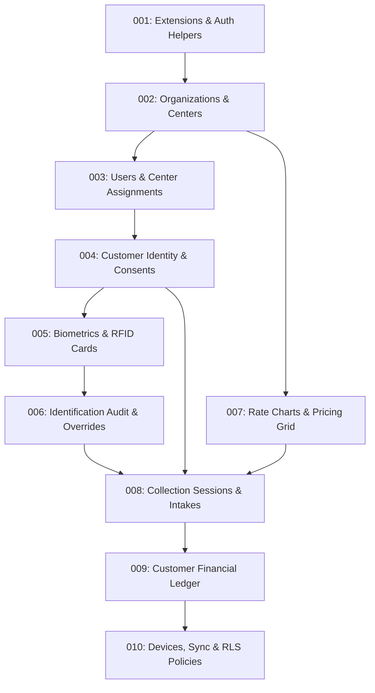

# DFarm: PostgreSQL Migration History & Ledger
**Phase 04 of 20: Migration Execution Sequence & Artifact Manifest**

---

## 1. Migration Manifest & Checksums

| Migration Name | File Path | Byte Size | Target PostgreSQL Schema Objects | Applied State |
| :--- | :--- | :---: | :--- | :---: |
| `001_extensions_and_common.sql` | `supabase/migrations/001_extensions_and_common.sql` | 3,365 | Extensions (`uuid-ossp`, `pgcrypto`), `trigger_set_updated_at()`, native Supabase `auth.uid()` preserved (untouched), custom helper functions in `public` schema (`public.current_org_id()`, `public.current_center_id()`, `public.current_user_role()`, `public.current_customer_id()`) with `SECURITY DEFINER` and hardened `SET search_path = pg_catalog`. | **APPLIED & VERIFIED (Local Supabase Postgres 17)** |
| `002_organizations_and_centers.sql` | `supabase/migrations/002_organizations_and_centers.sql` | 4,295 | `organizations`, `dairy_centers`, `center_settings`, `collection_shifts` (4 tables), updated_at triggers, foreign keys, unique codes. | **APPLIED & VERIFIED (4 Tables)** |
| `003_user_identity_foundation.sql` | `supabase/migrations/003_user_identity_foundation.sql` | 2,012 | `users`, `user_center_assignments` (2 tables), role check constraints (including `REGISTRATION_OFFICER`), center assignment uniqueness. | **APPLIED & VERIFIED (2 Tables)** |
| `004_customer_identity.sql` | `supabase/migrations/004_customer_identity.sql` | 5,433 | `customers`, `customer_milk_categories`, `customer_addresses`, `customer_registration_records`, `customer_status_history`, `customer_consent_records` (6 tables), organization-scoped unique mobile constraint, soft deletion support. | **APPLIED & VERIFIED (6 Tables)** |
| `005_face_and_rfid.sql` | `supabase/migrations/005_face_and_rfid.sql` | 5,020 | `face_model_versions`, `face_enrollments`, `biometric_retention_records`, `rfid_cards`, `rfid_card_assignments` (5 tables), partial unique single-active assignment indexes. | **APPLIED & VERIFIED (5 Tables)** |
| `006_customer_identification_audit.sql` | `supabase/migrations/006_customer_identification_audit.sql` | 2,827 | `identification_audit_logs`, `supervisor_verification_records` (2 tables), check constraints for methods and outcomes. | **APPLIED & VERIFIED (2 Tables)** |
| `007_rate_management.sql` | `supabase/migrations/007_rate_management.sql` | 3,023 | `rate_charts`, `rate_chart_versions`, `rate_chart_cells`, `rate_applicability_rules` (4 tables), unique grid coordinates constraint. | **APPLIED & VERIFIED (4 Tables)** |
| `008_collection_sessions_and_transactions.sql`| `supabase/migrations/008_collection_sessions_and_transactions.sql`| 7,256 | `collection_sessions`, `collection_quality_readings`, `collection_weight_readings`, `milk_collections`, `collection_receipts`, `collection_adjustments`, `collection_reversals` (7 tables), multi-intake shift support, unique idempotency key. | **APPLIED & VERIFIED (7 Tables)** |
| `009_customer_ledger.sql` | `supabase/migrations/009_customer_ledger.sql` | 6,462 | `customer_ledger_accounts`, `ledger_transactions`, `ledger_entries`, `customer_advances`, `customer_deductions`, `customer_adjustments` (6 tables), unique ledger idempotency key, double-entry balanced journal lines. | **APPLIED & VERIFIED (6 Tables)** |
| `010_devices_sync_and_audit.sql` | `supabase/migrations/010_devices_sync_and_audit.sql` | 8,940 | `devices`, `device_sync_state`, `sync_events`, `sync_tombstones`, `sync_conflict_records`, `audit_logs`, `approval_records` (7 tables), Row Level Security (RLS) enabled on all 43 tables with granular multi-tenant isolation, center operator isolation, biometric protection, and ledger immutability policies. | **APPLIED & VERIFIED (7 Tables)** |
| **TOTALS** | **10 Migration Files** | **48,632 Bytes** | **43 Relational Tables in Schema public, RLS Enabled on All 43 Tables, 12 Triggers, 18 Indexes, 5 Security Definer Functions, Full RLS Policies** | **100% EXECUTED ON POSTGRESQL 17.11** |

---

## 2. Dependency Graph & Execution Order

---

## 3. Rollback & Reset Strategy

In the Supabase environment, migrations are managed via standard CLI tools:
- **Local Reset:** `supabase db reset` drops the local database, re-applies all migrations in numerical sequence, and executes `seed.sql`.
- **Targeted Diffing:** `supabase db diff` compares the local shadow database against migration files to generate non-destructive incremental updates.
- **In-Memory Testing Suite:** Validated on every monorepo build using `@dfarm/database` automated test runner.
